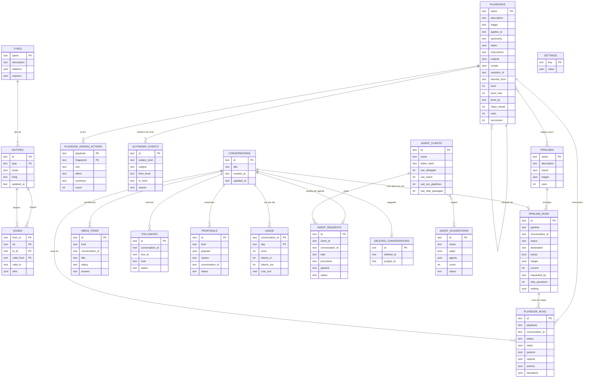

# Banco de dados

O Orbi guarda tudo num arquivo SQLite, `data/orbi.db` (`ORBI_DB` muda o caminho),
aberto pelo `node:sqlite`, sem servidor. Este documento descreve as tabelas, como
elas se ligam, as migrações, os gatilhos que viram eventos e o índice de busca.
A fonte de verdade é `apps/runtime/src/db/migrations.ts`.

## O que fica fora do `orbi.db`

| O quê | Onde | Por quê |
| --- | --- | --- |
| Histórico das conversas (mensagens, chamadas de ferramenta, execução ativa) | `data/flue.db` (`ORBI_FLUE_DB`) | É do Flue: o agente relê dali a cada turno |
| Valores das credenciais | Chaveiro do sistema ou arquivo AES-256-GCM | Nunca entram no banco (documento 9) |
| Índice do cofre (nomes, descrições, origem, datas) | arquivo JSON em `data/` | Sem valores |
| Modelos de transcrição | `data/models/<modelo>/` | Arquivos grandes, não são dados |
| Exportação do cérebro em Markdown | `data/brain-md/` | Para abrir no Obsidian |

A tabela `conversations` do `orbi.db` e o `flue.db` usam o mesmo id de conversa
(`chat:…`). Apagar uma conversa a marca em `deleted_conversations`; o histórico
no `flue.db` sai na próxima vez que o runtime iniciar (`conversations/purge.ts`).

## Diagrama

As ligações são **lógicas**: só `entities.type → types.name` tem chave
estrangeira declarada. As outras são mantidas pelo código (`brain/store.ts`,
`pipelines/engine.ts`…), que valida antes de gravar. Colunas `json` são `TEXT`
com JSON dentro.



## Tabelas

Datas são texto ISO 8601 (UTC). Ids gerados pelo Orbi são ULID, às vezes com
prefixo (`est_…` nas entregas de esteira, `orb_…` só no token do agente, que não
é guardado).

### Cérebro

**`types`** · a ontologia: os tipos de coisa que existem. Começa vazia; o Orbi
propõe cada tipo na primeira vez que precisa. Tela **Cérebro → Ontologia**.

| Coluna | O quê |
| --- | --- |
| `name` PK | `Repositorio`, `Portal`… |
| `description` | Para que serve o tipo |
| `relations` | JSON `{ ligação: tipoDestino }`: as ligações que o tipo aceita |
| `requires` | JSON `[ligação]`: o que precisa ter para não virar lacuna |
| `props` | JSON `{ propriedade: o que é }`: o que um procedimento pode citar como `{{entrada.propriedade}}` (migração 19) |
| `knows` | JSON `{ saber: como }`: o que vale para toda entidade do tipo, como `achar` (migração 19) |

**`entities`** · as coisas concretas. Tela **Cérebro → Conhecimento**.

| Coluna | O quê |
| --- | --- |
| `id` PK | `portal-clientes-front` |
| `type` FK → `types.name` | O tipo |
| `props` | JSON livre (`{ "url": "…" }`) |
| `body` | Texto livre |
| `aliases` | JSON `[nome]`: outros nomes pelos quais é chamada; entram na busca (migração 19) |
| `source` | De onde veio: `cartao:<conversa>`, `execucao:<execução>` (migração 19) |
| `updated_at` | Última mudança |

**`edges`** · ligações entre entidades, com validade. Uma ligação "muda" fechando
a antiga (`valid_to`) e abrindo outra; o passado continua consultável.

| Coluna | O quê |
| --- | --- |
| `from_id`, `rel`, `to_id`, `valid_from` | Chave primária composta |
| `valid_to` | Fim da validade (nulo = vale hoje) |
| `attrs` | JSON com detalhes da ligação |

Índice `edges_to (to_id)` para achar quem aponta para uma entidade.

**`playbooks`** · os procedimentos (documento 5). Tela **Cérebro → Procedimentos**.

| Coluna | O quê |
| --- | --- |
| `name` PK | kebab-case, `promover-front-hml` |
| `description`, `trigger` | Quando usar; é por aqui que a busca acha |
| `applies_to` | Classe a que se aplica (`MicroFrontend`), ou nulo |
| `intent` | Para que serve, em termos de conceitos (migração 19) |
| `inputs` | JSON `[{ name, concept?, description? }]`: o que recebe, com o conceito (migração 19) |
| `tested_run` | A execução (ou o ensaio) que provou que funciona (migração 19) |
| `autonomy` | `observe` (só observar), `ask` (= N1) ou `auto` (= N3 posto por você); acompanha o nível |
| `level`, `level_max` | Nível de autonomia (1 a 3) e o máximo permitido (migração 13; documento 3) |
| `level_by` | Quem pôs o nível: `learned`, `promoted`, `demoted` ou `user` |
| `clean_streak` | Execuções seguidas sem desvio no nível atual |
| `steps` | JSON `[{ id, label, how }]`, com `{{parametro}}` e `{{segredo:nome}}` |
| `instructions` | Texto que vale para o procedimento todo |
| `outputs` | JSON `[{ name, description }]`: o que ele **entrega** (migração 10) |
| `scripts` | JSON `[{ name, description, code, effect? }]`: scripts Python do procedimento, rodados com `run_script` (migração 15) |
| `variation_of` | De qual procedimento foi derivado (migração 5) |
| `learned_from` | De onde veio ("conversa …", "agente: Claude Code") |
| `uses`, `successes` | Contadores; os mais usados entram como skills |

**`review_notes`** · o que a revisão no fim da execução guardou (documento 19): `kind`
`idea` (ideia que não vale mudar agora, mostrada no Cérebro), `environment` (problema conhecido
recorrente: "Vamos corrigir o seu ambiente?") ou `change` (os passos que a mudança pedida pode
tocar, por 2 horas, na mesma conversa). `subject` é o analisador, o problema ou os passos (JSON);
`status` `kept`, `open`, `dismissed`, `done` ou `applied`; `times` conta quantas vezes apareceu.
Vira evento `brain`.

**`playbook_runs`** · cada execução de um procedimento. Checklist ao vivo na
conversa, **Cérebro → Execuções**.

| Coluna | O quê |
| --- | --- |
| `id` PK | ULID |
| `playbook` | Nome do procedimento |
| `conversation_id` | Onde rodou |
| `status` | `running`, `waiting`, `done` ou `failed` |
| `steps` | JSON: cada passo com estado e nota |
| `params` | JSON: o que recebeu (migração 10) |
| `outputs` | JSON: o que entregou (migração 10) |
| `kind` | `run` ou `rehearsal` (ensaio, antes de existir o procedimento; migração 19) |
| `resolved` | JSON `{ entrada: { value, entity, learned, undone? } }`: as entradas que viraram fatos no passo 0 (migração 19) |
| `actions` | JSON: as ações que rodou, com impressão digital, efeito e passo (migração 13) |
| `deviations` | JSON: o que saiu do caminho: ferramenta que falhou, ação negada (migração 13) |
| `reviewed_at` | Quando a revisão do fim da execução passou por ela (migração 14); nulo = ainda não revisada |
| `started_at`, `finished_at` | Duração |

**`playbook_known_actions`** · o que cada procedimento já fez numa execução sem
desvio (migração 13). Chave `(playbook, fingerprint)`: a impressão digital é a
ferramenta e os argumentos, com os valores dos parâmetros trocados por `{{nome}}`.
Guarda `tool`, `effect` (`leitura`, `local`, `publica`, `apaga`), `summary`, `step`,
`count` e as datas. É o que os níveis N2 e N3 repetem sozinhos.
Tela **Cérebro → Playbooks → Ações conhecidas**.

**`autonomy_events`** · histórico das mudanças de autonomia (migração 13):
`subject_kind` `playbook` (o nível, `N1 → N2`, ou o teto) ou `passage` (uma
passagem de esteira, `esteira/etapa`, `pergunta → segue`), com o motivo e a
conversa. Tela **Cérebro → Playbooks → Histórico**.

**`proposals`** · o que o Orbi quer guardar no cérebro e espera aprovação. Viram
cartões de aprendizado e pendências.

| Coluna | O quê |
| --- | --- |
| `kind` | `type`, `entity`, `edge`, `playbook` ou `pipeline` |
| `payload` | JSON do item proposto |
| `reason`, `conversation_id` | Por quê e de onde |
| `status` | `open`, `applied` ou `rejected` |

### Esteiras (documento 16)

**`pipelines`** · as esteiras. Tela **Esteiras → Minhas esteiras**.

| Coluna | O quê |
| --- | --- |
| `name` PK | kebab-case |
| `inputs` | JSON `[{ name, description, options? }]`: o que precisa para começar |
| `stages` | JSON `[{ id, label, passage: "ask" \| "auto", options: [{ playbook, when?, map? }] }]` |
| `uses` | Quantas entregas começaram |
| `passage_streaks` | JSON `{ etapa: n }`: quantas vezes seguidas você seguiu cada passagem que pergunta (migração 13) |

**`pipeline_runs`** · cada entrega rodando ou terminada. Tela **Esteiras → Em
andamento** e a faixa da conversa.

| Coluna | O quê |
| --- | --- |
| `id` PK | `est_…` |
| `pipeline`, `conversation_id` | Qual esteira, em qual conversa |
| `status` | `running`, `waiting`, `done` ou `cancelled` |
| `destination` | Id da etapa onde parar, ou nulo |
| `inputs` | JSON com as entradas dadas |
| `stages` | JSON: por etapa, o procedimento escolhido, a execução (`runId`), estado, parâmetros, de onde veio cada um (`from`) e o que entregou |
| `current` | Índice da etapa atual |
| `requested_by` | `user` ou `agent:<nome>` |
| `skip_questions` | 1 se o agente pode pular passagens que perguntam |
| `waiting` | JSON do que espera: `passage`, `failure` ou `params`, com a pendência |

Índices por conversa e por `(status, updated_at)`.

### Conversas e o que espera você

**`conversations`** · lista da tela **Ensinar** (id `chat:…`, título, datas, `model` escolhido para a conversa).
As mensagens ficam no `flue.db`.

**`deleted_conversations`** · conversas apagadas (`deleted_at`) e quando o
histórico do Flue foi limpo (`purged_at`).

**`inbox_items`** · o painel **Pendências** (documento 2).

| Coluna | O quê |
| --- | --- |
| `kind` | `approval`, `question`, `learning`, `secret`, `pipeline`, `level` ou `code-change` (avisos que só informam) |
| `conversation_id`, `title`, `detail` | Onde e o quê |
| `approval_id`, `routine` | Ligação com o portão de autonomia. Num aviso `level`: `routine` é o que mudou (`playbook:nome`, `passage:esteira/etapa`) e `approval_id` o valor de antes, para o Manter |
| `status` | `open`, `approved`, `denied` ou `answered` |
| `answer` | A resposta escolhida (migração 6) |

Índice `(status, created_at)`.

**`followups`** · retornos agendados (documento 11): conversa, quando
(`due_at`), o que conferir (`note`) e `status`: `scheduled` (esperando),
`delivering` (venceu, sendo entregue), `delivered` (a conversa aceitou),
`failed` (não chegou depois de 3 tentativas: vira Pendência) ou `cancelled`.
Desde a migração 20: `attempts`, `run_id` e `step_id` (a execução e o passo que
ele acorda), `created_at`, `delivered_at`, `cancelled_by` (`desenvolvedor`,
`orbi`, `substituido`, `conversa apagada`) e `last_error`. Um ativo por conversa
(o serviço garante). Índice `(status, due_at)`. Vira o evento `followups`.

### Configuração e uso

**`settings`** · pares chave/valor JSON. Chaves em uso: `autonomy` (níveis por
categoria, tela **Autonomia**) e `stt` (modelo de transcrição escolhido).

**`usage`** · uso do modelo e das ferramentas, uma linha por conversa e por dia
(documento 13): turnos e falhas, tokens de entrada e saída, cache, custo em US$,
tempo do modelo e das ferramentas, chamadas de ferramenta. Índice por `day`.

### Agentes de código (documento 15)

**`agent_clients`** · agentes conectados pelo MCP. Guarda só o **hash** SHA-256
do token (`token_hash`, único). Permissões: `can_delegate` e `can_teach` (ligadas
por padrão), `can_run_pipelines` e `can_skip_passages` (desligadas, migração 12).
`last_seen_at` e `revoked_at`.

**`agent_requests`** · cada pedido: agente, conversa (única por pedido), tarefa,
procedimento ou esteira (`pipeline`, migração 12), contexto JSON (repositório,
branch, sessão), `status` (`running`, `done`, `failed`), resumo e links da
resposta.

**`agent_suggestions`** · procedimentos sugeridos por agentes: nome, descrição,
passos JSON, por que, quais agentes (`agents`) e quantas vezes (`count`),
parecidos (`similar_to`) e `status` (`open`, `accepted`, `rejected`).

### Agentes de código desta máquina (documento 17)

**`code_agents`** · os agentes de código instalados que o Orbi chama para
investigar ou corrigir (Claude Code, Cursor, Devin…): `id` (kebab-case), nome,
programa (`binary`), comando de uso único (`command`, com `{prompt}` e
`{modelo}`), modelos aceitos (`models`, JSON), de onde veio o cadastro
(`source`: `catalogo`, `ajuda`, `manual`), onde roda (`run_in`: `background`, o padrão, ou `window`, uma janela do terminal; migrações 17 e 18) e o último teste (`test_at`,
`test_ok`, `test_detail`).

**`code_agent_tasks`** · qual agente faz cada tarefa (`task`: `investigar` ou
`corrigir`) e com qual `model` (nulo = o padrão do agente).

## Migrações

Cada migração roda numa transação ao abrir o banco; a versão fica em
`PRAGMA user_version`. São só de acréscimo: uma migração publicada nunca é
editada, sempre se cria outra.

| # | O que faz |
| --- | --- |
| 1 | Cérebro: `types`, `entities`, `edges`, `playbooks`, `playbook_runs`, `proposals`, `followups` (com `IF NOT EXISTS`, para bancos de antes das migrações) |
| 2 | Estado do app, antes em arquivos JSON: `inbox_items`, `conversations`, `settings` |
| 3 | `usage` |
| 4 | Cérebro começa vazio: apaga os tipos de fábrica nunca usados nem editados |
| 5 | `playbooks.variation_of` |
| 6 | `inbox_items.answer` |
| 7 | Índice de busca FTS5 de procedimentos e entidades, com os gatilhos |
| 8 | Agentes de código: `agent_clients`, `agent_requests`, `agent_suggestions` |
| 9 | `deleted_conversations` |
| 10 | `playbooks.outputs`, `playbook_runs.params` e `playbook_runs.outputs` |
| 11 | `pipelines`, `pipeline_runs` |
| 12 | Permissões de esteira dos agentes e `agent_requests.pipeline` |
| 13 | Autonomia que cresce: nível em `playbooks` (procedimentos `auto` viram N3 seu), `actions` e `deviations` em `playbook_runs`, `playbook_known_actions`, `autonomy_events`, `pipelines.passage_streaks` |
| 14 | `playbook_runs.reviewed_at` (as execuções antigas contam como revisadas) |
| 15 | `playbooks.scripts` (scripts do procedimento) |
| 16 | Agentes de código desta máquina: `code_agents`, `code_agent_tasks` |
| 17 | `code_agents.run_in` (onde o agente roda) |
| 18 | Agentes de código voltam a rodar em segundo plano por padrão |
| 19 | Conceitos, fatos e procedimentos: `types.props`/`knows`, `entities.aliases`/`source` (apelidos entram no índice de busca), `playbooks.intent`/`inputs`/`tested_run`, `playbook_runs.kind`/`resolved` |
| 20 | Retornos agendados com dono: `followups.attempts`/`run_id`/`step_id`/`created_at`/`delivered_at`/`cancelled_by`/`last_error`; `fired` vira `delivered` |
| 21 | Modelo escolhido por conversa: `conversations.model` (vazio = o padrão) |
| 22 | Revisão no fim da execução: `playbook_runs.asked`/`tokens_in`/`tokens_out`/`cost_usd`; tabela `review_notes` (ideias guardadas, ambiente a corrigir, escopo da mudança) |

O número é o `user_version` depois que a migração roda (hoje 20). É o mesmo
número que os documentos das funcionalidades usam ("migração 11" para as esteiras).

## Gatilhos

### Escrita vira evento

`db/changes.ts` cria, a cada abertura, um gatilho **temporário** por tabela e
operação (`INSERT`, `UPDATE`, `DELETE`) que chama a função `orbi_changed`
registrada no SQLite. Ela emite o evento no barramento, e o app recebe por
`GET /api/events` (server-sent events) e recarrega o que mostra (`useLive`).
Assim nenhuma loja precisa avisar que mudou.

| Tabelas | Tópico | Id no evento |
| --- | --- | --- |
| `types`, `entities`, `edges`, `playbooks`, `proposals`, `playbook_known_actions`, `autonomy_events` | `brain` | — |
| `playbook_runs` | `runs` | `id` |
| `inbox_items` | `inbox` | `id` |
| `conversations` | `conversations` | `id` |
| `settings` | `autonomy` | — |
| `usage` | `usage` | `conversation_id` |
| `pipelines`, `pipeline_runs` | `pipelines` | `name` / `conversation_id` |
| `agent_clients`, `agent_requests`, `agent_suggestions` | `agents` | `id` |
| `code_agents`, `code_agent_tasks` | `code-agents` | `id` / — |

Tabela nova que aparece na tela precisa entrar nessa lista. Uma escrita desfeita
(rollback) também emite: o app só recarrega, então não faz mal.

### Índice de busca

Duas tabelas virtuais FTS5, com `tokenize = 'unicode61 remove_diacritics 2'`
(acha "homologacao" e "homologação"):

- `playbooks_fts (key, name, description, trigger, applies, steps)`: `steps`
  junta `label` e `how` de todos os passos;
- `entities_fts (key, id, type, props, body)`.

Gatilhos permanentes (`*_fts_ai`, `*_fts_au`, `*_fts_ad`) mantêm as duas em dia a
cada inserção, mudança e remoção. As tabelas `*_fts_config`, `_content`, `_data`,
`_docsize` e `_idx` são internas do FTS5. Como a busca usa o índice está no
documento 8.

## Transações

`db/database.ts` expõe `transaction(db, fn)`. Aninhada, ela usa `SAVEPOINT`.
Com `{ rollback: true }` roda e desfaz: é o ensaio do `brain.learnProblems`,
que confere um lote de aprendizados inteiro antes de gravar (tudo ou nada).

## Como olhar o banco

```bash
sqlite3 data/orbi.db '.tables'
sqlite3 data/orbi.db 'PRAGMA user_version'
sqlite3 data/orbi.db "SELECT name, uses, successes FROM playbooks ORDER BY uses DESC"
```

Com o runtime parado, ou só leitura: o runtime usa WAL, então ler em paralelo é
seguro, mas escrever por fora pula as validações do código.
