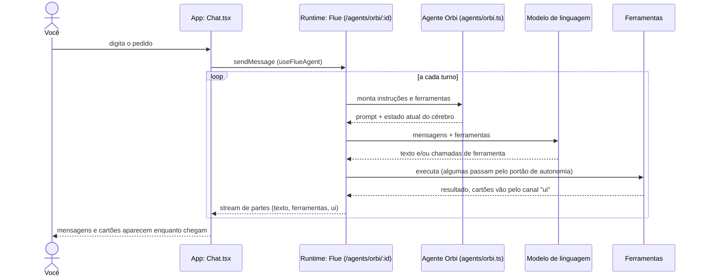

# 1. Conversa

## Para que serve

É onde você pede algo ao Orbi e acompanha o que ele faz. Cada conversa é uma
linha de trabalho separada ("subir o portal para dev", "deletar o repositório
X"), com a própria memória de curto prazo: o que foi dito, as ferramentas que
rodaram e o procedimento em andamento.

## Onde aparece

- **Tela Conversa**: lista de conversas à esquerda, a conversa aberta no centro,
  as pendências à direita.
- **Botão +** cria uma conversa nova. O título vira o primeiro pedido.
- **Ferramentas**: chamadas internas (checklist, consultas ao cérebro, interface)
  não aparecem, porque o checklist e os cartões já mostram. O resto aparece pelo
  propósito ("Obter a URL do Pages"); aberto, mostra o comando e o que ele
  imprimiu, não o JSON. Várias seguidas viram uma linha ("2 comandos · 1 ação no
  navegador"). Uma chamada que espera aprovação aparece só como o cartão.
- **Copiar conversa**, no topo, copia tudo em Markdown (mensagens, ferramentas
  com entrada e resultado, cartões, falhas) para colar num chamado ou mandar a alguém.
- **Microfone** ao lado de Enviar: dita a mensagem. A fala é cortada nas pausas,
  cada trecho é transcrito pelo runtime (`POST /api/transcribe`, a mesma
  transcrição das demonstrações, documento 6) e entra na caixa. Nada é enviado
  sozinho: você confere e envia. O áudio não fica guardado.
- **Apagar** (lixeira no topo da conversa) pede confirmação no próprio lugar e
  apaga a conversa: ela some da lista na hora, as pendências dela saem do painel,
  os retornos agendados são cancelados e, se um agente pediu, ele vê o pedido
  como encerrado. O que o Orbi aprendeu e as execuções ficam no Cérebro.
- Conversas também começam sem você digitar: ao terminar uma demonstração no
  navegador (documento 6) e quando um retorno agendado acorda o Orbi (documento 11).

## Como funciona

O agente roda no **Flue**, um framework de agentes que guarda cada conversa como
um stream durável num SQLite próprio (`data/flue.db`). O app conversa com ele
pela rota `/agents/orbi/<id da conversa>`, usando o cliente React do Flue
(`useFlueAgent`), que recebe a resposta aos pedaços (streaming) e reconstrói as
mensagens.

### O agente é refeito a cada turno

`agents/orbi.ts` é uma função que o Flue chama **antes de cada chamada ao
modelo**. Ela monta, do zero:

- as instruções fixas, de `apps/runtime/src/prompts/orbi/`: a base sempre, e as partes de procedimento, falhas, esteiras e pedido de agente só quando a conversa está nessa situação (`agents/prompt.ts`);
- uma linha com o estado atual ("Cérebro agora: 5 tipos, 12 entidades…") e o
  procedimento em execução, se houver;
- as ferramentas (`agents/capabilities.ts` liga cada módulo de `agents/tools/`);
- o catálogo de skills: a skill `aprender-procedimento` e os procedimentos mais
  usados (documento 5);
- o subagente `investigador` e a conexão MCP com o Chrome (documento 7).

Assim o que o Orbi sabe nunca fica velho: aprendeu algo agora, o próximo turno já vê.

### Texto e cartões

A resposta tem dois canais:

- **texto**, em Markdown, desenhado por `components/Markdown.tsx`;
- **canal `ui`**: componentes estruturados (checklist de procedimento, aprovação,
  pergunta, tabela, link, código, "Já sei algo parecido"). O modelo não escreve
  HTML: chama `show_ui` (ou outra ferramenta que mostra um cartão) com um objeto
  validado pelo contrato `packages/contracts/src/ui.ts`. Um componente mandado de
  novo com o mesmo `id` é atualizado no lugar, e é assim que o checklist avança.

Chamadas de ferramenta aparecem como linhas recolhidas ("2 ações: Comando,
Consulta ao cérebro"); as que já viram cartão (`show_ui`, passos de procedimento,
`similar_found`) ficam escondidas para não repetir.

### Conversas que começam por fora

Quando o runtime manda uma mensagem sozinho (aprovação decidida, demonstração
terminada, retorno agendado), ele usa `tellAgent` (`conversations/tell.ts`), que
entrega a mensagem ao Flue e emite o evento `dispatched` com o id da conversa.
Se você está olhando essa conversa e ela ainda estava vazia, o app busca de novo
e as mensagens aparecem.

## Peças

| Onde | O quê |
| --- | --- |
| `apps/desktop/src/views/conversation/ConversationView.tsx` | Tela: lista, conversa aberta, pendências |
| `apps/desktop/src/views/conversation/Chat.tsx` | Mensagens, compositor, botão copiar, painel de demonstração |
| `apps/desktop/src/views/conversation/Message.tsx` | Como cada mensagem e ferramenta é desenhada |
| `apps/desktop/src/views/conversation/transcript.ts` | Markdown do "Copiar conversa" |
| `apps/desktop/src/components/UiComponents.tsx`, `SimilarCards.tsx` | Os cartões do canal `ui` |
| `apps/runtime/src/agents/orbi.ts` | O agente: instruções, ferramentas, skills, subagente |
| `apps/runtime/src/agents/capabilities.ts` | Liga as capacidades (mãos, memória, voz, relógio) |
| `apps/runtime/src/agents/ui-channel.ts` | O canal `ui` (componentes atualizados no lugar) |
| `apps/runtime/src/prompts/orbi/` + `agents/prompt.ts` | Instruções fixas do Orbi, em partes por situação |
| `apps/runtime/src/conversations/` | Lista de conversas (títulos) e `tellAgent` |
| `apps/runtime/src/http/routes/conversations.ts` | `GET/POST/PATCH /api/conversations` |
| `packages/contracts/src/ui.ts` | Catálogo de componentes, validado nos dois lados |

## Tecnologias

- **Flue** (`@flue/runtime`, `@flue/react`): agente, ferramentas, skills,
  subagentes, streams duráveis por conversa e o cliente React.
- **Pi** (`@earendil-works/pi-ai`): a camada que fala com o provedor do modelo
  (documento 12).
- **valibot**: esquemas do canal `ui`, validados no runtime e tipados no app.
- **React 19** no app.

## Dados

| O quê | Onde |
| --- | --- |
| Mensagens, chamadas de ferramenta, estado persistente do agente | `data/flue.db` (Flue) |
| Lista de conversas e títulos | tabela `conversations` em `data/orbi.db` |
| Conversas apagadas, até o histórico sair do Flue | tabela `deleted_conversations` em `data/orbi.db` |

## Configuração

| Variável | Para quê |
| --- | --- |
| `ORBI_MODEL` | Modelo usado pelo agente (padrão `anthropic/claude-haiku-5-5`) |
| `ORBI_FLUE_DB` | Onde fica o banco do Flue |

## Limites conhecidos

- O Orbi não manda imagens ao modelo; uma imagem vira o texto `[imagem]`.
- Uma conversa muito longa é compactada pelo Flue; o resumo substitui o início.
- O Flue não tem como apagar uma conversa. Ao apagar, ela some do app na hora, e o
  histórico interno (mensagens, chamadas) sai de `data/flue.db` na próxima vez que o
  runtime iniciar, antes de o Flue abrir o arquivo (`conversations/purge.ts`, chamado
  em `src/db.ts`). Isso depende das tabelas do Flue 2.3: se mudarem numa atualização,
  a limpeza pula o que não reconhece e tenta de novo.
- Não dá para apagar uma mensagem só, porque o histórico do Flue é contínuo; apague a
  conversa e comece outra.

## Testes

- `apps/runtime/test/flow-*.test.ts`: o ciclo inteiro pelo Flue real, com
  um modelo roteirizado (aprender, aprovar, executar, agendar, "já sei algo parecido").
- `apps/desktop/test/message.test.ts` e `transcript.test.ts`: agrupamento das
  ferramentas e o Markdown copiado.
