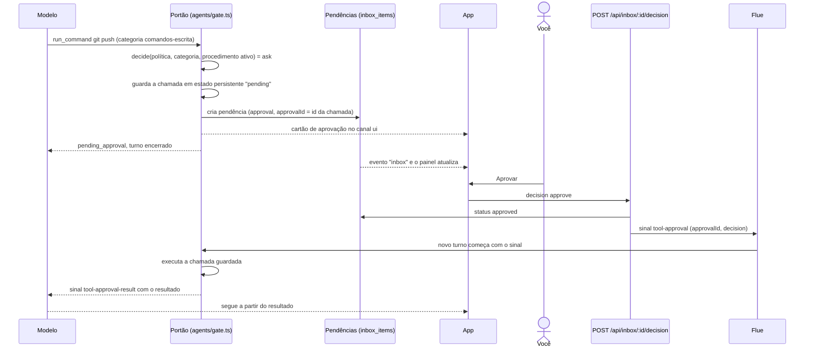

# 2. Pendências e aprovações

## Para que serve

Tudo o que espera uma decisão sua fica num lugar só: ações que precisam de
aprovação (um `git push`, um clique que salva algo num portal), aprendizados
para guardar no cérebro e perguntas do Orbi. Enquanto você não decide, nada
daquilo acontece, e o Orbi encerra o turno em vez de ficar esperando.

## Onde aparece

- **Painel Pendências**, à direita da tela Conversa: um item por pendência
  aberta. Clicar abre a conversa de onde veio.
- **Número no ícone Conversa**, na barra lateral: quantas estão abertas.
- **Na própria conversa**, como cartões:
  - **aprovação** (ação ou aprendizado), com **Aprovar** e **Negar**. O de
    aprendizado mostra o procedimento em passos legíveis e, se for uma variação,
    o que mudou em relação à base (documento 8);
  - **pergunta** (`ask_developer`), com botões de opção e um campo de resposta livre;
  - **"Já sei algo parecido"**, com as opções da escolha (documento 8).

## Como funciona

Há três tipos de pendência na tabela `inbox_items`: `approval`, `learning` e
`question`. As duas primeiras nascem no **portão de autonomia**; a terceira nasce
das ferramentas que perguntam.

Pontos que importam:

- **A ação guardada é a que roda.** O portão guarda os argumentos exatos da
  chamada no estado persistente da conversa (`usePersistentState('pending')`). Ao
  aprovar, roda aquela chamada, não uma que o modelo escreva de novo.
- **Negar também volta ao modelo**, com a instrução de não tentar de novo e
  perguntar como seguir.
- **Perguntas** (`ask_developer`, `similar_found` parecido) criam uma pendência
  `question` e encerram o turno. A resposta vai pela rota `/answer` como uma
  mensagem sua normal; a pendência guarda o texto escolhido, que o cartão mostra
  ("Você escolheu: …").
- **Decidir duas vezes não é possível**: a rota responde `409` se a pendência já
  foi decidida.

## Peças

| Onde | O quê |
| --- | --- |
| `apps/runtime/src/agents/gate.ts` | O portão: decide, guarda, cria a pendência, executa ao aprovar |
| `apps/runtime/src/agents/tools/voice.ts` | `ask_developer` e `show_ui` |
| `apps/runtime/src/conversations/inbox.ts` | Pendências no banco (`add`, `resolve` com a resposta) |
| `apps/runtime/src/http/routes/inbox.ts` | `GET /api/inbox`, `POST /:id/decision`, `POST /:id/answer` |
| `apps/desktop/src/views/conversation/InboxPanel.tsx` | O painel |
| `apps/desktop/src/components/UiComponents.tsx` | Cartões de aprovação (com a prévia do aprendizado) e de pergunta |
| `apps/desktop/src/App.tsx` | `InboxContext`: decidir e responder de qualquer cartão |

## Tecnologias

- **Flue**: sinais (`tool-approval`) entregues à conversa, `useAgentStart` para
  agir no início do turno, estado persistente por conversa.
- **SQLite** (`node:sqlite`) para as pendências; cada mudança vira o evento
  `inbox` (documento 14, "Eventos").

## Dados

| O quê | Onde |
| --- | --- |
| Pendências: tipo, título, detalhe, conversa, status, resposta | tabela `inbox_items` em `data/orbi.db` |
| A chamada que espera aprovação | estado persistente `pending` da conversa, em `data/flue.db` |

## Limites conhecidos

- Aprovar não tem prazo: uma pendência antiga continua valendo até ser decidida.
- Não há aprovação em lote; cada cartão é decidido sozinho.

## Testes

- `apps/runtime/test/agent-flow.test.ts`: aprendizado fica pendente até aprovar;
  pergunta "parecido" vira pendência e a escolha chega ao agente.
- `apps/runtime/test/http.test.ts`: validação, `404`, `409` (já decidido, tipo errado).
