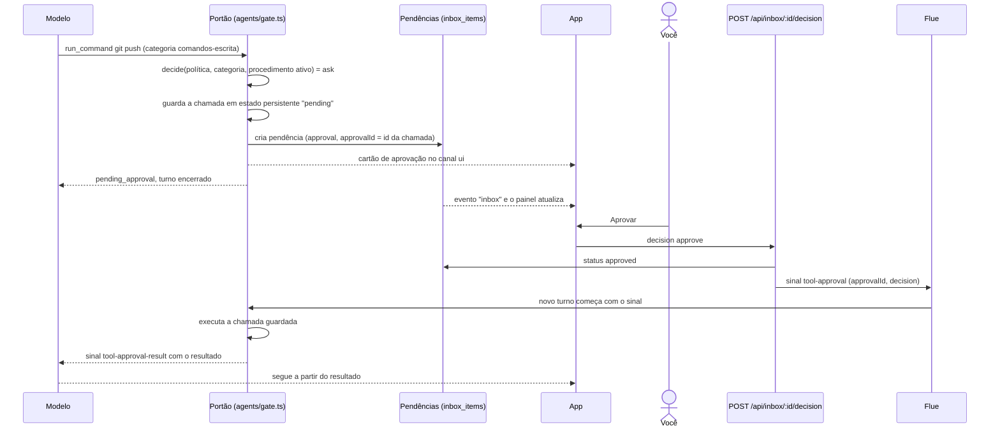

# 2. Pendências e aprovações

## Para que serve

Tudo o que espera uma decisão sua fica num lugar só: ações que precisam de
aprovação (um `git push`, um clique que salva algo num portal), aprendizados
para guardar no cérebro e perguntas do Orbi. Enquanto você não decide, nada
daquilo acontece, e o Orbi encerra o turno em vez de ficar esperando.

## Onde aparece

- **Painel Pendências**, à direita da tela Conversa, em três grupos:
  - **Falta você aprovar**: ações, aprendizados e decisões de esteira. Ação
    pode ser aprovada ali mesmo. **Ir até ↓** rola a conversa até o cartão e o
    destaca; se for de outra conversa, **Abrir conversa →** abre e rola.
  - **Perguntas**: perguntas do Orbi e credenciais.
  - **Para você saber**: avisos que não esperam nada (um procedimento subiu de
    nível, uma passagem de esteira virou automática), com **Manter** (desfaz) e **Ok**.
  Cada item diz se é desta conversa ou de outra e há quanto tempo.
- **Número no ícone Conversa** e nas conversas: quantas esperam você (os avisos não contam).
- **Na própria conversa**, como cartões:
  - **aprovação** (ação ou aprendizado), com **Aprovar** e **Negar**. O de ação
    diz o que acontece em palavras, o **alcance** (nesta máquina, publica para
    fora, apaga, e se dá para desfazer), **por que pede** (o nível do procedimento,
    ou que a ação é nova), o passo e o comando numa linha; os argumentos brutos
    ficam em "ver detalhes". O de aprendizado mostra o procedimento em passos
    legíveis e, se for uma variação, o que mudou em relação à base (documento 8);
  - **pergunta** (`ask_developer`), com botões de opção e um campo de resposta livre;
  - **"Já sei algo parecido"**, com as opções da escolha (documento 8).

## Como funciona

Os tipos de pendência na tabela `inbox_items`: `approval` e `learning` nascem no
**portão de autonomia**; `question` e `secret`, das ferramentas que perguntam;
`pipeline`, do motor da esteira; `level`, do fim de uma execução que mudou um
nível (documento 3). `level` só informa: não conta como "esperando você", não
deixa um pedido de agente em "esperando" e não aceita `/decision`.

Pontos que importam:

- **A ação guardada é a que roda.** O portão guarda os argumentos exatos da
  chamada no estado persistente da conversa (`usePersistentState('pending')`). Ao
  aprovar, roda aquela chamada, não uma que o modelo escreva de novo.
- **Negar também volta ao modelo**, com a instrução de não tentar de novo e
  perguntar como seguir.
- **Perguntas** (`ask_developer`, `similar_found` parecido) criam uma pendência
  `question` e encerram o turno. A resposta vai pela rota `/answer` como uma
  mensagem sua normal; a pendência guarda o texto escolhido, que o cartão mostra
  ("Você escolheu: …").
- **Decidir duas vezes não é possível**: a rota responde `409` se a pendência já
  foi decidida.

## Peças

| Onde | O quê |
| --- | --- |
| `apps/runtime/src/agents/gate.ts` | O portão: decide, guarda, cria a pendência, executa ao aprovar |
| `apps/runtime/src/agents/tools/voice.ts` | `ask_developer` e `show_ui` |
| `apps/runtime/src/conversations/inbox.ts` | Pendências no banco (`add`, `resolve` com a resposta) |
| `apps/runtime/src/inbox/` | Um handler por tipo de pendência (aprovação, pergunta, caminho do shell, credencial, aviso): o que cada ação faz. As rotas só acham o handler. Tipo novo = handler novo + uma linha em `index.ts` |
| `apps/desktop/src/views/conversation/inbox.ts` | `INBOX_KINDS`: rótulo, grupo, ícone e ações de cada tipo no painel, num lugar só |
| `apps/runtime/src/http/routes/inbox.ts` | `GET /api/inbox`, `POST /:id/decision`, `/answer`, `/secret`, `/dismiss`, `/keep` |
| `apps/desktop/src/views/conversation/{InboxPanel,InboxEntry}.tsx`, `inbox.ts` | O painel em grupos e cada item com as ações |
| `apps/desktop/src/views/conversation/useGoTo.ts` | Ir até: rola até o cartão (`data-inbox`) e destaca |
| `apps/desktop/src/components/ApprovalCard.tsx`, `effect.ts` | Cartão de aprovação legível |
| `apps/desktop/src/components/UiComponents.tsx` | Prévia do aprendizado e cartão de pergunta |
| `apps/desktop/src/App.tsx` | `InboxContext`: decidir e responder de qualquer cartão |

## Tecnologias

- **Flue**: sinais (`tool-approval`) entregues à conversa, `useAgentStart` para
  agir no início do turno, estado persistente por conversa.
- **SQLite** (`node:sqlite`) para as pendências; cada mudança vira o evento
  `inbox` (documento 14, "Eventos").

## Dados

| O quê | Onde |
| --- | --- |
| Pendências: tipo, título, detalhe, conversa, status, resposta | tabela `inbox_items` em `data/orbi.db` |
| A chamada que espera aprovação | estado persistente `pending` da conversa, em `data/flue.db` |

## Limites conhecidos

- Aprovar não tem prazo: uma pendência antiga continua valendo até ser decidida.
- Não há aprovação em lote; cada cartão é decidido sozinho. Com o nível dos
  procedimentos subindo, eles ficam menos frequentes (documento 3).
- Aprendizado não se aprova pelo painel: o Ir até leva ao cartão, para ler antes.

## Testes

- `apps/runtime/test/flow-*.test.ts`: aprendizado fica pendente até aprovar;
  pergunta "parecido" vira pendência e a escolha chega ao agente.
- `apps/runtime/test/http.test.ts`: validação, `404`, `409` (já decidido, tipo errado).
- `apps/desktop/test/message.test.ts`: grupos do painel, avisos fora da contagem,
  rótulo do Manter, ferramentas internas escondidas, comando e saída legíveis.
