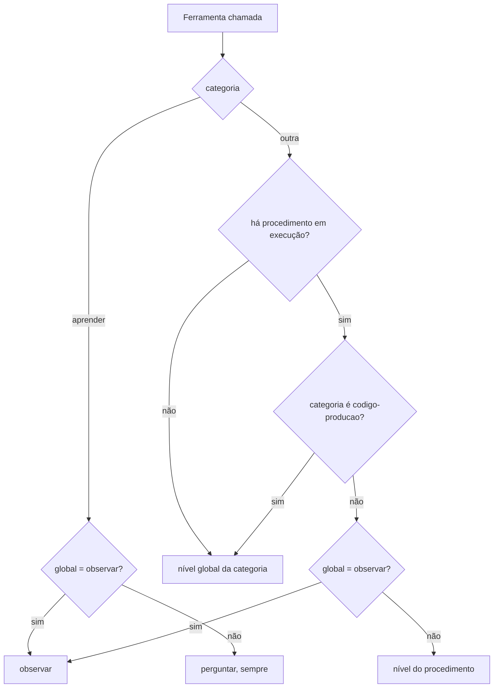

# 3. Autonomia

## Para que serve

Define quanto o Orbi pode fazer sozinho. Ler o estado de um repositório é
inofensivo; dar push, clicar em "Salvar" num portal ou mudar código de produção
não é. A autonomia deixa você soltar o Orbi aos poucos, à medida que confia.

## Onde aparece

- **Tela Autonomia**, seção de níveis: um nível por tipo de ação.
- **Tela Cérebro → Playbooks**: um nível por procedimento.
- Indiretamente, em cada cartão de aprovação (documento 2): ele só existe porque
  o nível daquela ação é **Perguntar**.

## Os três níveis

| Nível | O que acontece |
| --- | --- |
| **Só observar** (`observe`) | O Orbi não executa; diz o que faria |
| **Perguntar** (`ask`) | Prepara a ação e espera sua aprovação |
| **Automático** (`auto`) | Executa e conta depois |

## Os tipos de ação

| Categoria | Exemplos | Padrão |
| --- | --- | --- |
| `comandos-leitura` | `git status`, `gh run view`, `aws logs tail` | automático |
| `comandos-escrita` | `git push`, `gh pr merge`, `gh workflow run` | perguntar |
| `navegador-leitura` | abrir página, ler a tela | automático |
| `navegador-escrita` | clicar, preencher, enviar formulário | perguntar |
| `codigo-teste` | correção que só mexe em arquivos de teste | automático |
| `codigo-producao` | correção que mexe em código de produção | perguntar |
| `aprender` | guardar algo no cérebro | perguntar (sempre) |

A classificação é do código, não do modelo:

- **Comandos**: `commandCategory` (`autonomy/policy.ts`) conhece os verbos de
  leitura de `git`, `gh` e `aws`. Qualquer outro verbo, ou outra CLI, conta como escrita.
  (Scripts de investigação em Python usam `run_python`, que roda isolado e não
  passa pelo portão; veja o documento 10.)
- **Navegador**: uma lista fixa das ferramentas do Chrome que só leem; o resto é escrita.
- **Código**: depois que o Claude Code prepara a correção, o portão olha os
  arquivos alterados. Se todos são de teste, é `codigo-teste`; se algum não é, `codigo-producao`.

## Como o nível é decidido

Em palavras (`decide()` em `autonomy/policy.ts`):

1. Aprender **sempre** pede aprovação, a menos que esteja em "Só observar".
2. Fora de um procedimento, vale o nível global da categoria.
3. Dentro de um procedimento, vale o nível dele, que pode soltar "Perguntar"
   para "Automático" nos passos comuns. Nunca solta o que você pôs em "Só
   observar" e nunca vale para código de produção.

O caminho natural: um procedimento novo nasce em **Perguntar**. Depois de algumas
execuções que deram certo, você o põe em **Automático** e ele roda inteiro sozinho.

## Peças

| Onde | O quê |
| --- | --- |
| `apps/runtime/src/autonomy/policy.ts` | Níveis, categorias, `decide()`, classificação de comandos, navegador e código |
| `apps/runtime/src/agents/gate.ts` | Aplica a decisão a cada ferramenta que muda algo |
| `apps/runtime/src/http/routes/autonomy.ts` | `GET/PATCH /api/autonomy` |
| `apps/runtime/src/http/routes/brain.ts` | `PATCH /api/brain/playbooks/:name` (nível do procedimento) |
| `apps/desktop/src/views/autonomy/AutonomyView.tsx` | Tela Autonomia |
| `apps/desktop/src/views/brain/Playbooks.tsx` | Nível por procedimento |

## Dados

| O quê | Onde |
| --- | --- |
| Níveis por categoria | tabela `settings` em `data/orbi.db` |
| Nível de cada procedimento | coluna `autonomy` da tabela `playbooks` |

## Limites conhecidos

- O nível de um procedimento que apaga algo pode ser posto em "Automático" pela
  tela; o Orbi propõe "Perguntar" para ações sem volta, mas não trava essa escolha.
- A lista de verbos de leitura cobre `git`, `gh` e `aws`. Outra CLI
  liberada em `ORBI_ALLOWED_BINARIES` tem todos os comandos tratados como escrita.

## Testes

- `apps/runtime/test/units.test.ts`: `decide()` com e sem procedimento, comandos
  de leitura e escrita, arquivos de teste e de produção.
- `apps/runtime/test/http.test.ts`: validação do `PATCH /api/autonomy`.
