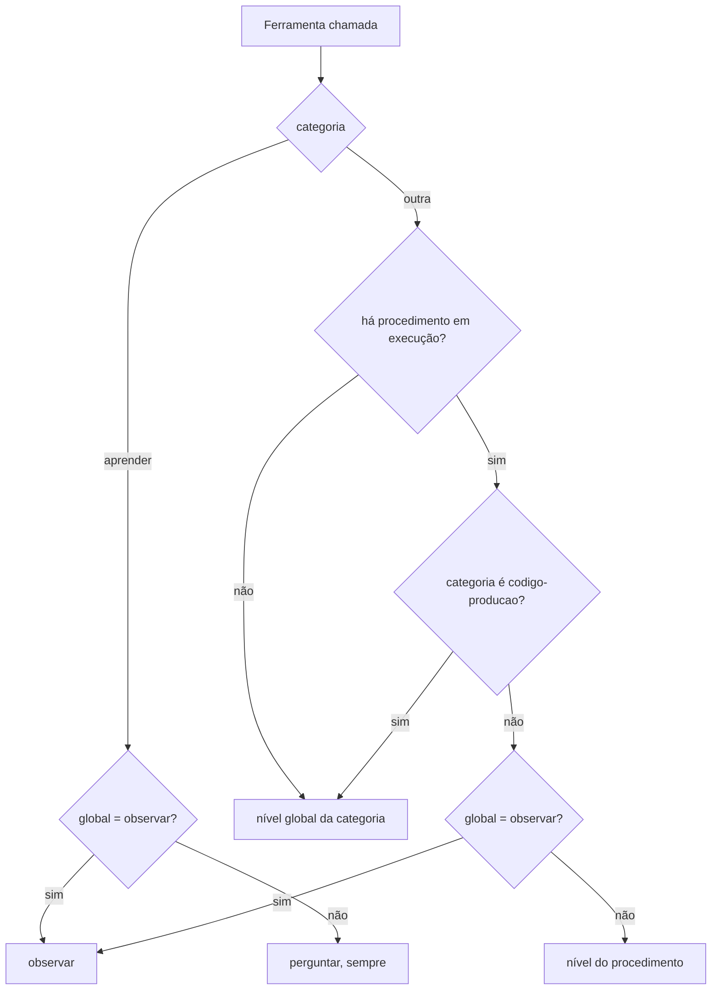

# 3. Autonomia

## Para que serve

Define quanto o Orbi pode fazer sozinho. Ler o estado de um repositório é
inofensivo; dar push, clicar em "Salvar" num portal ou mudar código de produção
não é. A autonomia deixa você soltar o Orbi aos poucos, à medida que confia.

Dentro de um procedimento, a autonomia **cresce com o uso**: um procedimento novo
pede cada ação; depois de rodar de ponta a ponta sem correção, ele passa a repetir
sozinho o que já deu certo, e só pergunta o que é novo. O objetivo é que as tarefas
repetitivas rodem sem você, e o Orbi só chame quando há uma decisão nova.

## Onde aparece

- **Tela Autonomia**, seção de níveis: um nível por tipo de ação.
- **Tela Cérebro → Playbooks**: o nível de cada procedimento (N1, N2, N3), a
  caminhada até o próximo, o nível máximo, as ações conhecidas e o histórico.
- **Na conversa**, ao fim de uma execução: o cartão "subiu para N2" (ou "desceu"),
  com o que agora segue sozinho e o que ainda pergunta, e **Manter em N1**.
- **Pendências → Para você saber**: o mesmo aviso, com **Manter** e **Ok**.
- Indiretamente, em cada cartão de aprovação (documento 2): ele só existe porque
  o nível daquela ação é **Perguntar**.

## Os três níveis

| Nível | O que acontece |
| --- | --- |
| **Só observar** (`observe`) | O Orbi não executa; diz o que faria |
| **Perguntar** (`ask`) | Prepara a ação e espera sua aprovação |
| **Automático** (`auto`) | Executa e conta depois |

## Os níveis de um procedimento

| Nível | O que faz sozinho |
| --- | --- |
| **N1 · Aprendendo** | Só lê. Pede cada ação que muda algo |
| **N2 · Assistido** | Repete as ações conhecidas que só mexem nesta máquina. Pede o que é novo e o que publica para fora |
| **N3 · Autônomo** | Repete todas as ações conhecidas, publicar incluído. Só pergunta o que é novo |

- **Ação conhecida**: a mesma ação que rodou numa execução anterior do mesmo
  procedimento que terminou sem desvio. A comparação é pela impressão digital: a
  ferramenta e os argumentos, sem o texto de propósito, com os valores dos
  parâmetros da execução trocados por `{{nome}}` (o mesmo `git tag` com outra
  versão é a mesma ação). Para comandos: o binário e os argumentos.
- **Efeito** de cada ação (`commandEffect` em `autonomy/policy.ts`): `leitura`,
  `local` (muda arquivos nesta máquina: `git add/commit/pull`, `cp`, scripts),
  `publica` (`git push`, `gh pr create`, escrita na nuvem, ação no navegador) ou
  `apaga` (`push --force`, `git push :branch`, `gh … delete`, `rm`).
- **Apagar nunca roda sozinho**, a não ser que você tenha posto o procedimento no
  N3 e a ação já seja conhecida.
- **Quando muda**: na revisão do fim da execução (documento 5), depois que todas
  as falhas daquele turno chegaram, nunca no meio.
- **Sobe sozinho**: N1 → N2 com uma execução de ponta a ponta sem desvio; N2 → N3
  com mais três seguidas. Nunca passa do **nível máximo** que você escolher.
- **Desce um nível** quando a execução falha ou você nega uma ação. Editar os passos
  (por exemplo, uma correção vinda da revisão) **não** muda o nível: um passo que
  mudou roda outras ações, e ação nova pede aprovação de qualquer jeito.
- **Desvio**: um passo falhou ou foi pulado, uma ferramenta falhou, você negou uma
  ação. A execução com desvio não conta para subir, e as ações dela não viram conhecidas.
- **Pôr à mão**: escolher o nível na tela vale como decisão sua. N3 posto por você
  confia também nas ações novas (como o antigo "Automático"); só apagar continua
  pedindo. `autonomy` continua existindo: `observe` (só observar), `ask` (= N1) e
  `auto` (= N3 seu).

## Os tipos de ação

| Categoria | Exemplos | Padrão |
| --- | --- | --- |
| `comandos-leitura` | `git status`, `gh run view`, `aws logs tail` | automático |
| `comandos-escrita` | `git push`, `gh pr merge`, `gh workflow run` | perguntar |
| `navegador-leitura` | abrir página, ler a tela | automático |
| `navegador-escrita` | clicar, preencher, enviar formulário | perguntar |
| `codigo-teste` | correção que só mexe em arquivos de teste | automático |
| `codigo-producao` | correção que mexe em código de produção | perguntar |
| `aprender` | guardar algo no cérebro | perguntar (sempre) |

A classificação é do código, não do modelo:

- **Comandos**: `commandCategory` (`autonomy/policy.ts`) conhece os verbos de
  leitura de `git`, `gh` e `aws`. Qualquer outro verbo, ou outra CLI, conta como escrita.
  (Scripts de investigação em Python usam `run_python`, que roda isolado e não
  passa pelo portão; veja o documento 10.)
- **Navegador**: uma lista fixa das ferramentas do Chrome que só leem; o resto é escrita.
- **Código**: depois que o agente de código prepara a correção, o portão olha os
  arquivos alterados. Se todos são de teste, é `codigo-teste`; se algum não é, `codigo-producao`.
  Investigar um erro que ninguém conhece, e aplicar o que a investigação achou,
  **sempre pede** (o portão ignora o nível e o global em automático). A correção de
  um problema conhecido segue o nível, e aplicá-la na branch da entrega conta como
  local; o teto continua sendo `codigo-producao` (documento 10).

## Como o nível é decidido

Em palavras (`decide()` em `autonomy/policy.ts`):

1. Aprender **sempre** pede aprovação, a menos que esteja em "Só observar".
2. Fora de um procedimento, vale o nível global da categoria.
3. Dentro de um procedimento, leitura segue o global (não pede, mesmo no N1).
4. O resto segue o nível do procedimento e se a ação é conhecida (tabela acima),
   pelo `decideAction` em `brain/domain/levels.ts`. Nunca solta o que você pôs em
   "Só observar" e nunca vale para código de produção.
5. Uma ferramenta pode **sempre pedir** (`alwaysAsk` no `GatedTool`): o que daria
   automático vira pedido. Hoje: investigar com o agente de código e aplicar uma
   correção que não vem de um problema conhecido.

O caminho natural: um procedimento novo nasce no **N1**. Rodou certo uma vez, vai
para o **N2**; mais três vezes sem desvio, **N3**. Você é avisado a cada mudança e
pode desfazer.

## Peças

| Onde | O quê |
| --- | --- |
| `apps/runtime/src/autonomy/policy.ts` | Níveis, categorias, `decide()`, classificação de comandos, navegador e código |
| `apps/runtime/src/agents/gate.ts` | Aplica a decisão a cada ferramenta que muda algo |
| `apps/runtime/src/http/routes/autonomy.ts` | `GET/PATCH /api/autonomy` |
| `apps/runtime/src/brain/domain/levels.ts` | Níveis: decisão, subida e descida, impressão digital |
| `apps/runtime/src/brain/repo/levels.ts` | Ações conhecidas e histórico |
| `apps/runtime/src/http/routes/brain.ts` | `PATCH /api/brain/playbooks/:name` (`autonomy`, `level`, `levelMax`), `GET …/:name/autonomy` |
| `apps/runtime/src/http/routes/inbox.ts` | `POST /api/inbox/:id/keep` e `/dismiss` (avisos de nível) |
| `apps/desktop/src/views/autonomy/AutonomyView.tsx` | Tela Autonomia |
| `apps/desktop/src/views/brain/PlaybookAutonomy.tsx` | Nível, máximo, ações conhecidas e histórico de um procedimento |
| `apps/desktop/src/components/LevelCard.tsx` | Cartão de nível na conversa |

## Dados

| O quê | Onde |
| --- | --- |
| Níveis por categoria | tabela `settings` em `data/orbi.db` |
| Nível de cada procedimento | colunas `level`, `level_max`, `level_by`, `clean_streak` (e `autonomy`) de `playbooks` |
| O que cada execução fez e o que saiu do caminho | colunas `actions` e `deviations` de `playbook_runs` |
| Ações conhecidas | tabela `playbook_known_actions` |
| Histórico de níveis e passagens | tabela `autonomy_events` |

## Limites conhecidos

- Um script `python3 -c` muda de texto a cada vez: raramente vira ação conhecida.
  Por isso o procedimento tem **scripts próprios** (documento 5), rodados com
  `run_script`: o mesmo script com outros dados é a mesma ação. A revisão sugere
  a troca quando vê `python3 -c` num passo.
- A ação conhecida vale para o procedimento inteiro, não para um passo só.
- A lista de verbos de leitura cobre `git`, `gh` e `aws`. Outra CLI
  liberada em `ORBI_ALLOWED_BINARIES` tem todos os comandos tratados como escrita.

## Testes

- `apps/runtime/test/units.test.ts`: `decide()` com e sem procedimento, comandos
  de leitura e escrita, arquivos de teste e de produção.
- `apps/runtime/test/levels.test.ts`: `git -C`, efeito dos comandos, leitura no N1,
  o que cada nível faz sozinho, subida e descida, teto, impressão digital, ações
  conhecidas, `auto` como N3, passagem de esteira que vira automática.
- `apps/runtime/test/flow-*.test.ts` ("autonomia que cresce"): passo com
  ferramenta falhada não fecha, a falha pede correção, a execução limpa sobe, Manter desfaz.
- `apps/runtime/test/http.test.ts`: validação do `PATCH /api/autonomy`.
