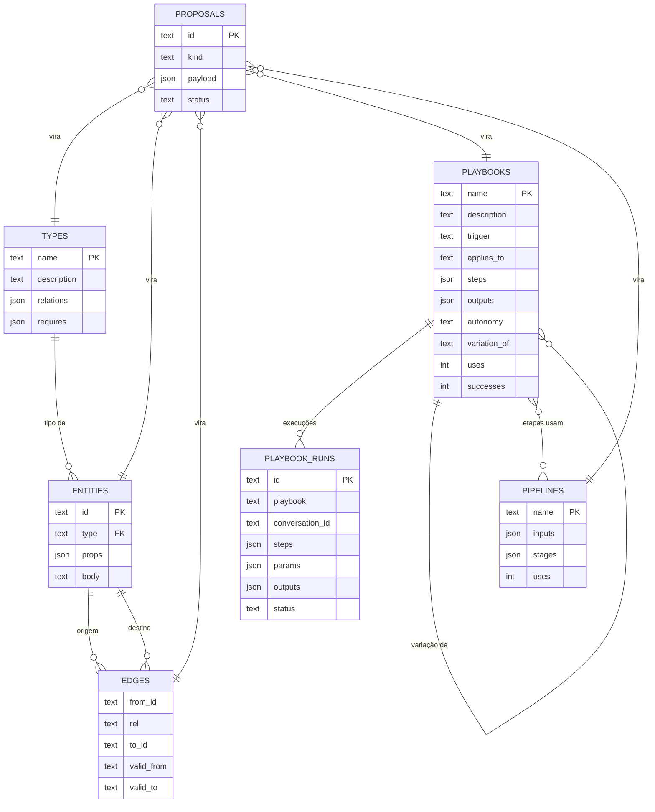
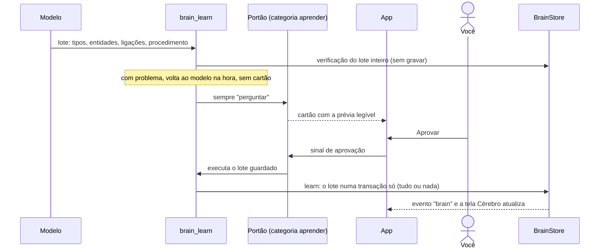
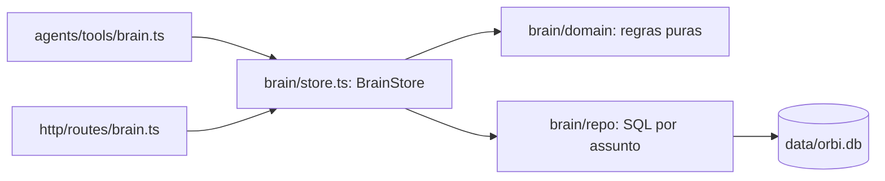
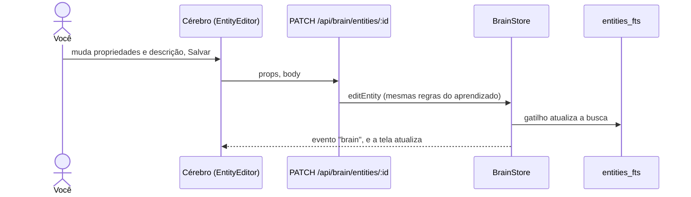

# 4. Cérebro

## Para que serve

É a memória de longo prazo do Orbi: o que existe no seu ambiente de trabalho
(repositórios, ambientes, portais, pessoas, incidentes), como essas coisas se
ligam e os procedimentos que ele aprendeu com você. Tudo que o Orbi sabe fazer
vem daqui. Nada no código conhece CI, GMUD ou portais: isso é aprendido e guardado.

O cérebro **começa vazio**, sem conhecimento e sem tipos. Cresce enquanto você
trabalha com o Orbi, e cada coisa nova só entra depois que você aprova.

## Onde aparece

- **Tela Cérebro**, com quatro abas:
  - **Conhecimento**: o grafo (entidades como nós, ligações como setas), filtro,
    detalhe da entidade escolhida e as **lacunas** (o que falta saber);
  - **Playbooks**: procedimentos, variações e nível de autonomia (documento 5);
  - **Execuções**: cada vez que um procedimento rodou e como terminou cada passo;
  - **Ontologia**: os tipos e as ligações que cada um aceita.
- **Editar e apagar uma entidade**: no detalhe, **Editar** muda as propriedades
  e a descrição (o id e o tipo ficam). **Apagar** pede confirmação e diz quantas
  ligações vão junto, incluindo as do histórico.
- **Exportar Markdown**: gera uma nota por entidade e por procedimento, com links
  entre elas, para abrir no Obsidian. Só leitura: o cérebro continua no banco.
- **Na conversa**, o cartão de aprovação de um aprendizado mostra o que vai entrar.

## O modelo de dados

A parte do banco que é o cérebro. O banco inteiro (conversas, pendências,
esteiras, agentes, uso), as migrações e os gatilhos estão em
[../banco.md](../banco.md).

- **Ontologia** (`types`): os tipos que existem (`Repositorio`, `Portal`…), a
  descrição de cada um e as ligações que ele aceita: `Repositorio` pode
  `publicaEm` um `Ambiente`, por exemplo. O próprio Orbi propõe cada tipo na
  primeira vez que precisa dele.
- **Entidades** (`entities`): as coisas concretas, como `portal-clientes-front`
  do tipo `Repositorio`, com propriedades livres e um texto.
- **Ligações com validade** (`edges`): cada ligação tem início e, opcionalmente,
  fim. "A Marina aprova GMUDs até 31/12; a partir de janeiro, o Rafael" vira duas
  ligações com datas. Consultas por padrão olham o presente, e o passado continua lá.
- **Procedimentos** (`playbooks`) e **execuções** (`playbook_runs`): documento 5.
  Cada procedimento declara o que entrega (`outputs`); cada execução guarda o que
  recebeu (`params`) e o que entregou (`outputs`).
- **Esteiras** (`pipelines`): procedimentos em sequência, documento 16.
- **Propostas** (`proposals`): o que o Orbi quer guardar e ainda espera aprovação.

### Lacunas

Uma regra simples aponta o que falta saber: um tipo pode exigir ligações
(`requires`), e uma entidade do tipo `Classe` também pode exigir ligações de quem
"é um" dela. Exemplo: se todo `FrontEnd` precisa estar `registradoEm` um Portal e
o `novo-front` não está, a lacuna aparece na tela, e o Orbi pode perguntar.

## Como o conhecimento entra

- **Validação antes do cartão**: o lote é testado inteiro numa transação desfeita
  (`learnProblems`). Entidade de tipo que não existe, ligação que o tipo não aceita,
  procedimento sem passos ou variação de uma base inexistente voltam ao modelo na
  hora, com a explicação, e nada é pedido ao desenvolvedor. Se falta um tipo, a
  resposta diz para incluí-lo no lote, não para tirar a entidade. Antes, o lote só
  falhava depois de aprovado, e o modelo reenviava só o procedimento: o
  conhecimento e a ontologia ficavam vazios.
- **Tudo ou nada**: aprovado, o lote é gravado numa transação só (`learn`).
- **Ordem**: dentro do lote, os tipos são gravados antes das entidades que os
  usam. Por isso o Orbi pode propor um tipo novo e uma entidade dele de uma vez.
- **Como o Orbi consulta**: `brain_query` por id (a entidade, as ligações e a
  vizinhança no grafo), por tipo ou por texto (índice de busca, documento 8).

## Camadas no código

- `brain/domain/`: regras sem banco (validação da ontologia, lacunas,
  procedimentos e execuções, aprendizado, busca). Testáveis sem SQLite.
- `brain/repo/`: um repositório SQL por assunto (`ontology`, `graph`,
  `playbooks`, `proposals`, `followups`).
- `brain/store.ts`: a fachada que aplica as regras e grava pelos repositórios,
  com transações onde mais de uma tabela muda.

## Quando você edita

Edição pela tela não passa por aprovação: é você mudando. Valem as mesmas
regras de quando o Orbi aprende. Propriedades que não eram texto (uma lista, um
número) continuam do mesmo tipo se o valor novo ainda for JSON válido. Apagar
(`DELETE /api/brain/entities/:id`) remove a entidade e todas as ligações dela,
numa transação.

## Peças

| Onde | O quê |
| --- | --- |
| `apps/runtime/src/brain/` | Domínio, repositórios, fachada e exportação Markdown |
| `apps/runtime/src/agents/tools/brain.ts` | `brain_query` (livre) e `brain_learn` (pelo portão) |
| `apps/runtime/src/db/migrations.ts` | Esquema e migrações versionadas |
| `apps/runtime/src/http/routes/brain.ts` | `GET /api/brain`, entidades, procedimentos, execuções, exportação |
| `apps/desktop/src/views/brain/` | A tela: grafo e layout, detalhe, editores, playbooks, execuções, ontologia |
| `apps/desktop/src/views/brain/editing.ts` | Propriedades como linhas editáveis e passos como lista (sem React, testável) |
| `apps/desktop/src/components/ConfirmDelete.tsx` | Confirmação de exclusão com as consequências |

## Tecnologias

- **SQLite** pelo `node:sqlite` do próprio Node (sem servidor, sem dependência
  nativa extra), em um arquivo só, junto com o estado do app.
- **Migrações versionadas** por `PRAGMA user_version`.
- **FTS5** (índice de texto do SQLite) para a busca.
- **Grafo desenhado** por um layout de forças próprio, em SVG, sem biblioteca.

## Dados

Tudo em `data/orbi.db`. A exportação Markdown vai para `data/brain-md/`.

## Configuração

| Variável | Para quê |
| --- | --- |
| `ORBI_DB` | Caminho do banco (padrão `data/orbi.db`) |
| `ORBI_BRAIN_EXPORT_DIR` | Para onde vai a exportação Markdown |

## Limites conhecidos

- A busca por texto acha palavras e radicais, não sinônimos (documento 8).
- Pela tela não dá para mudar o id nem o tipo de uma entidade, nem criar ou
  encerrar uma ligação; isso passa pela conversa.
- Apagar uma entidade não mexe em procedimentos que a citam no texto.

## Testes

- `apps/runtime/test/brain-domain.test.ts`: regras puras, busca, variações, medição da busca.
- `apps/runtime/test/units.test.ts`: cérebro vazio, ontologia, ligações com
  validade, propostas, migração que remove tipos de fábrica não usados.
- `apps/desktop/test/layout.test.ts`: layout do grafo.
