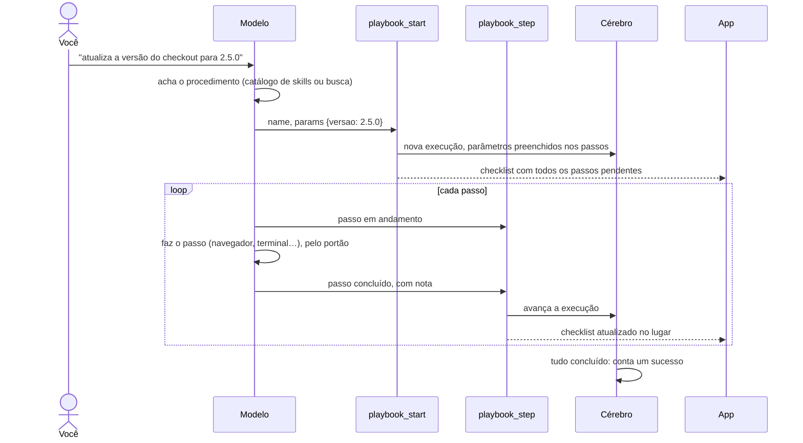

# 5. Procedimentos (playbooks)

## Para que serve

Um procedimento é algo que o Orbi aprendeu a fazer: "subir para dev",
"atualizar a versão do MFE no portal", "abrir a GMUD". Tem gatilho, passos,
parâmetros e um nível de autonomia próprio. É o que transforma o trabalho
repetitivo depois do commit em algo que o Orbi faz sozinho.

## Onde aparece

- **Na conversa**, quando um procedimento roda: um **checklist ao vivo** (um passo
  por linha, com estado e nota) que avança no lugar.
- **No cartão de aprovação**, quando ele é aprendido: os passos numerados, o
  gatilho, a quem se aplica, os parâmetros e as credenciais (só os nomes).
- **Cérebro → Playbooks**: todos os procedimentos, quantas vezes deram certo, o
  nível de autonomia e as variações, cada uma logo abaixo da base.
- **Cérebro → Execuções**: o histórico de cada vez que rodou.
- **Editar e apagar**: ao abrir um procedimento em Cérebro → Playbooks:
  - **Editar** muda para que serve, quando usar, a classe, as instruções e os
    passos (renomear, reordenar, incluir, tirar). O nome, a autonomia, a base e os
    contadores ficam. Passos existentes mantêm o `id`, então um passo renomeado
    continua sendo o mesmo para o histórico e para as variações; passos novos
    ganham um `id` a partir do nome.
  - **Apagar** pede confirmação e diz o que acontece: o Orbi deixa de saber fazer
    aquilo, as variações continuam (sem a ligação) e as execuções passadas
    continuam em Execuções.

## Anatomia de um procedimento

```json
{
  "name": "atualizar-versao-mfe",
  "description": "Troca a versão do MFE no portal interno depois do deploy.",
  "trigger": "deploy do MFE concluído em dev",
  "appliesTo": "MicroFrontend",
  "autonomy": "ask",
  "variationOf": null,
  "steps": [
    { "id": "abrir",  "label": "Abrir o portal",       "how": "navigate_page em https://portal.interno/admin" },
    { "id": "salvar", "label": "Trocar para {{versao}}", "how": "browser_act fill no campo 'Versão' da aba Configuração; Salvar" },
    { "id": "conferir", "label": "Conferir no menu",   "how": "take_snapshot mostra {{versao}}" }
  ],
  "instructions": "Login com {{segredo:portal.interno/usuario}} e {{segredo:portal.interno/senha}}."
}
```

- **`description` e `trigger`** dizem quando usar. É por eles que a busca acha
  o procedimento (documento 8).
- **`how`** descreve o passo pelo sentido ("o campo rotulado Versão"), não por
  posição na página, para continuar funcionando quando a página muda um pouco.
- **`{{parametro}}`** é o que muda a cada vez (a versão, o nome do MFE).
  **`{{segredo:…}}`** é uma credencial do cofre: nunca é preenchida no texto,
  só dentro da ferramenta que usa (documento 9).
- **`appliesTo`** prende o procedimento a uma classe ("todo MicroFrontend") em
  vez de um repositório específico.
- **`variationOf`**: de qual procedimento este foi derivado (documento 8).
- **`outputs`** (opcional): o que o procedimento **entrega** ao terminar, como
  `versao` ou `numero_gmud` (nome em `snake_case` e descrição). O Orbi registra os
  valores no último `playbook_step`; nomes não declarados são recusados e valores
  do cofre são limpos. É assim que uma esteira passa dados de uma etapa para a
  próxima (documento 16). Na tela: **Recebe** (os parâmetros) e **Entrega**.

## Como é aprendido

Por três caminhos, todos terminando num `brain_learn` que você aprova (documento 4):

1. **Fazendo junto, na conversa**: a skill `aprender-procedimento`
   (`prompts/aprender-procedimento.md`) guia o Orbi: procurar o que já sabe,
   descobrir sozinho o que dá (ler o repositório, os workflows), perguntar só o
   que falta, executar junto e guardar.
2. **Pelo navegador**: você mostra e explica; ele monta os passos (documento 6).
3. **Como variação** de um que já existe (documento 8).

## Como é executado



- **Autonomia durante a execução**: enquanto um procedimento roda, o nível dele
  (N1, N2, N3) e se a ação já é conhecida decidem o que pede aprovação
  (documento 3). O portão registra na execução cada ação que rodou e cada desvio
  (ferramenta que falhou, ação negada).
- **Passo esquecido**: marcar o último passo com outro ainda aberto devolve na hora
  `pendentes` e o pedido de fechá-los (feito ou pulado). O procedimento só termina
  quando todos fecham; numa esteira, só então ela segue.
- **Passo com ferramenta falhada não fecha**: `playbook_step` com `done` logo
  depois de uma ferramenta que falhou é recusado; o Orbi corrige ou marca o passo
  como falhou ou pulado (`observability/tool-outcomes.ts`).
- **Revisão no fim da execução** (`review/review.ts`): quando o turno da conversa
  termina, o runtime revisa as execuções que acabaram nele. Esperar o fim do turno
  garante que todas as falhas já chegaram, inclusive de ferramentas chamadas na
  mesma leva do passo que encerrou a execução (o modelo faz isso). Para cada uma:
  - os problemas: ferramenta que falhou, ação negada, passo que falhou ou foi
    pulado, e **passo dado como feito cuja ferramenta falhou**;
  - o nível, acertado com base nisso (execução com problema não sobe);
  - numa esteira, a configuração dela (documento 16).
  Se há algo a mostrar (problema ou mudança de nível), um sinal `review` leva à
  conversa o cartão **Revisão da execução** e, havendo problema, pede ao Orbi as
  correções num único `brain_learn` (o cartão de aprendizado espera você). Execução
  limpa sem mudança de nível passa em silêncio. Cada execução é revisada uma vez
  (`playbook_runs.reviewed_at`). Numa esteira, a revisão espera a entrega terminar,
  ser encerrada ou parar numa decisão sua; não acontece a cada aprovação no caminho.
  Procedimento que ficou aberto quando a entrega terminou aparece como "ficou aberto".
- **Cartão da correção**: quando o Orbi corrige procedimentos que já existem, o
  título é "Corrigir N procedimentos: …" e cada passo aparece marcado (igual, muda,
  novo, sai) contra a versão atual. Aprender não leva "por que pede" nem o passo do
  procedimento que estiver rodando, e não entra no histórico da execução.
- **Passo que pergunta algo que já veio**: quando o valor chegou como parâmetro
  (da esteira, do padrão), o Orbi usa e não pergunta (regra no prompt).
- **Estados de um passo**: pendente, em andamento, concluído, falhou, esperando
  (CI, aprovação, retorno agendado) e pulado. Qualquer falha marca a execução
  como falha; tudo concluído ou pulado a encerra.
- **Contadores**: cada início soma um uso; cada execução concluída soma um
  sucesso. É o "4 de 4 deram certo" que aparece nos cartões.
- **Falha no meio**: a skill orienta marcar o passo, investigar com o subagente
  `investigador`, corrigir se for seguro (documento 10), guardar o incidente e,
  se não der, perguntar.

### Como o modelo encontra o procedimento

Os 15 mais usados entram como **skills** do Flue: uma linha de catálogo cada
(nome e descrição) nas instruções do modelo, e os passos só são lidos quando ele
ativa a skill. Os demais ele acha com `playbook_similar`, que devolve passos e
instruções, e roda pelo nome. Assim as instruções não crescem com o número de
procedimentos.

## Peças

| Onde | O quê |
| --- | --- |
| `apps/runtime/src/agents/tools/playbooks.ts` | Catálogo de skills, `playbook_start`, `playbook_step`, checklist |
| `apps/runtime/src/brain/domain/playbooks.ts` | Validação, parâmetros, avanço de uma execução |
| `apps/runtime/src/brain/repo/playbooks.ts` | SQL de procedimentos, execuções e busca |
| `apps/runtime/src/skills/aprender-procedimento.ts` + `prompts/aprender-procedimento.md` | Como aprender |
| `apps/desktop/src/components/UiComponents.tsx` | Checklist (`stepper`) e prévia do aprendizado |
| `apps/desktop/src/views/brain/Playbooks.tsx` | Lista, variações, autonomia, execuções, apagar |
| `apps/desktop/src/views/brain/PlaybookEditor.tsx` | Editor de procedimento |
| `apps/runtime/src/http/routes/brain.ts` | `PUT` e `DELETE /api/brain/playbooks/:name` |

## Tecnologias

- **Skills do Flue** (`defineSkill`/`useSkill`): catálogo enxuto e instruções
  carregadas só quando usadas.
- **Estado persistente do Flue** (`usePersistentState`): qual execução está
  ativa na conversa, entre um turno e outro.

## Dados

| O quê | Onde |
| --- | --- |
| Procedimentos | tabela `playbooks` |
| Execuções e o estado de cada passo | tabela `playbook_runs` |
| Execução ativa na conversa | estado `activeRun` no `data/flue.db` |

## Configuração

| Variável | Para quê |
| --- | --- |
| `ORBI_SKILL_CATALOG_SIZE` | Quantos procedimentos entram como skills (padrão 15) |

## Limites conhecidos

- Um procedimento roda por vez em cada conversa.
- A correção sugerida depende do modelo propor bem; o runtime garante que ele é
  avisado do que falhou e que nada muda no cérebro sem você.
- A revisão chega depois da última mensagem do Orbi naquele turno, como uma nova
  mensagem: conta como mais um turno do modelo.
- Editar um procedimento não muda uma execução já em andamento: ela segue com os
  passos que tinha quando começou.
- Pela tela não dá para renomear um procedimento; peça na conversa.

## Testes

- `apps/runtime/test/agent-flow.test.ts`: aprender, aprovar, ver como skill,
  executar com checklist e contar o sucesso.
- `apps/runtime/test/demonstration.test.ts`: parâmetros preenchidos, segredos
  continuam referência.
- `apps/runtime/test/units.test.ts`: catálogo de skills só com os mais usados.
