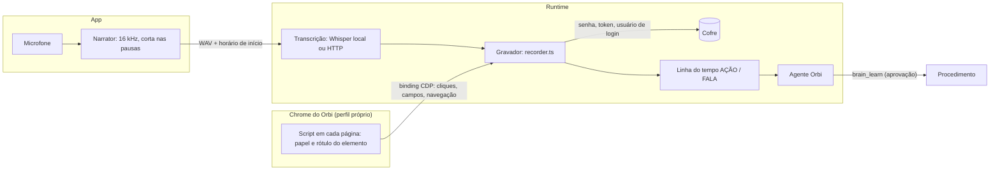

# 6. Ensinar pelo navegador

## Para que serve

É o jeito mais rápido de ensinar um procedimento que acontece numa página web
(um portal interno, o ServiceNow, um painel de feature flags). Em vez de
descrever em texto, você faz o procedimento uma vez no navegador e, se quiser,
explica em voz alta enquanto faz. O Orbi junta o que você fez com o que você
disse e propõe o procedimento para você aprovar.

## Onde aparece

1. Na conversa, botão **Ensinar pelo navegador** (ou o atalho de mesmo nome nas sugestões).
2. Um painel pede a página inicial e se você quer narrar. Ao começar, o Chrome do
   Orbi abre nessa página e o app pede o microfone.
3. Enquanto você trabalha no Chrome, o painel mostra ao vivo, lado a lado,
   **O que você fez** (cada clique e campo) e **O que você explicou** (cada trecho
   transcrito), com o relógio e o nível do microfone. Dá para pausar a narração.
4. **Terminar e aprender** (ou **Descartar**). O painel mostra
   "Transcrevendo e montando o passo a passo…".
5. A demonstração entra na conversa como um cartão, e o Orbi responde com a
   proposta do procedimento, normalmente depois de checar se já sabe algo
   parecido (documento 8).

## Como funciona

Duas trilhas no mesmo relógio: **ações** (do navegador) e **fala** (do microfone).



### Trilha das ações

- O gravador (`browser/recorder.ts`) se conecta ao **Chrome compartilhado** pelo
  protocolo de depuração (CDP, via `puppeteer-core`). É o mesmo Chrome que o
  agente usa (documento 7), com perfil próprio em `data/chrome-profile`: logins
  feitos uma vez continuam valendo.
- Em cada página e aba, ele injeta um script (`browser/page-recorder.ts`) que
  observa cliques, campos preenchidos, seleções, caixas marcadas, Enter e envio
  de formulário, além das navegações. Cada evento descreve o elemento **pelo
  papel e pelo rótulo acessível** ("o campo Versão na aba Configuração"), não por
  um seletor CSS. Assim o passo continua reconhecível mesmo se o layout mudar.
- Digitação no mesmo campo vira uma ação só (o último valor).

### Trilha da fala

- O app (`apps/desktop/src/audio.ts`) lê o microfone, reduz para 16 kHz mono e
  corta em trechos nas pausas naturais: pelo menos 6 s de áudio seguidos de cerca
  de 0,7 s de silêncio, ou 20 s no máximo. Trechos só de silêncio são descartados,
  porque o Whisper costuma "ouvir" frases no silêncio.
- Cada trecho vai como WAV, com o horário em que começou, para
  `POST /api/recordings/:id/audio`. O runtime transcreve na hora (`voice/stt.ts`)
  e encaixa a fala no relógio das ações.

### Credenciais nunca ficam na gravação

Campos de senha, token, código de verificação (e o usuário de um formulário de
login) são reconhecidos na página. O valor vai **direto para o cofre**
(documento 9) com um nome como `portal.interno/senha`. A gravação, a mensagem ao
agente, o cérebro e o procedimento só guardam a referência
`{{segredo:portal.interno/senha}}`.

### Da linha do tempo ao procedimento

Ao terminar, o gravador espera as transcrições pendentes e monta uma mensagem:

```
<demonstracao id="rec_…" duracao="02:14" acoes="11" falas="4">
[00:03] AÇÃO  Abriu https://portal.interno/login — página "Entrar"
[00:05] FALA  "Sempre que sair versão nova do checkout, atualiza aqui…"
[00:09] AÇÃO  Preencheu o campo "Senha" com {{segredo:portal.interno/senha}} (credencial guardada no cofre)
…
</demonstracao>
```

Ela entra na conversa como sua mensagem (via `tellAgent`). A seção "Aprender por
demonstração" de `prompts/aprender-procedimento.md` orienta o modelo:

- a **intenção** (gatilho, porquê, critério de pronto, o que é variável) vem da fala;
- a **mecânica** (onde clicar, o que preencher) vem das ações;
- ações agrupadas em passos com sentido; cliques acidentais ignorados;
- valores que mudam a cada vez viram `{{parametros}}`;
- cada passo descrito pelo sentido do elemento, com critério de sucesso.

Antes de guardar, o Orbi verifica se já sabe algo parecido. Depois propõe o
procedimento com `brain_learn`, e o cartão mostra os passos, os parâmetros e as
credenciais (só os nomes).

## Peças

| Onde | O quê |
| --- | --- |
| `apps/desktop/src/components/Demonstration.tsx` | Painel de início e cartão da demonstração na conversa |
| `apps/desktop/src/components/RecordingPanel.tsx` | Painel ao vivo (ações, fala, relógio, microfone) |
| `apps/desktop/src/audio.ts` | Captura e corte do áudio |
| `apps/runtime/src/browser/recorder.ts` | Sessão de gravação, ações, narração, mensagem final |
| `apps/runtime/src/browser/page-recorder.ts` | Script injetado em cada página |
| `apps/runtime/src/browser/chrome.ts` | O Chrome compartilhado |
| `apps/runtime/src/voice/stt.ts` | Transcrição |
| `apps/runtime/src/http/routes/recordings.ts` | Iniciar, enviar áudio, consultar, terminar |

## Tecnologias

- **Chrome DevTools Protocol** por `puppeteer-core` (só conecta; não baixa navegador).
- **Web Audio API** no app para capturar e reduzir o áudio.
- **Whisper** para transcrever:
  - local, pelo `@huggingface/transformers` (ONNX Runtime), sem o áudio sair da
    máquina. O modelo padrão é o `whisper-small` (cerca de 250 MB, baixado uma vez
    para `data/models`);
  - ou qualquer serviço compatível com `/v1/audio/transcriptions` da OpenAI.
- O painel acompanha a gravação pelo evento `recording` (documento 14); o relógio
  roda no próprio app.

## Dados

| O quê | Onde |
| --- | --- |
| Gravação em andamento (ações, falas) | memória do runtime, enquanto dura |
| A demonstração terminada | a mensagem na conversa (`data/flue.db`) |
| Credenciais | cofre (documento 9) |
| Modelo do Whisper | `data/models` |

## Configuração

| Variável | Para quê |
| --- | --- |
| `ORBI_STT` | `local` (padrão), `http` ou `off` |
| `ORBI_STT_LOCAL_MODEL` | Outro modelo local, por exemplo `onnx-community/whisper-large-v3-turbo` (mais preciso, mais pesado) |
| `ORBI_STT_URL`, `ORBI_STT_API_KEY`, `ORBI_STT_MODEL` | Serviço de transcrição compatível com a OpenAI |
| `ORBI_STT_LANGUAGE` | Idioma da fala (padrão `pt`) |
| `ORBI_STT_MODEL_HOST` | Espelho do Hugging Face na empresa, para baixar o modelo |
| `ORBI_STT_OFFLINE` | `true`: usa só o modelo já copiado para `ORBI_MODELS_DIR` |
| `ORBI_MODELS_DIR` | Onde ficam os modelos |
| `CHROME_PATH`, `CHROME_PROFILE_DIR`, `CHROME_DEBUG_PORT` | O Chrome compartilhado (documento 7) |

### Windows e rede fechada

A transcrição local roda no Windows, no macOS e no Linux. No computador da
empresa, o que pode atrapalhar é baixar o modelo do huggingface.co na primeira
vez. As saídas são `ORBI_STT_MODEL_HOST` (espelho interno), `ORBI_STT_OFFLINE`
(modelo copiado à mão) ou `ORBI_STT=http` (serviço da empresa). Sem nenhuma, a
demonstração funciona sem a narração, só com os cliques.

### O modelo: quando baixa, onde fica, como trocar

- **Quando**: não no build nem na instalação. Na primeira transcrição (ditado na
  conversa ou narração), ou quando você clica em **Baixar agora** em
  **Autonomia → Transcrição de voz**. Depois disso, não usa mais a internet.
- **Carregar na memória**: baixado uma vez, o modelo ainda precisa ser carregado
  na memória a cada vez que o Orbi abre, e isso leva alguns segundos (mais no
  `whisper-large`). Por isso o runtime carrega logo ao abrir, em segundo plano, se
  os arquivos já estão no disco (`voice/warm.ts`); o mesmo depois de **Baixar
  agora** ou de trocar o modelo. Enquanto carrega, o estado é `loading` e o
  microfone da conversa fica com o indicador girando, desabilitado, com "Carregando
  o modelo de voz…" embaixo da caixa (durante o download, "Baixando o modelo de
  voz N%"). `ORBI_STT_PRELOAD=false` desliga o carregamento ao abrir: economiza a
  memória do modelo, e o primeiro ditado espera carregar.
- **Onde** (`<pasta de dados>/models/<modelo>/`):

  | Como roda | Pasta |
  | --- | --- |
  | `npm run dev` / `npm start` | `apps/runtime/data/models/` |
  | App instalado no macOS | `~/Library/Application Support/br.com.zup.orbi/data/models/` |
  | App instalado no Windows | `%APPDATA%\br.com.zup.orbi\data\models\` |
  | App instalado no Linux | `~/.local/share/br.com.zup.orbi/data/models/` |

  `ORBI_DATA_DIR` muda a pasta de dados. A tela mostra o caminho exato desta máquina.
- **O que baixa** (Whisper do onnx-community em 8 bits): `config.json`,
  `generation_config.json`, `preprocessor_config.json`, `tokenizer.json`,
  `tokenizer_config.json`, `onnx/encoder_model_quantized.onnx` e
  `onnx/decoder_model_merged_quantized.onnx`.
- **Se o download falhar** (proxy da empresa): a tela lista os arquivos que faltam,
  com o link de cada um. Baixe pelo navegador, salve na pasta mantendo a subpasta
  `onnx/` e clique em **Testar**. Arquivos já na pasta são usados sem internet; copiar
  a pasta de outro computador também funciona.
- **Trocar de modelo**: na mesma tela, `whisper-base` (~80 MB, rápido, erra mais),
  `whisper-small` (padrão, ~250 MB) ou `whisper-large-v3-turbo` (~1,1 GB, o melhor
  em português). Outro modelo do onnx-community com os mesmos arquivos funciona em
  **Outro**. A escolha fica no banco (`settings`, chave `stt`) e vale sobre o
  `ORBI_STT_LOCAL_MODEL`; vale na próxima transcrição.
- Peças: `voice/model.ts` (arquivos, estado, troca), `http/routes/voice.ts`
  (`GET /api/voice`, `POST /api/voice/prepare`, `PUT /api/voice/model`), tela
  `views/autonomy/Voice.tsx`. O andamento chega pelo evento `voice`.

### Quando a narração sai "não transcrito"

Rode `npm run stt:testar -w @orbi/runtime`. Ele carrega o modelo como o runtime
(mesmo `.env`, mesma pasta), mostra cada arquivo baixado e transcreve um segundo
de silêncio. Se falhar, a mensagem diz o arquivo e a causa (host bloqueado,
status HTTP, disco). O erro "Unable to get model file path or buffer" vinha de o
transformers.js não guardar o download quando o `fetch` devolve um `Response` de
outra implementação; o runtime agora entrega sempre o `Response` do próprio Node
(`voice/stt.ts`, `loadWhisper`).

No macOS o app pede permissão de microfone na primeira gravação
(`apps/desktop/src-tauri/Info.plist`).

## Limites conhecidos

- Uma gravação por vez.
- O gravador só registra o que a pessoa fez (`isTrusted`): cliques e preenchimentos
  feitos por script da própria página (o login do GitHub preenche campos ocultos)
  ficam de fora, assim como campos `hidden`.
- Campo com nome de algo ("Passkey nickname", "Nome do token") não é credencial,
  mesmo perto de uma palavra de senha.
- O painel da gravação confere sozinho, a cada 2 s, se a transcrição acabou (caso
  um evento se perca) e tem **Fechar** depois de terminar a gravação.
- A transcrição pode errar termos técnicos; o modelo corrige pelo contexto, mas
  vale conferir o cartão antes de aprovar.
- Não testado no Windows.

## Testes

- `npm run e2e:demo -w @orbi/runtime`: grava uma demonstração num portal local
  com o Chrome real, confere o cofre e reexecuta pelo MCP.
- `apps/runtime/test/demonstration.test.ts`: descrição das ações, segredos,
  linha do tempo, parâmetros.
- `apps/runtime/scripts/ui-narration/`: a trilha de áudio pela interface, com um
  microfone falso tocando uma narração sintetizada e um serviço de transcrição simulado.
- No `npm run demo`, o botão já vem com um portal de exemplo
  (`http://127.0.0.1:4310/login`, usuário `arthur`, senha `s3nh@-Portal!`).
