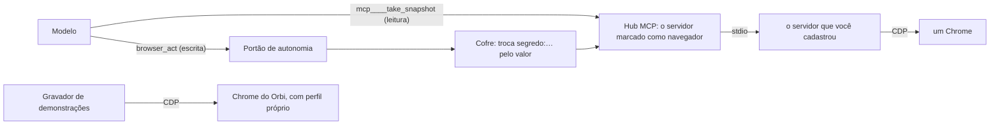

# 7. Navegador do Orbi

## Para que serve

Muita coisa depois do commit acontece em páginas web: trocar uma versão num
portal, abrir uma GMUD, ligar uma feature flag. O Orbi tem um Chrome para isso.
Ele lê as páginas e age nelas, com as mesmas regras de autonomia das outras ações.

## Onde aparece

- Quando um passo de procedimento é numa página: as ações aparecem como linhas
  de ferramenta na conversa ("Ação no navegador") e, conforme a autonomia, como
  cartão de aprovação ("Salvar a versão 2.5.0 (navegador: click)").
- O **Chrome do Orbi** abre na tela. É uma janela comum, e você pode olhar ou
  intervir (um MFA no celular, por exemplo).
- **Configurações › Servidor MCP**: o servidor que você cadastrou e marcou como
  **navegador do Orbi** (documento 31). Nada vem embarcado: sem marcar um, os passos de
  navegador recusam dizendo o que fazer.
- **Configurações › Servidor MCP › Chrome do gravador**: o Chrome que o Orbi abre para
  gravar uma demonstração (documento 6) — perfil próprio ou o seu Chrome pelo endereço
  local da depuração, mostrar a janela, pasta do perfil e o programa do Chrome. Esse
  ajuste não tem mais nada a ver com MCP.

## Como funciona

O navegador é um **servidor MCP que você cadastra** e marca como navegador
(documento 31) — em geral o **chrome-devtools-mcp**, mantido pelo time do Chrome,
que expõe o navegador como ferramentas: abrir página, tirar um "retrato" da
página com os elementos e seus identificadores, clicar, preencher. O Orbi não
traz nenhum dentro dele.

### Ler e agir são caminhos diferentes

- **Ler** (listar páginas, navegar, retrato da página, captura de tela, esperar
  um texto, console, rede): as ferramentas do servidor marcado aparecem ao modelo
  diretamente, como `mcp__<servidor>__take_snapshot`, com autonomia **por
  ferramenta** (documento 20) — leitura roda sozinha.
- **Agir** (clicar, preencher, enviar, escolher opção, rodar script na página):
  só por `browser_act`, que passa pelo portão (`navegador-escrita`, "Perguntar"
  por padrão) e informa o propósito da ação para o cartão.
- **Credenciais**: o procedimento escreve `{{segredo:portal.interno/senha}}`.
  `browser_act` com `saveTo` grava o que a página devolve (por exemplo, a lista de um
  `evaluate_script`; o JSON de dentro do bloco, se houver) direto num arquivo do workspace e
  devolve só o caminho: o Orbi nunca copia o resultado à mão para um comando. Gravar o
  retorno de uma leitura é `navegador-escrita` com efeito `local`.
  O `browser_act` troca pela senha do cofre **dentro da ferramenta**, na hora de
  preencher, e apaga o valor de qualquer saída antes de devolver ao modelo. O
  modelo nunca vê a senha.
- **Subagente**: o `investigador` não tem a montagem MCP; ele lê o navegador por
  `browser_read`, que recusa qualquer ferramenta de escrita.

### Como acha o elemento certo

O passo do procedimento descreve o elemento pelo sentido ("o campo rotulado
Versão na aba Configuração"). Na execução, o modelo tira um retrato da página
(`take_snapshot`), que lista os elementos com papel, rótulo e um `uid`, acha o
elemento descrito e manda `browser_act` com aquele `uid`. Por isso o passo
sobrevive a mudanças de layout que quebrariam um seletor CSS.

### O Chrome do gravador

`browser/chrome.ts` abre um Chrome **na primeira vez que o gravador precisa
dele**, com a porta de depuração ligada e um perfil próprio
(`data/chrome-profile`). Logins feitos ali continuam valendo nas próximas vezes.
Com `CHROME_BROWSER_URL` o Orbi usa um Chrome que você abriu (com
`--remote-debugging-port`), por exemplo o seu do dia a dia. Quem decide em qual
Chrome o **agente** trabalha é o servidor MCP que você cadastrou — e ele pode
apontar para esse mesmo perfil, pela porta de depuração.

## Peças

| Onde | O quê |
| --- | --- |
| `contexts/tools/browser/src/chrome.ts` | Achar, abrir e parar o Chrome do gravador |
| `contexts/tools/browser/src/mcp/chrome-devtools.ts` | Acha o servidor marcado e chama nele; a recusa quando não há nenhum |
| `contexts/tools/mcp-client/src/store.ts` | A marca: qual servidor é o navegador (um só) |
| `agents/tools/browser.ts` | `browser_act` (pelo portão, com cofre) e `browser_read` |
| `contexts/trust/policy/src/policy.ts` | Quais ferramentas do navegador são leitura |

## Tecnologias

- **Model Context Protocol** (`@modelcontextprotocol/sdk`), por stdio, pelo hub de
  servidores cadastrados (documento 20).
- **Chrome DevTools Protocol**, usado direto pelo gravador.

## Configuração

Todas são do **Chrome do gravador**, e as quatro primeiras também se mudam pela tela
(Configurações › Servidor MCP › Chrome do gravador); um valor vazio vale o padrão. O navegador do
agente não se configura por variável: é o servidor que você cadastra.

| Variável | Para quê |
| --- | --- |
| `CHROME_BROWSER_URL` | Usar um Chrome que você abriu |
| `CHROME_PATH` | Onde está o Chrome, se não for o local padrão |
| `CHROME_DEBUG_PORT`, `CHROME_PROFILE_DIR` | Porta e perfil do Chrome do Orbi |
| `CHROME_HEADLESS` | `true` para abrir sem janela |

## Limites conhecidos

- Precisa do Google Chrome (ou Chromium) instalado.
- MFA e captchas pedem você: o procedimento pausa e pergunta.
- Páginas muito dinâmicas podem precisar de um `wait_for` antes de agir.

## Testes

- `npm run e2e:demo -w @orbi/runtime`: demonstração gravada e reexecutada pelo caminho do
  agente — o script **cadastra** um servidor de navegador por comando e marca, como você faria,
  com a senha vinda do cofre.
- `apps/runtime/test/browser-server.test.ts`: a recusa sem servidor marcado, um só navegador,
  e o servidor desligado que deixa de ser.
- `apps/runtime/test/units.test.ts`: classificação das ferramentas do navegador.
- `apps/runtime/test/browser-settings.test.ts` (o `.env`, o endereço só local, a rota) e
  `apps/desktop/test/chromeForm.test.ts` (o formulário).
