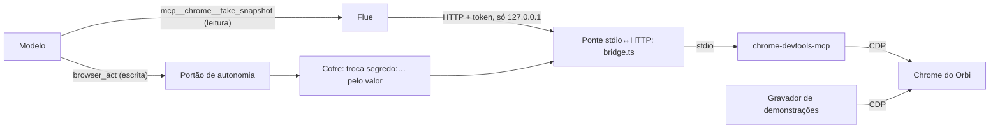

# 7. Navegador do Orbi

## Para que serve

Muita coisa depois do commit acontece em páginas web: trocar uma versão num
portal, abrir uma GMUD, ligar uma feature flag. O Orbi tem um Chrome para isso.
Ele lê as páginas e age nelas, com as mesmas regras de autonomia das outras ações.

## Onde aparece

- Quando um passo de procedimento é numa página: as ações aparecem como linhas
  de ferramenta na conversa ("Ação no navegador") e, conforme a autonomia, como
  cartão de aprovação ("Salvar a versão 2.5.0 (navegador: click)").
- O **Chrome do Orbi** abre na tela. É uma janela comum, e você pode olhar ou
  intervir (um MFA no celular, por exemplo).
- Na barra lateral do app, o segundo ponto indica se o navegador está conectado.

## Como funciona

O Orbi usa o **chrome-devtools-mcp**, um servidor MCP (Model Context Protocol)
mantido pelo time do Chrome, que expõe o navegador como ferramentas: abrir
página, tirar um "retrato" da página com os elementos e seus identificadores,
clicar, preencher. Como o Flue só conecta MCP por HTTP e esse servidor fala por
stdio, há uma ponte entre os dois.

### Ler e agir são caminhos diferentes

- **Ler** (listar páginas, navegar, retrato da página, captura de tela, esperar
  um texto, console, rede): as ferramentas aparecem ao modelo diretamente, como
  `mcp__chrome__take_snapshot` etc. São leitura e não passam pelo portão
  (categoria `navegador-leitura`, automática por padrão).
- **Agir** (clicar, preencher, enviar, escolher opção, rodar script na página):
  só por `browser_act`, que passa pelo portão (`navegador-escrita`, "Perguntar"
  por padrão) e informa o propósito da ação para o cartão.
- **Credenciais**: o procedimento escreve `{{segredo:portal.interno/senha}}`.
  `browser_act` com `saveTo` grava o que a página devolve (por exemplo, a lista de um
  `evaluate_script`; o JSON de dentro do bloco, se houver) direto num arquivo do workspace e
  devolve só o caminho: o Orbi nunca copia o resultado à mão para um comando. Gravar o
  retorno de uma leitura é `navegador-escrita` com efeito `local`.
  O `browser_act` troca pela senha do cofre **dentro da ferramenta**, na hora de
  preencher, e apaga o valor de qualquer saída antes de devolver ao modelo. O
  modelo nunca vê a senha.
- **Subagente**: o `investigador` não tem a montagem MCP; ele lê o navegador por
  `browser_read`, que recusa qualquer ferramenta de escrita.

### Como acha o elemento certo

O passo do procedimento descreve o elemento pelo sentido ("o campo rotulado
Versão na aba Configuração"). Na execução, o modelo tira um retrato da página
(`take_snapshot`), que lista os elementos com papel, rótulo e um `uid`, acha o
elemento descrito e manda `browser_act` com aquele `uid`. Por isso o passo
sobrevive a mudanças de layout que quebrariam um seletor CSS.

### Um Chrome só, aberto quando precisa

- `browser/chrome.ts` abre o Chrome **na primeira vez que alguma ferramenta
  precisa dele**, com a porta de depuração ligada e um perfil próprio
  (`data/chrome-profile`). Logins feitos ali, por você numa demonstração ou pelo
  Orbi, continuam valendo nas próximas vezes.
- O gravador de demonstrações (documento 6) usa o **mesmo** Chrome.
- Com `CHROME_BROWSER_URL`, o Orbi usa um Chrome que você abriu (com
  `--remote-debugging-port`), por exemplo o seu do dia a dia com as sessões
  da empresa.

### Segurança da ponte

A ponte (`browser/mcp/bridge.ts`) escuta só em `127.0.0.1` e exige um token
gerado a cada execução. O navegador pode ter sessões logadas em sistemas da
empresa, então nada fora da sua máquina pode chegar nele.

## Peças

| Onde | O quê |
| --- | --- |
| `apps/runtime/src/browser/chrome.ts` | Achar, abrir e parar o Chrome compartilhado |
| `apps/runtime/src/browser/mcp/bridge.ts` | Ponte stdio↔HTTP com token |
| `apps/runtime/src/browser/mcp/chrome-devtools.ts` | Montagem MCP no Flue (só leitura) e chamada direta |
| `apps/runtime/src/agents/tools/browser.ts` | `browser_act` (pelo portão, com cofre) e `browser_read` |
| `apps/runtime/src/autonomy/policy.ts` | Quais ferramentas do Chrome são leitura |
| `apps/runtime/src/compose.ts` | Sobe a ponte junto com o runtime |

## Tecnologias

- **chrome-devtools-mcp** e o **Model Context Protocol** (`@modelcontextprotocol/sdk`).
- **Chrome DevTools Protocol**.
- **Montagem MCP do Flue** (`defineMcpConnection`, opcional: sem a ponte, o Orbi
  continua funcionando sem navegador e o modelo é avisado).

## Configuração

| Variável | Para quê |
| --- | --- |
| `CHROME_MCP_AUTOSTART` | `false` para não subir a ponte |
| `CHROME_MCP_PORT`, `CHROME_MCP_TOKEN` | Porta e token da ponte (o token é gerado se faltar) |
| `CHROME_BROWSER_URL` | Usar um Chrome que você abriu |
| `CHROME_PATH` | Onde está o Chrome, se não for o local padrão |
| `CHROME_DEBUG_PORT`, `CHROME_PROFILE_DIR` | Porta e perfil do Chrome do Orbi |
| `CHROME_HEADLESS` | `true` para abrir sem janela |

## Limites conhecidos

- Precisa do Google Chrome (ou Chromium) instalado.
- MFA e captchas pedem você: o procedimento pausa e pergunta.
- Páginas muito dinâmicas podem precisar de um `wait_for` antes de agir.

## Testes

- `npm run e2e:chrome -w @orbi/runtime` (`apps/runtime/scripts/e2e-chrome-mcp.ts`), ou `npm run e2e` na raiz para os dois: a ponte, o MCP
  e o Chrome real numa página local.
- `npm run e2e:demo -w @orbi/runtime`: demonstração gravada e reexecutada pelo
  MCP, com a senha vinda do cofre.
- `apps/runtime/test/units.test.ts`: classificação das ferramentas do navegador.
