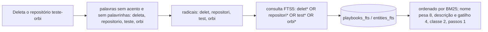
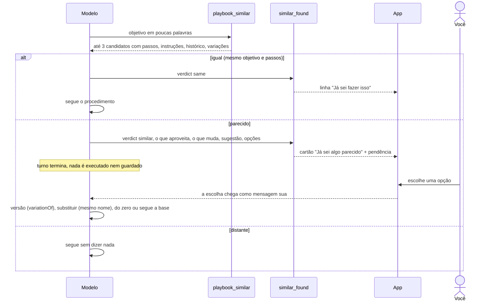

# 8. Busca e "Já sei algo parecido"

## Para que serve

Duas perguntas que o Orbi faz o tempo todo:

- **O que eu sei sobre isso?** Achar, entre muitos procedimentos e entidades, os
  que têm a ver com o pedido.
- **Já sei fazer isso, ou algo parecido?** Antes de agir num pedido e antes de
  guardar algo que você ensinou. Evita fazer a coisa errada (usar o procedimento
  de *criar* para *deletar*), evita duplicar procedimentos quase iguais e
  aproveita o que já deu certo.

## Onde aparece

- **"Já sei fazer isso: criar-repositorio · 4 de 4 deram certo · Não é isso?"**:
  uma linha na conversa quando o pedido é igual a um procedimento conhecido. O
  Orbi segue com ele; "Não é isso?" manda a correção como mensagem sua.
- **Cartão "Já sei algo parecido"** quando é parecido, mas não igual:
  - a primeira frase diz o que ele sabe e o que não sabe;
  - o procedimento base, com histórico ("4 de 4 deram certo", data);
  - **O que dá para aproveitar** e **O que muda**, lado a lado;
  - a sugestão dele, com o porquê;
  - as opções. Num pedido: **Criar versão a partir deste**, **É outra coisa:
    aprender do zero**, **Era isso mesmo**. No que você ensinou: **Guardar como
    variação**, **Substituir o que eu sabia**, **São coisas diferentes**.
- **Prévia com diferenças**, no cartão de aprovação de uma versão: cada passo
  marcado como igual, muda (com o que era antes), novo ou sai.
- **Cérebro → Playbooks**: a variação aparece logo abaixo da base, com "variação
  de …" de um lado e "Variações: …" do outro.

## Como funciona

### 1. A busca (índice de texto)

- **Índice**: duas tabelas FTS5 no `orbi.db`, uma para procedimentos (nome,
  descrição, gatilho, classe, passos) e outra para entidades (id, tipo,
  propriedades, texto). Gatilhos do SQLite atualizam o índice a cada escrita.
  Não há passo de reindexar.
- **Pedido vira consulta** (`brain/domain/similarity.ts`): sem acento, sem
  maiúsculas, sem palavrinhas ("de", "para", "por favor"), cada palavra cortada
  no radical. Assim "deleta", "deletar" e "deletado" se encontram em `delet*`.
- **Ordem por BM25**: palavra rara e decisiva pesa mais que palavra comum; o nome
  do procedimento pesa mais que os passos. Empate: o que mais deu certo primeiro.
- **O que a busca não faz**: sinônimos ("apagar" × "deletar", "prod" ×
  "produção"). Isso precisa de busca por significado, ainda não implementada.

### 2. O julgamento (o modelo)

A busca só traz candidatos; quem decide é o modelo, seguindo as regras em
`prompts/orbi.md`:

Regras que o modelo segue:

- Na dúvida entre igual e parecido, é parecido.
- O procedimento de uma ação nunca serve para a ação oposta.
- Palavras, nunca porcentagens ou notas.
- O histórico no cartão (usos, sucessos, data) vem do banco, preenchido pelo
  runtime. O modelo não pode inventá-lo.
- Numa versão, os passos aproveitados mantêm o mesmo `id`. É assim que a prévia
  sabe o que é igual, o que mudou e o que é novo.

### 3. A comparação dos passos (o app)

`apps/desktop/src/components/stepDiff.ts` compara a versão com a base pelo `id`
de cada passo: mesmo id e mesmo texto = igual; mesmo id com outro texto = muda;
id novo = novo; id da base que sumiu = sai (mostrado onde estava). Se o
procedimento tem o mesmo nome de um existente, a comparação é com ele
("Substituir o que eu sabia").

### 4. As instruções não crescem com o cérebro

Só os 15 procedimentos mais usados entram no catálogo de skills do modelo, em
ordem estável. Os outros ele acha com `playbook_similar` e roda pelo nome
(documento 5).

## Peças

| Onde | O quê |
| --- | --- |
| `apps/runtime/src/brain/domain/similarity.ts` | Palavras, radicais, consulta FTS5 |
| `apps/runtime/src/brain/repo/playbooks.ts`, `graph.ts` | Consultas ao índice com BM25 |
| `apps/runtime/src/db/migrations.ts` | Tabelas FTS5 e gatilhos (migração 7) |
| `apps/runtime/src/agents/tools/similar.ts` | `playbook_similar` e `similar_found` |
| `apps/runtime/src/prompts/orbi.md` | As regras de igual, parecido e distante |
| `apps/desktop/src/components/SimilarCards.tsx` | Linha "Já sei fazer isso" e cartão "parecido" |
| `apps/desktop/src/components/stepDiff.ts` | Comparação dos passos |
| `apps/runtime/scripts/eval-search.ts` + `test/fixtures/search-eval.json` | Medição da busca |

## Tecnologias

- **SQLite FTS5** com `unicode61 remove_diacritics 2` e ordenação **BM25**.
- Radicais por uma lista curta de sufixos do português (não é um stemmer completo).

## Medição

`npm run eval:search -w @orbi/runtime` roda 40 pedidos sobre 24 procedimentos
e mostra quantas vezes o certo veio em 1º e entre os 3 primeiros, separando
pedidos com as mesmas palavras e pedidos por sinônimo. Um teste trava um mínimo,
para nenhuma mudança piorar a busca sem ninguém ver.

| | Antes do índice | Hoje |
| --- | --- | --- |
| Mesmas palavras, entre os 3 primeiros | 91% | 100% |
| Mesmas palavras, em 1º | 88% | 100% |
| Sinônimos, entre os 3 primeiros | 38% | 38% |

## Configuração

| Variável | Para quê |
| --- | --- |
| `ORBI_SKILL_CATALOG_SIZE` | Quantos procedimentos entram como skills (padrão 15) |

## Limites conhecidos e próximos passos

- **Sinônimos**: o próximo passo é a busca por significado (vetores), com um
  modelo pequeno no próprio computador ou pelo plugin de LLM da empresa,
  misturada ao índice de texto.
- **Aprender com as correções**: guardar quando você responde "Não é isso?" ou
  "É outra coisa", para pesar nas próximas buscas.
- No caso "parecido", o Orbi sempre pergunta; não cria a variação sozinho.

## Testes

- `apps/runtime/test/brain-domain.test.ts`: radicais, consulta, índice
  atualizado a cada escrita, ordem, mínimo da medição, variações.
- `apps/runtime/test/flow-*.test.ts`: igual não interrompe; parecido mostra
  o cartão, a escolha chega e vira variação aprovada, sem mudar a base.
- `apps/desktop/test/stepDiff.test.ts`: igual, muda, novo e sai; variações abaixo da base.
- No `npm run demo`: peça "Deleta o repositório teste-orbi" (parecido) ou
  "Cria um repositório novo" (igual).
