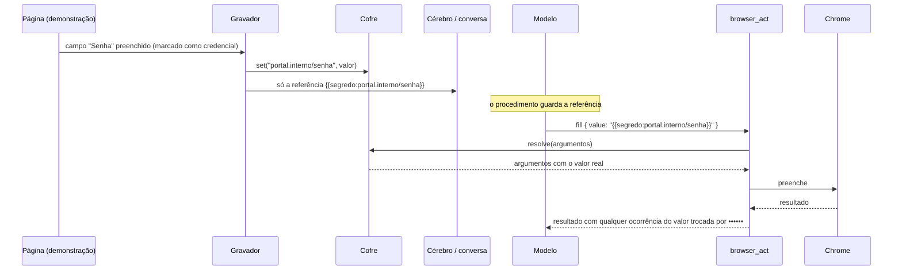
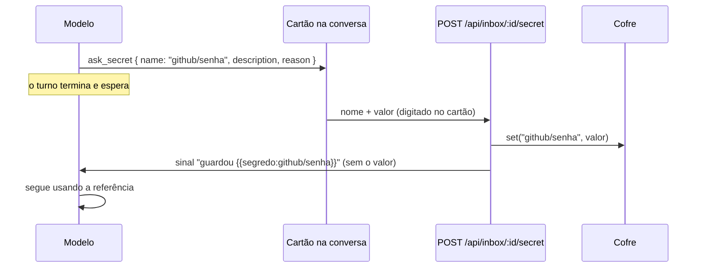

# 9. Cofre de credenciais

## Para que serve

O Orbi precisa entrar em portais e sistemas, mas não pode **saber** as senhas:
elas não podem ir para o cérebro, para a conversa, para o modelo nem para os
logs. O cofre guarda as credenciais fora de tudo isso e só as entrega no último
momento, dentro da ferramenta que preenche o campo.

## Onde aparece

- **Durante uma demonstração** (documento 6): quando você digita uma senha, um
  token, um código ou o usuário num formulário de login, o painel mostra
  "No cofre: portal.interno/senha". O valor nunca aparece.
- **Na conversa, quando o Orbi precisa de uma**: ao aprender ou executar algo
  que pede login, ele chama `ask_secret` propondo um nome (`github/senha`). Aparece
  o cartão **"O Orbi precisa de uma credencial"** com o nome (editável) e um campo
  de senha. **Guardar no cofre** grava direto no cofre; o valor não vira mensagem
  e não passa pelo modelo. O Orbi recebe só o sinal de que `{{segredo:github/senha}}`
  existe e segue. Se o nome já estiver no cofre, o cartão oferece usar o que existe.
  O pedido também aparece em **Pendências** como "Credencial".
- **No cartão de aprovação do procedimento**: as credenciais aparecem só pelo nome.
- **Tela Autonomia → Cofre**: nomes, descrição e de onde cada uma veio.
  **Adicionar credencial** cadastra uma nova (nome, descrição, valor) e mostra a
  referência para usar no procedimento; **Trocar valor** e **Remover** cuidam das
  existentes. O valor pode ser escrito, nunca lido.
- **O Orbi sabe os nomes**: a cada turno ele recebe a lista de referências do
  cofre (nome e descrição, nunca o valor), para usar a certa no `browser_act` e no
  procedimento. Não cole senhas na conversa: o modelo recusa e elas ficariam no histórico.

## Como funciona

- **Como reconhece uma credencial** (`browser/page-recorder.ts`): campo do tipo
  senha, ou com nome, rótulo ou dica de senha, token, código, MFA, chave de API,
  PIN, CVV. O usuário de um formulário que tem senha também vai para o cofre.
- **Nome**: o domínio mais o campo, normalizados (`portal.interno/senha`,
  `portal.interno/usuario`).
- **Referência**: `{{segredo:<nome>}}` em qualquer texto. `vault.resolve`
  troca as referências de um objeto inteiro pelos valores. Um nome que não
  existe no cofre gera erro com o nome que falta, nunca um campo vazio.
- **Saída limpa**: `redact` troca o valor por `••••••` em tudo que a ferramenta
  devolve, para uma página que mostre a senha de volta não a vazar para o modelo.

### Pela conversa

### Onde fica guardado

| Armazenamento | Quando |
| --- | --- |
| **Cofre do sistema**: Keychain no macOS, Gerenciador de Credenciais no Windows, Secret Service no Linux | Padrão, quando disponível |
| **Arquivo criptografado** (AES-256-GCM) em `data/secrets.enc` | Sem cofre do sistema (servidores, contêineres), ou com `ORBI_VAULT=file` |

No arquivo, a chave vem de `ORBI_VAULT_KEY` ou de um arquivo de chave criado com
permissão só para o dono (`data/vault.key`). Em qualquer caso, os **nomes**
ficam num índice à parte (`data/secrets.json`): nome, descrição, origem, datas,
nunca o valor.

## Peças

| Onde | O quê |
| --- | --- |
| `apps/runtime/src/vault/vault.ts` | Cofre: armazenamentos, índice, `resolve`, `redact`, nomes |
| `apps/runtime/src/browser/page-recorder.ts` | Reconhece campos de credencial na página |
| `apps/runtime/src/browser/recorder.ts` | Manda o valor ao cofre e grava só a referência |
| `apps/runtime/src/agents/tools/browser.ts` | Resolve na hora de agir e limpa a saída |
| `apps/runtime/src/http/routes/vault.ts` | Listar (só nomes), gravar (valida o nome), apagar |
| `apps/runtime/src/agents/tools/secrets.ts` | `ask_secret`: o cartão que pede uma credencial na conversa |
| `apps/runtime/src/http/routes/inbox.ts` | `POST /api/inbox/:id/secret`: grava no cofre e avisa a conversa só com a referência |
| `apps/runtime/src/agents/orbi.ts` | Passa ao modelo os nomes do cofre a cada turno |
| `apps/desktop/src/views/autonomy/Vault.tsx`, `AddSecret.tsx` | Seção Cofre da tela Autonomia e o formulário de nova credencial |
| `apps/desktop/src/components/SecretCard.tsx` | O cartão de credencial na conversa |

## Tecnologias

- **`@napi-rs/keyring`**: acesso ao cofre do sistema nas três plataformas.
- **`node:crypto`**: AES-256-GCM e scrypt para o arquivo.

## Configuração

| Variável | Para quê |
| --- | --- |
| `ORBI_VAULT` | `auto` (padrão), `keychain` ou `file` |
| `ORBI_VAULT_KEY` | Chave do arquivo criptografado (senão, um arquivo de chave local) |

## Limites conhecidos

- O modelo nunca vê o valor, mas um `evaluate_script` aprovado roda na página e
  poderia lê-lo de lá. Por isso fica na categoria de escrita, que pede aprovação.
- O cofre do sistema pode pedir sua senha do computador na primeira vez.
- Credenciais de terminal (`GH_TOKEN`, `AWS_*`) não passam pelo cofre: vêm do
  `.env` e são entregues só aos comandos (documento 10).

## Testes

- `apps/runtime/test/units.test.ts` e `demonstration.test.ts`: referências,
  resolução, nome que falta, limpeza da saída, arquivo criptografado.
- `npm run e2e:demo -w @orbi/runtime`: a senha digitada na demonstração vai ao
  cofre e é usada na reexecução sem aparecer em lugar nenhum.
- `apps/runtime/test/http.test.ts`: a API nunca devolve o valor; nome inválido é recusado.
- `apps/runtime/test/agent-flow.test.ts` ("credencial pela conversa"): o cartão grava no
  cofre, a pendência guarda só a referência e o valor nunca aparece no que o modelo recebe.
