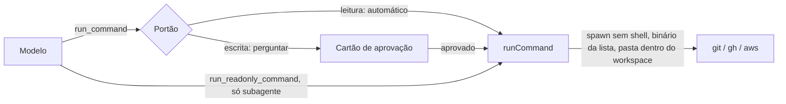

# 10. Terminal, investigação e correção de código

## Para que serve

As "mãos" do Orbi fora do navegador:

- **Terminal**: rodar `git`, `gh` (GitHub) e `aws` nos clones dos repositórios,
  por exemplo para disparar um workflow, ver um run, abrir um PR ou ler logs.
- **Investigação**: quando algo falha, um subagente lê logs, diffs e páginas e
  devolve só o diagnóstico.
- **Correção de código**: um agente de código da máquina (Claude Code, Cursor,
  Devin…) investiga ou corrige o bug numa cópia descartável; o commit e o push
  só acontecem depois, pelo portão de autonomia. Quem faz cada tarefa, e com qual
  modelo, fica em **Autonomia → Agentes de código** (documento 17).

## Onde aparece

- Na conversa, como linhas de ferramenta ("Comando", "Python", "Subagente",
  "Agente de código: investigar") e, quando muda algo, como cartão de aprovação
  ("git push origin main", "Aplicar a correção em acme/loja (feature/x)").
- Na correção, o cartão de aprovação mostra os arquivos e o diff antes do push.
- Depois de aplicada, o cartão **Houve correção de código** (o quê, por quê, quem,
  commit, ver diff). Se seguiu sozinha, ela fica em Pendências até você marcar Visto.
- Na **tela Autonomia → Capacidades**: quais comandos foram achados no PATH e se
  a correção de código está ligada.

## Como funciona

### Terminal



- **Sem shell**: o comando é sempre binário + lista de argumentos, entregues
  direto ao sistema. Não há como encadear com `;`, `|` ou `$(...)`.
- **Lista de binários permitidos**: `git`, `gh`, `aws`, `python3`, `cp` e `mkdir`,
  a menos que você configure outros. Qualquer outro é recusado.
- **`saveTo`**: a saída inteira do comando vai para um arquivo (caminho absoluto,
  `~/…` ou relativo ao workspace) e o modelo recebe só o caminho, o número de linhas
  e as primeiras linhas. É como uma lista ou um JSON grande passa de um passo para
  outro sem o modelo copiar à mão. Grava um arquivo: conta como escrita (efeito
  "nesta máquina"); o subagente de leitura não pode usar.
- **`run_script`**: roda um script **do procedimento em andamento** pelo nome,
  com argumentos (documento 5). O código vem do cérebro (aprovado com o
  procedimento) e é gravado em `<scratch>/scripts/<procedimento>/<hash>-<nome>`;
  roda com `python3` no workspace, com o mesmo ambiente do `run_command` (para
  ler e gravar arquivos seus) e aceita `saveTo`. A impressão digital é
  `run_script <procedimento>/<nome>@<versão> <argumentos>`, com os parâmetros da
  execução no lugar dos valores: com outros dados é a mesma ação. Fora de um
  procedimento, ou com um script que ele não tem, é recusado sem pedir nada.
  Com **`show: true`**, o script imprime um componente (tabela, status, link ou
  código, em JSON): o runtime valida e mostra direto na conversa, e o modelo
  recebe só o resumo (`shown`, linhas). Saída que não é componente vira erro com
  o motivo.
- **Terminal do desenvolvedor (`run_shell`)**: uma linha de shell (pipe, `&&`,
  redirecionamento, um script `.sh` do time), no shell da máquina: Git Bash no
  Windows (achado sozinho em `Program Files\Git`, também no app instalado), bash no
  macOS e no Linux; `ORBI_SHELL` aponta outro ou desliga (`off`). Como o shell
  interpreta a linha, o Orbi não sabe se ela só lê: é sempre `comandos-escrita`, o
  alcance sai do texto (`rm`, `git push --force`, `gh … delete` → apaga; o resto →
  publica), e uma linha nova sempre pede aprovação. Para um programa só, o
  `run_command` continua sendo o caminho: ele vira ação conhecida e ganha autonomia.
- **Git Bash não encontrado**: quando um comando precisa do shell (`run_shell`, ou
  npm/mvn no Windows) e nenhum foi achado, aparece na conversa e em Pendências o
  cartão "Onde está o Git Bash (bash.exe)?", com os caminhos mais comuns como opção.
  A resposta é conferida (o arquivo existe e é o bash), gravada no `.env`
  (`ORBI_SHELL`) e passa a valer na hora, sem reiniciar; o Orbi recebe um sinal e
  roda o comando de novo. Caminho errado deixa o cartão aberto com o motivo
  (`agents/tools/shell-setup.ts`, `settings/env-file.ts`).
- **Programas `.cmd` no Windows** (npm, mvn, npx): o Node não os roda sem shell, então
  vão pelo Git Bash como `npm 'arg' …`, cada argumento entre aspas simples (nada é
  interpretado). As ferramentas do Git (`cat`, `cp`, `mkdir`, em `Git\usr\bin`) entram
  no PATH dos comandos, então rodam mesmo com o app aberto pelo menu Iniciar.
- **Comandos padrão**: git, gh, aws, python3 (python/py), node, npm, mvn, cp, mkdir e
  cat (`ORBI_ALLOWED_BINARIES` troca a lista). `cat` é leitura; `npm publish` e
  `mvn deploy` publicam; `npm unpublish` apaga.
- **Windows**: `python3` costuma não existir lá; o Orbi usa `python` ou o
  lançador `py -3`, e ignora os atalhos da Microsoft Store (`WindowsApps`), que
  abrem a loja em vez de rodar. As dicas de instalação usam `winget` no Windows e
  `brew` no macOS (`resolveBinary` e `installHint` em `terminal/exec.ts`).
- **`gh api -X GET`** é leitura mesmo com `-f`/`-F` (viram parâmetros da consulta).
- **`git -C pasta …`** é classificado pelo verbo que vem depois (`git -C x status`
  é leitura). Cada comando também tem um efeito (nesta máquina, publica, apaga),
  usado pelos níveis de autonomia (documento 3) e mostrado no cartão.
- **Só dentro do workspace**: a pasta onde o comando roda tem que estar dentro de
  `ORBI_WORKSPACE`, onde ficam os clones.
- **Ambiente controlado**: o comando não herda o ambiente inteiro do Orbi. Recebe
  só `PATH`, `HOME`, idioma e as credenciais de CLI do `.env` (`GH_TOKEN`,
  `AWS_PROFILE`, `AWS_REGION` e chaves da AWS), entregues explicitamente.
- **Leitura ou escrita**: decidido pelo verbo (documento 3).
- **Erros claros**: comando não encontrado vem com a dica de instalação; pasta
  inexistente diz qual pasta e aponta o `ORBI_WORKSPACE`.

### Scripts Python de investigação

`run_python` roda um script curto para analisar logs, comparar arquivos ou
calcular. Cada execução acontece numa **pasta vazia própria**, que também é o
`HOME` e o temporário do script, com o ambiente reduzido a `PATH` e idioma.
O script não enxerga tokens nem arquivos de credencial (`~/.aws`,
`~/.config/gh`), e a pasta é apagada no fim. Limite de 60 s. Não passa pelo
portão porque não tem como mudar nada fora da própria pasta.

### Investigador (subagente)

Quando um passo falha, o Orbi delega ao `investigador` com um briefing (repo,
branch, run, erro). O subagente roda em contexto próprio, só com ferramentas de
leitura (comandos de leitura, Python, cérebro, navegador em leitura), segue as
instruções de `prompts/investigador.md` e devolve: o que falhou, a causa
provável, a evidência, se já aconteceu antes e a correção sugerida. O log
inteiro fica com ele; a conversa principal recebe só o diagnóstico.

### Correção pelo agente de código da máquina

Só existe com um agente cadastrado (documento 17). Há dois caminhos, pela
situação:

```mermaid
sequenceDiagram
  participant Orbi as Modelo (Orbi)
  participant Ag as Agente de código (pelo terminal, sem janela)
  participant WT as Cópia descartável (worktree)
  participant Portao as Portão
  actor Voce as Você

  alt erro que ninguém conhece
    Orbi->>Portao: code_agent_investigate (repo, branch, diagnóstico)
    Portao-->>Voce: sempre pede
    Voce->>Portao: Aprovar
    Portao->>Ag: agente e modelo da tarefa investigar, na cópia
  else problema conhecido com quem_corrige = agente de código
    Orbi->>Portao: code_agent_fix_known (problema, repo, branch, erro)
    Portao->>Ag: o nível decide (N1 pede); agente e modelo da tarefa corrigir
  end
  Ag->>WT: reproduz, edita, roda os testes, sem commit
  Ag-->>Orbi: fixId, arquivos, diff, o que tentou
  Orbi->>Portao: code_agent_push_fix
  Portao-->>Voce: correção de investigação sempre pede; conhecida segue o nível e as regras de código
  Portao->>WT: commit do Orbi e push para a branch da entrega
  Orbi->>Orbi: roda de novo o passo que falhou
```

- **Erro novo** (nenhum problema conhecido serve): investigar **sempre pede**, e
  aplicar o que a investigação achou também, mesmo com "Comandos que alteram algo"
  em automático ou um procedimento no N3 (`alwaysAsk` no portão).
- **Problema conhecido**: um problema do cérebro com `quem_corrige: agente de
  código` (e `conferir`, como checar antes de aplicar). A correção é delegada com
  a solução e a conferência no pedido. Preparar é uma ação local, e aplicar na
  branch da entrega também conta como local (desfaz com revert, e a CI confere):
  as duas viram ações conhecidas do procedimento. No N1 pedem; no N2 e no N3
  seguem sozinhas. Na `main` (ou `master`, `develop`), aplicar sempre publica.
- **O teto continua sendo a regra global**: aplicar em código de produção segue
  "Agente de código: corrigir código de produção" (padrão: perguntar), que nenhum
  nível sobrepõe. Para a correção conhecida seguir sozinha em código de
  produção, ponha essa regra em Automático. Só testes: "corrigir testes".
- **Aviso**: correção que seguiu sozinha vira o cartão **Houve correção de
  código** e um item em Pendências (**Para você saber**) até você marcar Visto.
- **Vira conhecimento**: quando uma correção de investigação passou, a revisão no
  fim da execução pede o problema conhecido com `quem_corrige` e `conferir`
  (cartão de aprendizado). Na próxima vez, é o caminho do problema conhecido.
- O agente nunca faz commit nem push, não vê credenciais e não grava no cérebro.
  `code_agent_discard_fix` apaga a cópia.

## Peças

| Onde | O quê |
| --- | --- |
| `apps/runtime/src/terminal/exec.ts` | `runCommand`: sem shell, lista de binários, ambiente, erros |
| `apps/runtime/src/agents/tools/terminal.ts` | `run_command` (portão), `run_readonly_command`, `run_python` |
| `apps/runtime/src/agents/tools/scripts.ts` | `run_script` (portão): scripts do procedimento |
| `apps/runtime/src/subagents/investigador.ts` + `prompts/investigador.md` | O investigador |
| `apps/runtime/src/code-agents/fixer.ts` | Preparar (worktree + o agente da tarefa pelo shell), subir e descartar |
| `apps/runtime/src/agents/tools/code.ts` | `code_agent_investigate`, `code_agent_fix_known`, `code_agent_push_fix`, `code_agent_discard_fix` |
| `apps/runtime/src/prompts/orbi/agentes-de-codigo.md` | Quando investigar e quando delegar (parte do prompt, só com agente cadastrado) |
| `apps/desktop/src/components/ui/CodeChange.tsx` | O cartão "Houve correção de código" |
| `apps/runtime/src/autonomy/policy.ts` | Leitura × escrita; teste × produção |

## Tecnologias

- **`node:child_process`** (`spawn` sem shell).
- **Subagentes do Flue** (`defineSubagent`).
- O Orbi **não leva agente de código**: usa os que estiverem instalados e cadastrados (documento 17), rodados no shell do desenvolvedor, sem janela, dentro da cópia descartável. Sem agente cadastrado, as ferramentas não existem e o Orbi devolve o diagnóstico a quem pediu.
- **git worktree** para corrigir sem tocar no clone principal.

## Configuração

| Variável | Para quê |
| --- | --- |
| `ORBI_WORKSPACE` | Pasta dos clones (padrão `./workspace`; aceita `~`) |
| `ORBI_ALLOWED_BINARIES` | Binários permitidos, separados por vírgula |
| `GH_TOKEN`, `AWS_PROFILE`, `AWS_REGION`, `AWS_ACCESS_KEY_ID`, `AWS_SECRET_ACCESS_KEY`, `AWS_SESSION_TOKEN` | Credenciais entregues às CLIs |
| `ORBI_CODE_AGENT` | O comando do agente de código (ex.: `claude -p --permission-mode acceptEdits`, `codex exec --full-auto {prompt}`); o pedido vai como último argumento ou onde estiver `{prompt}`. Sem ele, o Orbi não corrige código |
| `ORBI_SCRATCH_DIR` | Onde ficam os worktrees e as pastas do Python |

## Limites conhecidos

- A correção de código precisa da API da Anthropic (ou de um gateway compatível
  com ela). Com o LLM da sua empresa por plugin, fica desligada (documento 12).
- O `run_python` isola o ambiente e a pasta, mas não é uma sandbox do sistema
  operacional: um script ainda poderia ler um caminho absoluto. Por isso só
  investigação de dados passados no próprio código.
- O `run_script` também não é sandbox: roda com o seu ambiente, como o
  `run_command`. A proteção é você ler e aprovar o código, e qualquer mudança
  nele pedir aprovação de novo.
- No app aberto pelo Finder, o PATH vem do seu shell de login (documento 14).

## Testes

- `apps/runtime/test/exec-errors.test.ts`: binário fora da lista, não encontrado
  (com dica), pasta inexistente.
- `apps/runtime/test/run-python.test.ts`: pasta própria, sem variáveis nem HOME
  do usuário, apagada no fim.
- `apps/runtime/test/units.test.ts`: classificação de comandos e de arquivos de teste.
