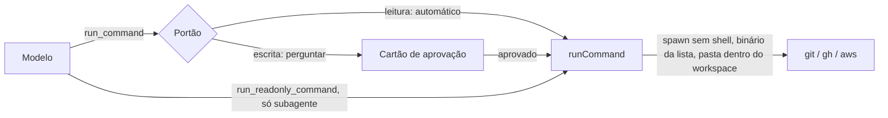
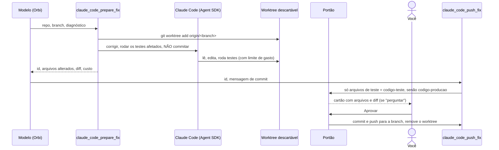

# 10. Terminal, investigação e correção de código

## Para que serve

As "mãos" do Orbi fora do navegador:

- **Terminal**: rodar `git`, `gh` (GitHub) e `aws` nos clones dos repositórios,
  por exemplo para disparar um workflow, ver um run, abrir um PR ou ler logs.
- **Investigação**: quando algo falha, um subagente lê logs, diffs e páginas e
  devolve só o diagnóstico.
- **Correção de código**: o Claude Code corrige o bug num lugar descartável; o
  commit e o push só acontecem depois, pelo portão de autonomia.

## Onde aparece

- Na conversa, como linhas de ferramenta ("Comando", "Python", "Subagente",
  "Claude Code: preparar correção") e, quando muda algo, como cartão de aprovação
  ("git push origin main", "Subir correção: corrige teste de data").
- Na correção, o cartão de aprovação mostra os arquivos e o diff antes do push.
- Na **tela Autonomia → Capacidades**: quais comandos foram achados no PATH e se
  a correção de código está ligada.

## Como funciona

### Terminal

- **Sem shell**: o comando é sempre binário + lista de argumentos, entregues
  direto ao sistema. Não há como encadear com `;`, `|` ou `$(...)`.
- **Lista de binários permitidos**: `git`, `gh`, `aws`, `python3`, `cp` e `mkdir`,
  a menos que você configure outros. Qualquer outro é recusado.
- **`saveTo`**: a saída inteira do comando vai para um arquivo (caminho absoluto,
  `~/…` ou relativo ao workspace) e o modelo recebe só o caminho, o número de linhas
  e as primeiras linhas. É como uma lista ou um JSON grande passa de um passo para
  outro sem o modelo copiar à mão. Grava um arquivo: conta como escrita (efeito
  "nesta máquina"); o subagente de leitura não pode usar.
- **`run_script`**: roda um script **do procedimento em andamento** pelo nome,
  com argumentos (documento 5). O código vem do cérebro (aprovado com o
  procedimento) e é gravado em `<scratch>/scripts/<procedimento>/<hash>-<nome>`;
  roda com `python3` no workspace, com o mesmo ambiente do `run_command` (para
  ler e gravar arquivos seus) e aceita `saveTo`. A impressão digital é
  `run_script <procedimento>/<nome>@<versão> <argumentos>`, com os parâmetros da
  execução no lugar dos valores: com outros dados é a mesma ação. Fora de um
  procedimento, ou com um script que ele não tem, é recusado sem pedir nada.
  Com **`show: true`**, o script imprime um componente (tabela, status, link ou
  código, em JSON): o runtime valida e mostra direto na conversa, e o modelo
  recebe só o resumo (`shown`, linhas). Saída que não é componente vira erro com
  o motivo.
- **`gh api -X GET`** é leitura mesmo com `-f`/`-F` (viram parâmetros da consulta).
- **`git -C pasta …`** é classificado pelo verbo que vem depois (`git -C x status`
  é leitura). Cada comando também tem um efeito (nesta máquina, publica, apaga),
  usado pelos níveis de autonomia (documento 3) e mostrado no cartão.
- **Só dentro do workspace**: a pasta onde o comando roda tem que estar dentro de
  `ORBI_WORKSPACE`, onde ficam os clones.
- **Ambiente controlado**: o comando não herda o ambiente inteiro do Orbi. Recebe
  só `PATH`, `HOME`, idioma e as credenciais de CLI do `.env` (`GH_TOKEN`,
  `AWS_PROFILE`, `AWS_REGION` e chaves da AWS), entregues explicitamente.
- **Leitura ou escrita**: decidido pelo verbo (documento 3).
- **Erros claros**: comando não encontrado vem com a dica de instalação; pasta
  inexistente diz qual pasta e aponta o `ORBI_WORKSPACE`.

### Scripts Python de investigação

`run_python` roda um script curto para analisar logs, comparar arquivos ou
calcular. Cada execução acontece numa **pasta vazia própria**, que também é o
`HOME` e o temporário do script, com o ambiente reduzido a `PATH` e idioma.
O script não enxerga tokens nem arquivos de credencial (`~/.aws`,
`~/.config/gh`), e a pasta é apagada no fim. Limite de 60 s. Não passa pelo
portão porque não tem como mudar nada fora da própria pasta.

### Investigador (subagente)

Quando um passo falha, o Orbi delega ao `investigador` com um briefing (repo,
branch, run, erro). O subagente roda em contexto próprio, só com ferramentas de
leitura (comandos de leitura, Python, cérebro, navegador em leitura), segue as
instruções de `prompts/investigador.md` e devolve: o que falhou, a causa
provável, a evidência, se já aconteceu antes e a correção sugerida. O log
inteiro fica com ele; a conversa principal recebe só o diagnóstico.

### Correção com Claude Code

- **Dois passos de propósito**: o portão precisa saber quais arquivos mudaram, e
  isso só existe depois que o Claude Code trabalhou.
- **Limites do Claude Code**: roda no worktree, pode ler, editar e rodar comandos,
  mas `git commit`, `git push`, `git reset` e acesso à web são proibidos. Há um
  teto de gasto por correção.
- **Teste × produção**: correção só em arquivos de teste é automática por padrão;
  em código de produção, pede aprovação sempre, mesmo dentro de um procedimento
  em "Automático".

## Peças

| Onde | O quê |
| --- | --- |
| `apps/runtime/src/terminal/exec.ts` | `runCommand`: sem shell, lista de binários, ambiente, erros |
| `apps/runtime/src/agents/tools/terminal.ts` | `run_command` (portão), `run_readonly_command`, `run_python` |
| `apps/runtime/src/agents/tools/scripts.ts` | `run_script` (portão): scripts do procedimento |
| `apps/runtime/src/subagents/investigador.ts` + `prompts/investigador.md` | O investigador |
| `apps/runtime/src/code/claude-code.ts` | Preparar (worktree + Agent SDK) e subir a correção |
| `apps/runtime/src/agents/tools/code.ts` | As duas ferramentas de correção |
| `apps/runtime/src/autonomy/policy.ts` | Leitura × escrita; teste × produção |

## Tecnologias

- **`node:child_process`** (`spawn` sem shell).
- **Subagentes do Flue** (`defineSubagent`).
- **Claude Agent SDK** (`@anthropic-ai/claude-agent-sdk`), o mesmo motor do Claude Code.
- **git worktree** para corrigir sem tocar no clone principal.

## Configuração

| Variável | Para quê |
| --- | --- |
| `ORBI_WORKSPACE` | Pasta dos clones (padrão `./workspace`; aceita `~`) |
| `ORBI_ALLOWED_BINARIES` | Binários permitidos, separados por vírgula |
| `GH_TOKEN`, `AWS_PROFILE`, `AWS_REGION`, `AWS_ACCESS_KEY_ID`, `AWS_SECRET_ACCESS_KEY`, `AWS_SESSION_TOKEN` | Credenciais entregues às CLIs |
| `ORBI_CODE_FIXER` | `claude-code` ou `off` (ligado por padrão só com a Anthropic) |
| `ORBI_CODE_MODEL` | Modelo do Claude Code |
| `ORBI_CODE_FIX_BUDGET_USD` | Teto de gasto por correção (padrão 0,50) |
| `ORBI_SCRATCH_DIR` | Onde ficam os worktrees e as pastas do Python |

## Limites conhecidos

- A correção de código precisa da API da Anthropic (ou de um gateway compatível
  com ela). Com o LLM da sua empresa por plugin, fica desligada (documento 12).
- O `run_python` isola o ambiente e a pasta, mas não é uma sandbox do sistema
  operacional: um script ainda poderia ler um caminho absoluto. Por isso só
  investigação de dados passados no próprio código.
- O `run_script` também não é sandbox: roda com o seu ambiente, como o
  `run_command`. A proteção é você ler e aprovar o código, e qualquer mudança
  nele pedir aprovação de novo.
- No app aberto pelo Finder, o PATH vem do seu shell de login (documento 14).

## Testes

- `apps/runtime/test/exec-errors.test.ts`: binário fora da lista, não encontrado
  (com dica), pasta inexistente.
- `apps/runtime/test/run-python.test.ts`: pasta própria, sem variáveis nem HOME
  do usuário, apagada no fim.
- `apps/runtime/test/units.test.ts`: classificação de comandos e de arquivos de teste.
