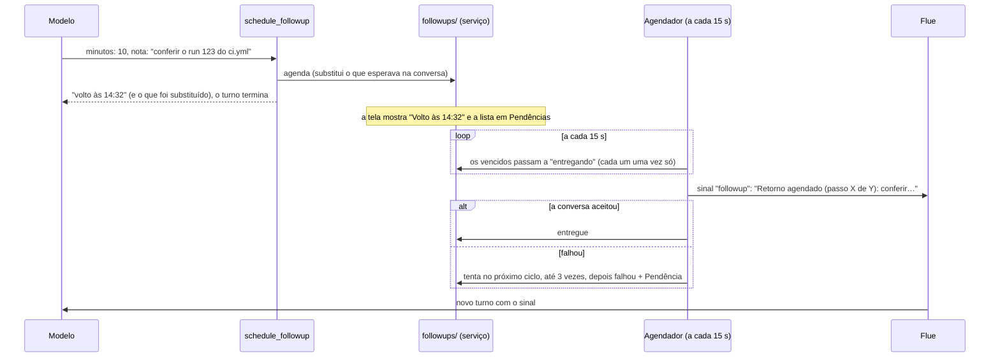

# 11. Retornos agendados

## Para que serve

Muita coisa depois do commit é esperar: um CI de 12 minutos, um deploy, a
aprovação de uma GMUD. O Orbi não fica consultando em loop (gastaria tokens e
travaria a conversa). Ele agenda um retorno, encerra o turno e é acordado na
hora marcada, na mesma conversa, para conferir e seguir.

## Onde aparece

- Na conversa, o Orbi diz algo como "o CI leva uns 10 minutos; volto às 14:32
  para conferir" e para. O horário vem da própria ferramenta, não do modelo.
- No cabeçalho da conversa, enquanto o retorno espera, a etiqueta diz **Volto às
  14:32** (em vez de "Pronto"); na hora da entrega, **Voltando agora…**.
- Em **Pendências**, a seção **Retornos agendados** lista todos os que esperam
  (quando, o que conferir), com **Abrir conversa** e **Cancelar**. Eles não contam
  como "esperando você".
- Na hora, aparece a marca **Retorno agendado** e ele continua de onde parou, por
  exemplo marcando o passo "esperando CI" como concluído e indo para o próximo.
- Se um retorno não consegue voltar à conversa depois de 3 tentativas, aparece em
  Pendências como **Não consegui voltar à conversa às 14:32**, em vez de sumir.

## Como funciona

O módulo `followups/` é o dono do retorno; a ferramenta, o prompt, a API, a tela e
a conferência do passo "esperando" leem dele.

- **Estados** (`followups/domain.ts`): `scheduled` (esperando) → `delivering`
  (venceu, a caminho) → `delivered` (a conversa aceitou). Entrega que falha volta a
  `scheduled` para o próximo ciclo; na 3ª falha, `failed` e uma Pendência
  (`kind: 'followup'`, só informa). `cancelled` pelo desenvolvedor, pelo Orbi
  (`cancel_followup`), por um novo retorno na mesma conversa ou ao apagar a
  conversa.
- **Um por conversa**: agendar de novo substitui o que esperava, e a resposta da
  ferramenta diz qual foi substituído.
- **O passo que ele acorda**: dentro de um procedimento, o retorno guarda a
  execução e o passo que estava rodando ou esperando; o sinal diz "Retorno
  agendado (passo esperar-task de atualizar-versao): …".
- **O Orbi não precisa lembrar**: a cada turno, o estado da conversa traz "Retorno
  agendado para 14:32: <nota>" ou "Não há retorno agendado nesta conversa", lido do
  banco (`agents/orbi.ts`). O prompt diz que é isso que vale, não a memória.
- **Entregue de verdade**: o agendador marca `delivered` só depois que a conversa
  aceitou a mensagem. Um ciclo não começa enquanto o anterior ainda entrega. Se o
  runtime parou no meio de uma entrega, o retorno volta para a fila ao abrir.
- **"Esperando" só com algo esperando**: o `playbook_step` com `waiting` é
  recusado quando não há aprovação, pergunta ou retorno agendado na conversa
  (`agents/tools/playbooks.ts`).
- **Durável**: tudo fica no banco. Se o computador estava desligado na hora, o
  retorno é entregue assim que o Orbi voltar.

## Peças

| Onde | O quê |
| --- | --- |
| `apps/runtime/src/followups/domain.ts` | Estados, tentativas, o horário em texto, a linha do estado da conversa, a mensagem da entrega |
| `apps/runtime/src/followups/repo.ts`, `service.ts` | A tabela e o serviço (um por conversa, cancelar, entregar, falhar) |
| `apps/runtime/src/followups/scheduler.ts` | O agendador: entrega com nova tentativa e a Pendência da falha |
| `apps/runtime/src/agents/tools/followups.ts` | `schedule_followup` e `cancel_followup` |
| `apps/runtime/src/http/routes/followups.ts` | `GET /api/followups`, `DELETE /api/followups/:id` |
| `apps/runtime/src/inbox/followup.ts` | A Pendência do retorno que falhou (só informa) |
| `apps/desktop/src/views/conversation/ScheduledFollowups.tsx`, `followups.ts` | A seção em Pendências e a etiqueta do cabeçalho |
| `apps/desktop/src/components/chat/Message.tsx` | A marca "Retorno agendado" |

## Tecnologias

- `setInterval` no runtime e uma tabela no SQLite; sem agendador externo.
- **Sinais do Flue** para entrar na conversa sem parecer uma mensagem sua.

## Dados

Tabela `followups` em `data/orbi.db` (estados, tentativas, execução e passo,
quem cancelou; ver `docs/banco.md`). Evento `followups` a cada mudança.

## Configuração

| Variável | Para quê |
| --- | --- |
| `ORBI_FOLLOWUP_INTERVAL_MS` | De quanto em quanto tempo o relógio confere (padrão 15000, mínimo 1000) |

## Limites conhecidos

- Só funciona com o Orbi aberto; com o app fechado, o retorno espera ele abrir.
- Um retorno por conversa: duas esperas paralelas na mesma conversa não cabem.

## Testes

- `apps/runtime/test/followups.test.ts`: um por conversa (substitui e diz qual),
  entregue só depois de aceito, cada um uma vez, 3 tentativas e a Pendência,
  recuperação ao reabrir, cancelar.
- `apps/runtime/test/flow-followups.test.ts`: o Orbi agenda, o turno seguinte traz
  "Retorno agendado para…", a API lista e cancela, e depois o estado diz "Não há".
- `apps/runtime/test/flow-learn-run.test.ts`: agendar encerra o turno.
- `apps/desktop/test/followups.test.ts`: a etiqueta do cabeçalho.
