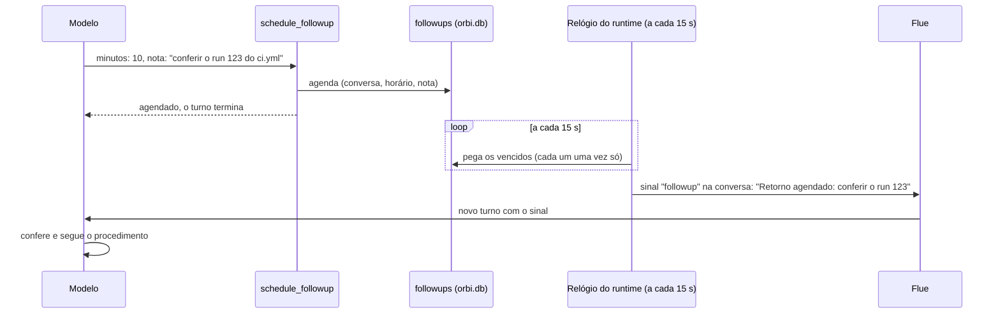

# 11. Retornos agendados

## Para que serve

Muita coisa depois do commit é esperar: um CI de 12 minutos, um deploy, a
aprovação de uma GMUD. O Orbi não fica consultando em loop (gastaria tokens e
travaria a conversa). Ele agenda um retorno, encerra o turno e é acordado na
hora marcada, na mesma conversa, para conferir e seguir.

## Onde aparece

- Na conversa, o Orbi diz algo como "o CI leva uns 10 minutos; volto às 14:32
  para conferir" e para.
- Na hora, aparece a marca **Retorno agendado** e ele continua de onde parou, por
  exemplo marcando o passo "esperando CI" como concluído e indo para o próximo.
- Se você estiver em outra conversa, ela sobe na lista; ao abrir, as mensagens novas estão lá.

## Como funciona

- **Agendar** (`schedule_followup`): de 1 minuto a 24 horas, com uma nota do que
  conferir. A ferramenta encerra o turno.
- **Acordar** (`startFollowups` em `compose.ts`): a cada 15 segundos, o runtime
  pega os retornos vencidos. Cada um é marcado como disparado antes de ser
  entregue, então nunca dispara duas vezes, mesmo com o runtime reiniciando no meio.
- **Entregar**: por `tellAgent`, como um sinal do tipo `followup` na conversa
  certa. O modelo recebe "Retorno agendado: <nota>" e as instruções dizem para conferir e seguir.
- **Durável**: o agendamento fica no banco. Se o computador estava desligado na
  hora, o retorno dispara assim que o Orbi voltar.

## Peças

| Onde | O quê |
| --- | --- |
| `apps/runtime/src/agents/tools/clock.ts` | `schedule_followup` |
| `apps/runtime/src/brain/repo/followups.ts` | Agendar e pegar os vencidos uma vez só |
| `apps/runtime/src/compose.ts` | `startFollowups`: o relógio |
| `apps/runtime/src/conversations/tell.ts` | Entrega na conversa e avisa o app |
| `apps/desktop/src/views/conversation/Message.tsx` | A marca "Retorno agendado" |

## Tecnologias

- `setInterval` no runtime e uma tabela no SQLite; sem agendador externo.
- **Sinais do Flue** para entrar na conversa sem parecer uma mensagem sua.

## Dados

Tabela `followups` em `data/orbi.db`: conversa, horário, nota, estado
(`scheduled` ou `fired`).

## Configuração

| Variável | Para quê |
| --- | --- |
| `ORBI_FOLLOWUP_INTERVAL_MS` | De quanto em quanto tempo o relógio confere (padrão 15000, mínimo 1000) |

## Limites conhecidos

- Só funciona com o Orbi aberto; com o app fechado, o retorno espera ele abrir.
- Não há tela que liste os retornos agendados nem como cancelar um.

## Testes

- `apps/runtime/test/flow-*.test.ts`: o Orbi agenda, encerra o turno, e cada retorno vencido é pego uma vez só.
