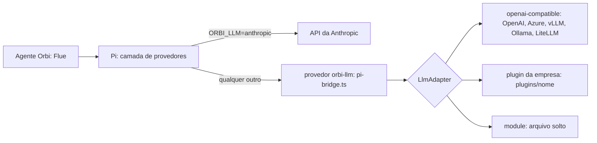
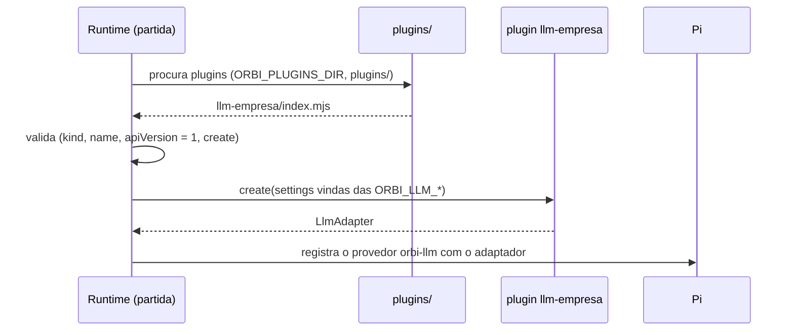

# 12. Modelo de linguagem e plugins

## Para que serve

O Orbi pensa com um modelo de linguagem. Por padrão é o Claude, pela API da
Anthropic. Mas o Orbi pode rodar onde só existe o LLM da empresa, por uma API ou
SDK próprios. Por isso ele fala com o modelo por uma interface própria, o
**adaptador**, e o resto (agente, ferramentas, aprovações, procedimentos) não muda.

## Onde aparece

- Em tudo: cada resposta do Orbi passa pelo modelo.
- **Na primeira abertura** (ou quando o modelo não está pronto): a tela **Com qual
  modelo o Orbi vai pensar?** vem antes de tudo. Os plugins achados aparecem
  primeiro e já escolhidos; depois Claude (chave da Anthropic) e um servidor
  compatível com OpenAI. Testar, depois Usar. "Configurar depois" deixa um aviso
  no topo de todas as telas até o modelo estar pronto.
- **Tela Configurações → Modelo**: o modelo em uso, Testar, Trocar o modelo (as
  mesmas opções) e os plugins desta máquina, com Procurar de novo.
- **Tela Configurações → Capacidades**: o provedor ativo, os plugins encontrados
  (e o erro, se algum não carregou) e se a correção de código está ligada.
- **Painel "Uso do modelo"** (documento 13): tokens e custo por conversa.
- **Embaixo da caixa de mensagem** de cada conversa: o modelo com que ela pensa.
  Começa no padrão; a lista é a do provedor em uso (os modelos do plugin, ou os do
  Claude), agrupada por custo: Barato, Intermediário, Caro e Sem categoria. A escolha
  vale para conversar e executar naquela conversa, a partir da próxima mensagem (`PUT
  /api/conversations/:id/model`, coluna `conversations.model`); o subagente da conversa
  usa o mesmo. Se o provedor mudar e não oferecer mais o modelo escolhido, a conversa
  volta ao padrão.
- **Configurações → Modelo → Modelo por tipo de trabalho**: quatro papéis, cada um com o seu
  modelo (`settings`, chave `model-roles`; `GET`/`PUT /api/model/roles`; `llm/roles.ts`).
  O runtime decide o papel de cada turno (`turnRole`), sem você trocar nada:
  - **Conversa**: perguntas e pedidos.
  - **Executar procedimento**: com uma execução aberta.
  - **Aprender e corrigir**: com um ensaio aberto, ou quando a revisão do fim da execução
    pede uma mudança. Aqui vale um modelo melhor; a escolha da conversa **não** se aplica.
    O Orbi ativa a skill `corrigir-procedimento` (só os passos indicados mudam, só
    ferramentas que existem nesta máquina, um único `brain_learn`).
  - **Revisor de conhecimento**: o agente que lê o que a execução leu (documento 19).
  Sem escolha, os três primeiros usam o padrão e o revisor o primeiro modelo barato. Um
  modelo que o provedor não oferece mais volta ao padrão.
- **Configurações → Modelo → Custo dos modelos**: a categoria de cada modelo. Vem, nesta
  ordem, do que você classificou (guardado em `settings`, chave `model-tiers`), do que o
  plugin informa (`tier` em cada modelo) ou da família conhecida do Claude (Haiku barato,
  Sonnet intermediário, Opus caro). Modelo da empresa sem `tier` aparece sem categoria
  até você classificar: o Orbi não adivinha pelo nome.

## Como funciona



- O Flue usa o **Pi** para falar com provedores. Com a Anthropic, o Pi fala
  direto com a API.
- Para qualquer outro, o Orbi registra no Pi um provedor chamado `orbi-llm`
  (`llm/pi-bridge.ts`), que traduz nos dois sentidos: a conversa do Pi (mensagens,
  ferramentas, resultados) vira uma `ChatRequest` simples; a resposta do adaptador
  (texto, chamadas de ferramenta, uso de tokens) vira os eventos que o Pi espera.
- O adaptador só precisa de uma função `chat(request)`, que devolve o resultado
  inteiro ou aos pedaços:

```ts
interface LlmAdapter {
  name: string;
  models: LlmModelInfo[];
  chat(request: ChatRequest, signal: AbortSignal): Promise<ChatResult> | AsyncIterable<ChatEvent>;
}
```

O contrato completo está em `packages/plugin-sdk/src/llm.ts`.

## Escolher o modelo

Pelo app (o caminho normal):

- **Plugin**: a tela pede só o modelo (da lista do plugin). O acesso, como chave
  ou senha, vem na implementação do plugin; se faltar algo, o teste diz o quê.
- **Claude**: a chave da Anthropic. O teste confere listando os modelos
  (`GET /v1/models`), sem gastar.
- **Servidor compatível com OpenAI**: endereço, chave e modelo.
- **Testar** não salva nada. **Usar** testa de novo e, só se funcionar, grava a
  escolha no `.env` da pasta de dados (no app instalado, `%APPDATA%\br.com.zup.orbi\.env`;
  a chave também, e só ali), põe no ambiente do runtime e registra o modelo na
  hora, sem reiniciar (`llm/setup.ts`, `applyModel`). A chave nunca volta para a
  tela, nem vai ao modelo, à conversa ou aos logs.
- Um plugin que não carrega na partida não derruba mais o runtime: o app abre e
  pede para escolher, mostrando o erro.

Ou no `.env` do runtime, à mão:

| `ORBI_LLM` | Quando usar | Outras variáveis |
| --- | --- | --- |
| `anthropic` (padrão) | API da Anthropic | `ANTHROPIC_API_KEY`, `ORBI_MODEL` |
| `openai-compatible` | Qualquer endpoint `/chat/completions`: OpenAI, Azure OpenAI, vLLM, Ollama, LiteLLM e a maioria dos gateways | `ORBI_LLM_BASE_URL`, `ORBI_LLM_MODEL`, `ORBI_LLM_API_KEY`, `ORBI_LLM_HEADERS` (JSON) |
| `<nome de um plugin>` | O LLM da sua empresa, por API ou SDK próprios | as `ORBI_LLM_*` que o plugin usar |
| `module:<arquivo>` | Um adaptador num arquivo solto (forma antiga; prefira plugin) | as que ele usar |

Opcionais do `openai-compatible`: `ORBI_LLM_CONTEXT_WINDOW` (padrão 128000),
`ORBI_LLM_MAX_TOKENS` (8192), `ORBI_LLM_TIMEOUT_MS` (120000).

## Plugins

Cada modelo do adaptador pode dizer o custo, para a escolha na conversa:
`models: [{ id: 'yara-mini', tier: 'cheap' }, { id: 'yara-pro', tier: 'premium' }]`
(`cheap` barato, `standard` intermediário, `premium` caro). É opcional e não muda a
versão do contrato.

Um plugin é uma pasta em `plugins/<nome>` (no app instalado, na pasta de dados;
documento 14) com um `index.mjs` que exporta:

```js
export default {
  kind: 'llm',
  name: 'llm-empresa',
  apiVersion: 1,
  description: 'LLM interno da Empresa',
  create(settings) { return { name: 'llm-empresa', models: [...], async chat(request, signal) { ... } } },
};
```



- `npm run plugin:new -- <nome>` cria a pasta a partir do modelo.
- `npm run plugin:test -- <nome>` confere o plugin sem o resto do Orbi: texto
  simples, chamada de ferramenta (somar 17 + 25) e resposta depois do resultado.
- O passo a passo de escrever um plugin está em [../plugins.md](../plugins.md).
- O pacote `@orbi/plugin-sdk` tem só os tipos e o número da versão do contrato
  (`PLUGIN_API_VERSION = 1`). Um plugin de versão diferente aparece com erro na
  tela Capacidades, em vez de quebrar o Orbi.

## Peças

| Onde | O quê |
| --- | --- |
| `packages/plugin-sdk/` | Contrato do adaptador e do plugin, e o modelo de plugin |
| `apps/runtime/src/llm/index.ts` | Escolhe o provedor (`configureLlm`) e monta as configurações |
| `apps/runtime/src/llm/pi-bridge.ts` | Tradução entre o Pi e o adaptador |
| `apps/runtime/src/llm/adapters/openai-compatible.ts` | Adaptador para `/chat/completions` |
| `apps/runtime/src/llm/plugins.ts` | Achar, validar e descrever plugins |
| `apps/runtime/src/llm/setup.ts` + `http/routes/model.ts` | Opções desta máquina, teste, escolher e aplicar sem reiniciar (`/api/model`) |
| `apps/desktop/src/views/setup/` | A tela da primeira abertura e o formulário comum (`ModelChoice`) |
| `apps/desktop/src/views/autonomy/ModelPage.tsx` | Configurações → Modelo |
| `apps/runtime/src/llm/plugin-check.ts` + `apps/runtime/scripts/plugin-test.ts` | O teste de plugin |
| `scripts/plugin-new.mjs` | Cria um plugin a partir do modelo |

## Tecnologias

- **Pi** (`@earendil-works/pi-ai`, fixado na 1.1.0 junto com o
  `pi-agent-core`: o Flue 2.3 quebra com o Pi 1.2+).
- **Flue** (`useModel`).
- Plugins como **módulos ES** carregados com `import()`, sem compilar.

## O que muda fora da Anthropic

- **A correção de código não depende do modelo**: ela usa o agente de código
  instalado na máquina (documento 17), com qualquer modelo.
- **O raciocínio estendido ("thinking") não é usado**; o adaptador recebe só o texto.
- **Imagens viram o texto `[imagem]`.**
- **Custo**: o painel de uso mostra tokens e custo se o adaptador informar o uso;
  senão aparecem zerados.
- **Transcrição é independente** (documento 6).

## Configuração

Além da tabela acima: `ORBI_PLUGINS_DIR` (onde procurar plugins) e
`ANTHROPIC_API_KEY` com a Anthropic. A tela Capacidades mostra o provedor ativo,
e o log da partida registra `runtime iniciado` com o modelo e o adaptador.

## Testes

- `apps/runtime/test/model-setup.test.ts`: opções (plugin primeiro, sem chave),
  teste da chave e do plugin com as mensagens de erro, e escolher só salva e vale
  quando o teste passa.
- `apps/desktop/test/modelSetup.test.ts` (regras de `views/setup/choice.ts`): qual opção vem escolhida, o que vai ao runtime.
- `apps/runtime/test/llm-adapter.test.ts`: o agente inteiro sobre um adaptador
  escrito no próprio teste.
- `apps/runtime/test/llm-openai-compatible.test.ts`: o mesmo contra um servidor
  que imita `/v1/chat/completions`.
- `apps/runtime/test/plugins.test.ts`: achar, validar e carregar plugins.
- `apps/runtime/test/model-roles.test.ts`: o modelo de cada papel, o papel de cada turno, a
  escolha da conversa que não vale para aprender, e o passo com programa fora da lista recusado.
