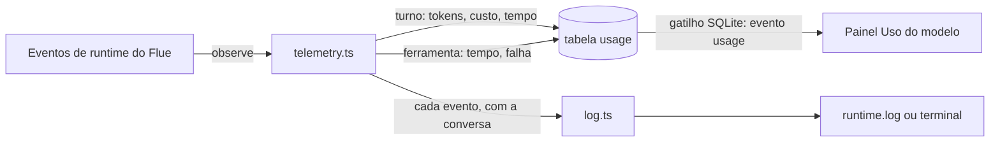

# 13. Uso e logs

## Para que serve

Responder duas perguntas sem adivinhar:

- **Quanto o Orbi está gastando, e onde?** Tokens, custo estimado, tempo de
  resposta e falhas, por conversa e por dia.
- **O que aconteceu?** Quando algo dá errado, um log com cada evento e a conversa
  a que pertence.

## Onde aparece

- **Tela Autonomia → Uso do modelo**: hoje, o período (7, 30 ou 90 dias) e uma
  tabela por conversa (turnos, tokens de entrada e saída, custo, resposta média,
  ferramentas e falhas). Atualiza sozinha a cada chamada ao modelo.
- **Log do runtime**: no terminal durante o desenvolvimento; no app instalado, em
  `logs/runtime.log` dentro da pasta de dados (documento 14).

## Como funciona



### Uso

- O Flue publica um evento por **turno do modelo** (provedor, modelo, duração,
  tokens, custo estimado pela tabela de preços do modelo, erro) e por **chamada de
  ferramenta** (nome, duração, erro). `telemetry.ts` assina esses eventos com
  `observe()`.
- Cada evento soma na tabela `usage`, uma linha por conversa e por dia. A conversa
  é a instância do agente (`chat:…`), então o trabalho do subagente `investigador`
  conta na conversa que o chamou.
- `GET /api/usage?days=30` devolve hoje, o período e cada conversa, a mais cara
  primeiro. O painel recarrega quando chega o evento `usage`.

### Logs

Todo log passa por `observability/log.ts`: uma linha por evento, com atributos
em vez de texto montado.

```
14:31:02 INFO  turno do modelo  conversation=chat:01J… model=anthropic/claude-haiku-5-5 ms=812 tokensIn=3593 tokensOut=210 costUsd=0.0042
14:31:05 WARN  ferramenta falhou  conversation=chat:01J… tool=run_command ms=95 error="gh: não encontrado"
```

- **Formato**: legível no terminal; JSON, uma linha por evento, no app instalado.
  Em JSON dá para filtrar com `jq`:

  ```bash
  jq -c 'select(.conversation == "chat:01J…")' ~/Library/Application\ Support/br.com.zup.orbi/logs/runtime.log
  ```

- **O que é registrado**: partida (modelo, adaptador, workspace, plugins,
  comandos que faltam no PATH), cada turno do modelo, cada falha de ferramenta,
  execuções que falharam ou foram interrompidas, erros nas rotas HTTP, a ponte do
  Chrome e os retornos agendados. Ferramentas que deram certo só aparecem no nível `debug`.
- **Segredos**: valores do cofre não chegam aos logs; as ferramentas devolvem a
  saída já sem eles (documento 9).

## Peças

| Onde | O quê |
| --- | --- |
| `apps/runtime/src/observability/log.ts` | Logger estruturado (json ou pretty, nível, `with()`) |
| `apps/runtime/src/observability/telemetry.ts` | Assina os eventos do Flue: uso e logs |
| `apps/runtime/src/observability/usage.ts` | Soma por conversa e dia; relatório |
| `apps/runtime/src/http/routes/usage.ts` | `GET /api/usage` |
| `apps/desktop/src/views/autonomy/Usage.tsx`, `format.ts` | O painel e a formatação (US$, tokens, tempo) |

## Tecnologias

- **Observabilidade do Flue** (`observe`, eventos `turn`, `tool`, `submission_settled`, `log`).
- **SQLite** para o uso; gatilho que vira o evento `usage`.

## Dados

Tabela `usage` em `data/orbi.db`: conversa, dia, modelo, turnos, falhas, tokens
(entrada, saída, cache), custo, tempo do modelo, chamadas e falhas de ferramenta.

## Configuração

| Variável | Para quê |
| --- | --- |
| `ORBI_LOG_FORMAT` | `json` ou `pretty` (padrão: pretty no terminal, json no app) |
| `ORBI_LOG_LEVEL` | `debug`, `info` (padrão), `warn`, `error` |

## Limites conhecidos

- O custo é uma estimativa pela tabela de preços do modelo, não a fatura.
- Com um adaptador que não informa uso, tokens e custo aparecem zerados.
- O `runtime.log` não é rotacionado: cresce até ser apagado.

## Testes

- `apps/runtime/test/observability.test.ts`: formato dos logs, turnos e
  ferramentas somados por conversa, relatório por período, evento `usage`.
- `apps/desktop/test/format.test.ts`: formatação de dólares, tokens e tempo.
