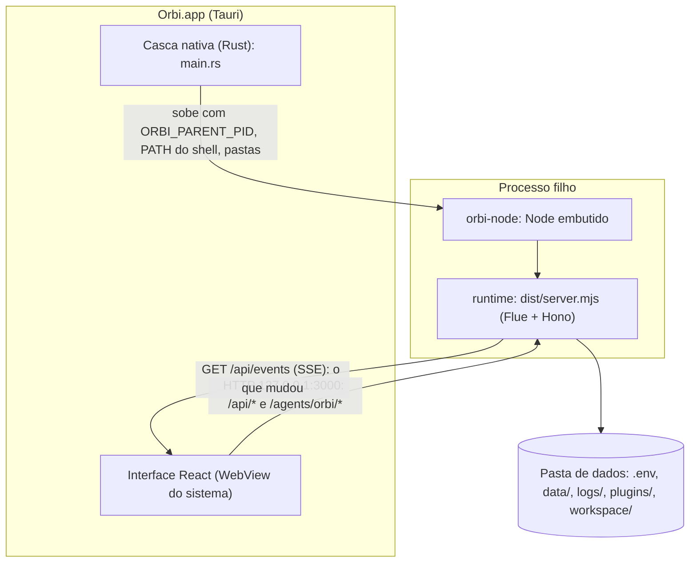

# 14. App desktop e empacotamento

## Para que serve

O Orbi é um programa local: a janela que você usa e um processo em segundo plano
(o runtime) que faz o trabalho. O app junta os dois. Abrir a janela sobe o
runtime; fechar a janela para o runtime. O instalador leva tudo, inclusive o
Node, sem depender do que está instalado na máquina.

## Onde aparece

- **A janela do Orbi**, com as telas Conversa, Cérebro e Autonomia na barra lateral.
- **Os dois pontos no pé da barra lateral**: o primeiro diz se o runtime está de
  pé (passe o mouse para ver o modelo); o segundo, se o navegador está conectado.
- **Faixa vermelha no topo** quando o runtime não responde, com o caminho do log.

## Como funciona

### A casca (Tauri)

`apps/desktop/src-tauri/src/main.rs`, ao abrir:

1. Se algo já responde em `127.0.0.1:3000` (por exemplo `npm run demo`), usa esse runtime.
2. Senão, sobe o runtime como processo filho:
   - **app instalado**: o runtime está dentro do pacote (`Resources/runtime`) e o
     Node ao lado do executável (`orbi-node`). Os dados ficam na pasta de dados do
     usuário: `~/Library/Application Support/br.com.zup.orbi` no macOS, a pasta
     equivalente em `AppData` no Windows. Na primeira vez ela cria `data/`,
     `logs/`, `plugins/` e um `.env` a partir do `.env.example`;
   - **desenvolvimento**: usa `apps/runtime` deste repositório e o `node` do PATH.
3. Passa ao runtime o PID da janela (`ORBI_PARENT_PID`). O runtime confere a
   cada 2 s e se encerra se a janela sumiu, mesmo que ela tenha sido morta sem
   chance de avisar.
4. No macOS, apps abertos pelo Finder recebem um PATH mínimo; a casca pergunta ao
   seu shell de login o PATH completo, para achar `git`, `gh` e `aws` do Homebrew.
5. A saída do runtime vai para `logs/runtime.log`.

### Interface e runtime conversam por HTTP local

- **Comandos e leituras**: `apps/desktop/src/api.ts` chama `/api/*`. Os formatos
  de pedido e resposta vêm de `@orbi/contracts`, o mesmo pacote que o runtime usa
  para validar. Erros chegam sempre como `{ error: { code, message } }` e o app
  mostra a mensagem.
- **Conversa**: `/agents/orbi/<id>`, pelo cliente React do Flue (documento 1).
- **Atualização sem consultar o tempo todo**: o runtime mantém um stream
  (`GET /api/events`) que diz **o que** mudou (pendências, conversas, cérebro,
  execuções, autonomia, cofre, gravação, uso). Cada tela escuta só os tópicos que
  mostra e busca de novo. Gatilhos do SQLite transformam qualquer escrita em
  evento, sem as partes do código precisarem avisar. A cada reconexão chega um
  `hello` e tudo recarrega. A única consulta periódica é a de saúde, a cada 10 s.
- **Só local**: o runtime escuta apenas em `127.0.0.1`, então outra máquina na
  mesma rede não chega nele (`apps/runtime/scripts/write-entry.mjs` troca a entrada gerada pelo
  Flue, que escutaria em todas as interfaces). Navegadores só são aceitos de
  origens locais (CORS), e dá para exigir um token em toda rota (`ORBI_API_TOKEN`).

### Empacotamento

`npm run build` na raiz (`scripts/build-app.mjs`):

1. compila o runtime (o contrato entra no bundle);
2. instala só as dependências de produção, nas versões exatas do `package-lock.json`;
3. remove binários de outras plataformas (Claude Code nativo, onnxruntime);
4. copia o Node que está rodando o build como `orbi-node`;
5. roda `tauri build`, que gera o `.app`/`.dmg` (macOS), `.msi`/`.exe` (Windows)
   ou `.deb`/`.AppImage` (Linux).

O instalador precisa ser gerado **na plataforma de destino**, porque as
dependências nativas são da máquina que roda o build. Detalhes de tamanho e
assinatura: [../empacotamento.md](../empacotamento.md).

## Peças

| Onde | O quê |
| --- | --- |
| `apps/desktop/src-tauri/src/main.rs` | Casca: sobe e para o runtime, pastas, PATH, log |
| `apps/desktop/src-tauri/tauri.conf.json`, `tauri.bundle.conf.json` | Configuração do app e do pacote |
| `apps/desktop/src-tauri/Info.plist`, `Entitlements.plist` | Permissão de microfone no macOS |
| `apps/desktop/src/App.tsx` | Barra lateral, telas, pendências, saúde |
| `apps/desktop/src/api.ts`, `live.ts`, `hooks.ts` | Cliente da API, feed de eventos, `useLive` |
| `apps/runtime/src/http/` | A API: rotas por recurso, erros, eventos |
| `apps/runtime/src/compose.ts` | `startBackground`: vigia do processo pai, relógio, ponte do Chrome |
| `scripts/build-app.mjs`, `scripts/start.mjs`, `scripts/dev.mjs` | Build, `npm start`, `npm run dev` |
| `apps/runtime/scripts/write-entry.mjs` | Entrada do servidor presa a `127.0.0.1` |

## Tecnologias

- **Tauri 2** (Rust) com a WebView do sistema: app pequeno, sem embutir um Chromium.
- **React 19** e **Vite** na interface.
- **Hono** no runtime para a API; **server-sent events** para o feed.
- **Node ≥ 22.13** embutido como sidecar (`externalBin` do Tauri).

## Configuração

| Variável | Para quê |
| --- | --- |
| `ORBI_DATA_DIR`, `ORBI_WORKSPACE`, `ORBI_PLUGINS_DIR`, `ORBI_FLUE_DB` | Definidas pela casca no app instalado |
| `ORBI_API_TOKEN` | Exigir um token em toda rota da API |
| `ORBI_HOST` | Endereço onde o runtime escuta (padrão `127.0.0.1`; só mude num contêiner) |
| `PORT` | Porta do runtime (padrão 3000; a janela procura na 3000) |
| `ORBI_PARENT_PID` | Definida pela casca; o runtime se encerra quando a janela some |

## Comandos

| Comando | O quê |
| --- | --- |
| `npm start` | Compila e sobe o runtime e a interface no navegador |
| `npm run dev` | O app desktop em desenvolvimento (precisa de Rust/cargo) |
| `npm run demo` | Runtime com modelo roteirizado e exemplos, sem chave de API |
| `npm run build` | Gera o instalador da plataforma atual |
| `npm test`, `npm run e2e` | Testes e testes de ponta a ponta |

## Limites conhecidos

- O app ocupa uns 750 MB instalado, a maior parte do Claude Code nativo e do
  onnxruntime (veja como reduzir em [../empacotamento.md](../empacotamento.md)).
- Para distribuir no macOS sem o aviso do Gatekeeper, é preciso assinar e
  notarizar com um Developer ID da Apple.
- O empacotamento e o microfone no Windows ainda não foram testados.

## Testes

- `apps/runtime/test/compose.test.ts`: montagem das peças e configuração inválida.
- `apps/runtime/test/http.test.ts`, `events.test.ts`: API, erros e o feed de eventos.
- `apps/desktop/test/live.test.ts`: o cliente do feed.
- O pacote `.deb` foi instalado e aberto numa máquina sem Node; o `.app` do macOS
  é gerado no próprio Mac.
