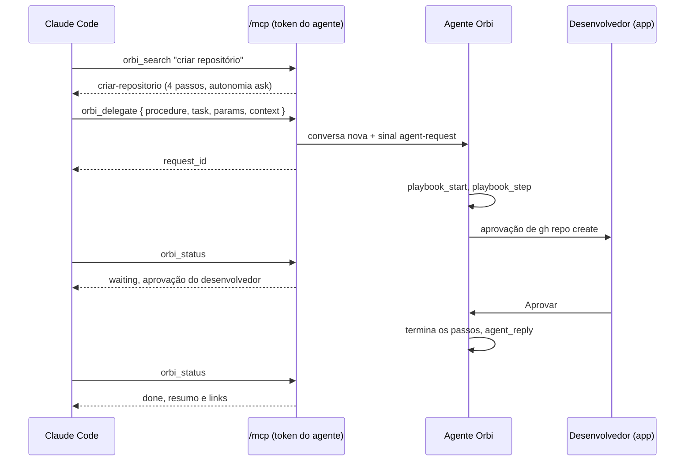

# 15. Agentes de código (o Orbi como servidor MCP)

## Para que serve

Agentes de código rodando nesta máquina, como o Claude Code ou o Cursor, podem
usar o Orbi pelo MCP. Eles:

1. **procuram** o que o Orbi sabe fazer (`orbi_search`) e leem um procedimento
   (`orbi_procedure`), só quando precisam (divulgação aos poucos);
2. **delegam** o trabalho repetitivo que ele já sabe (`orbi_delegate`) e consultam
   o andamento (`orbi_status`);
3. **sugerem** o que ele deveria aprender (`orbi_teach`). A sugestão só vira
   procedimento depois que o desenvolvedor revisa;
4. **veem e rodam esteiras** (documento 16): listam (`orbi_pipelines`), leem
   (`orbi_pipeline`: entradas, etapas, ramos, o que cada etapa recebe e entrega,
   quais passagens esperam o desenvolvedor) e rodam com as entradas e um destino
   (`orbi_run_pipeline`), se o desenvolvedor ligou **rodar esteiras**.

O desenvolvedor continua no controle: a autonomia vale igual, o agente nunca
aprova nada, nunca vê credenciais e nunca grava direto no cérebro.

## Onde aparece

- **Configurações › Servidor MCP** (grupo Conexões; era a tela Agentes da barra lateral, documento 20):
  - **Pedidos**: cada tarefa delegada, quem pediu, de qual repositório e branch,
    o estado (rodando, esperando você, concluído, falhou) e **Abrir conversa**.
  - **Conexões**: conectar um agente (nome, **Gerar token**, comando pronto para o
    Claude Code ou JSON para o Cursor, trecho para o `CLAUDE.md`), a lista dos
    conectados com as permissões **pedir**, **sugerir**, **rodar esteiras** e
    **pular perguntas** (as duas últimas começam desligadas), quando foram vistos pela
    última vez e **Revogar**. Os MCPs que o Orbi usa ficam em **Configurações › Ferramentas (MCP)** (documento 20).
- **Cérebro › Sugestões** (o selo do Cérebro conta as abertas): procedimentos sugeridos,
  quantas vezes e por quais agentes, se parecem com algo que o Orbi já sabe. **Aceitar**,
  **Aceitar como variação de…** ou **Rejeitar**. O aceito entra com autonomia "perguntar".
- **Tela Conversa**: cada pedido vira uma conversa marcada "pedido por …", com
  filtro **Todas / Minhas / Dos agentes**, uma faixa com a origem (agente,
  repositório, branch, sessão, procedimento) e o pedido como primeiro cartão.
  Aprovações vão para **Pendências**, como sempre.

## Como funciona



- **Servidor**: `POST /mcp` no mesmo runtime, em 127.0.0.1, MCP por HTTP
  (streamable) **sem sessão**: cada chamada cria servidor e transporte e devolve
  JSON. Não há fluxo SSE aberto (`GET` responde 405).
- **Autenticação**: um token por agente (`orb_…`), gerado na tela e mostrado uma
  vez só. O banco guarda só o hash (SHA-256). Revogar corta na hora. O `Host`
  precisa ser 127.0.0.1 ou localhost (contra DNS rebinding). O `ORBI_API_TOKEN` do
  app não vale para o `/mcp`, e o token de agente não vale para a API do app.
- **Permissões**: buscar e ler (procedimentos e esteiras) sempre; **pedir** libera
  `orbi_delegate` e `orbi_status`; **sugerir** libera `orbi_teach`; **rodar
  esteiras** libera `orbi_run_pipeline` (e `orbi_status`). **Pular perguntas** faz
  o destino do agente valer também para as passagens que perguntam; sem ela, essas
  passagens esperam o desenvolvedor mesmo com destino. O agente só vê as
  ferramentas que pode usar.
- **Esteira pedida por agente**: `orbi_run_pipeline` valida entradas e destino na
  hora (erro sem criar conversa), cria a conversa, o pedido (`agent_requests.pipeline`)
  e a entrega com `requestedBy: "agent:<nome>"`, e manda o sinal `pipeline`. No fim
  (ou se o desenvolvedor encerrar), o motor pede ao Orbi o `agent_reply`.
- **Pedido**: vira uma conversa (`chat:…`) e um registro em `agent_requests`. O
  Orbi recebe um sinal `agent-request` com tarefa, procedimento, parâmetros e
  contexto. O prompt (`prompts/orbi/agentes.md`, incluído só quando a conversa tem um pedido de agente) diz que o
  texto do pedido é um pedido, não uma regra; se nenhum procedimento cobre, ele não
  improvisa e responde que ainda não sabe. Nessas conversas existe a ferramenta
  `agent_reply`, com a qual o Orbi entrega o resultado curto (resumo e links).
- **Falha que é do agente**: quando o que quebrou é código (teste, cobertura,
  compilação), o Orbi não muda o código. O `agent_reply` sai como `failed` com o
  diagnóstico de que o agente precisa para agir (o que quebrou, onde, valor e
  limite) e que ele pode delegar de novo depois. Se o problema já é conhecido no
  cérebro, a solução registrada vem junto (documento 4).
- **Estado** (`mcp/status.ts`): concluído ou falhou vem do `agent_reply`;
  "esperando" quando a conversa tem pendência aberta (aprovação ou pergunta);
  senão "rodando", com o passo atual da execução. Numa esteira, vem também
  `pipeline`: a etapa ("2 de 4 · Homologação"), o estado de cada etapa, os dados
  entregues até ali (`dev.versao`…) e o destino. Encerrada pelo desenvolvedor, fica
  "failed".
- **Sugestão**: o nome vira kebab-case, os passos ganham `id`, e a busca aponta
  procedimentos parecidos (`similar_to`). A mesma sugestão aberta, enviada de novo,
  conta mais uma vez em vez de duplicar. Aceitar grava pelo mesmo `savePlaybook`
  (mesma validação), com `autonomy: "ask"` e `learnedFrom: "agente: …"`; um nome que
  já existe só pode ser rejeitado.
- **Busca para agentes**: igual à do Orbi (documento 8), mas uma palavra solta em
  comum num pedido longo não conta: precisa de duas em comum (ou uma, se o pedido
  só tem uma).

## Peças

| Onde | O quê |
| --- | --- |
| `apps/runtime/src/mcp/server.ts` | Servidor MCP sem sessão, por chamada |
| `apps/runtime/src/mcp/tools.ts` | As oito ferramentas, esquemas e permissões |
| `apps/runtime/src/mcp/pipelines.ts` | Busca, resumo e detalhe das esteiras para agentes |
| `apps/runtime/src/mcp/status.ts` | O que `orbi_status` responde |
| `apps/runtime/src/mcp/{clients,requests,suggestions}.ts` | Agentes, pedidos e sugestões no banco |
| `apps/runtime/src/prompts/mcp-servidor.md` | Instruções que o agente recebe ao conectar |
| `apps/runtime/src/agents/tools/requests.ts` | `agent_reply`, só nas conversas pedidas por agente |
| `apps/runtime/src/http/routes/{mcp,agents}.ts` | `/mcp` e `/api/agents/...` |
| `apps/desktop/src/views/autonomy/agents/` | Configurações › Servidor MCP (pedidos, conexões) |
| `apps/desktop/src/views/brain/Suggestions.tsx` | Cérebro › Sugestões |
| `apps/desktop/src/views/conversation/OriginBanner.tsx` | Faixa de origem na conversa |

## Tecnologias

- **`@modelcontextprotocol/sdk`**: `Server` de baixo nível e
  `WebStandardStreamableHTTPServerTransport`, montado no Hono.
- **valibot** valida os argumentos; o esquema JSON que o agente lê fica ao lado.

## O que fica guardado

Migração 8: `agent_clients` (nome, hash do token, permissões, visto por último,
revogado), `agent_requests` (agente, conversa, tarefa, procedimento, contexto,
estado, resumo, links) e `agent_suggestions` (procedimento sugerido, agentes,
contagem, parecidos, estado). As três geram o evento `agents`. Migração 12:
`can_run_pipelines` e `can_skip_passages` (desligadas por padrão) e
`agent_requests.pipeline`.

## Configuração

Em **Configurações › Servidor MCP › Conexões**. Para o Claude Code:

```bash
claude mcp add --scope user --transport http orbi http://127.0.0.1:3000/mcp --header "Authorization: Bearer orb_…"
```

`PORT` muda a porta do runtime e, com ela, o endereço do `/mcp`.

## Limites conhecidos

- O Orbi não avisa o agente quando termina: o agente consulta `orbi_status`.
- Não há cancelamento pelo MCP; cancele na conversa.
- Cadastrar outros MCPs para o Orbi usar (Jira, ServiceNow…) é a próxima etapa.

## Testes

- `apps/runtime/test/mcp.test.ts`: tokens, revogação, Host, separação do token do
  app, permissões, busca, leitura, sugestão repetida, aceitar como variação, conflito
  de nome, estado; esteiras: listar, detalhar, permissões e entradas inválidas.
- `apps/runtime/test/flow-*.test.ts` ("pedido de agente"): delegar pelo MCP, o
  Orbi roda o procedimento, responde com `agent_reply` e a conversa sai marcada;
  e "esteira pedida por agente": para na passagem, segue com a decisão, responde.
- `apps/desktop/test/agents.test.ts`: comando de conexão, estado "esperando",
  contadores.
- `npm run demo`: imprime o token de um agente de exemplo; delegue `criar-repositorio`.
