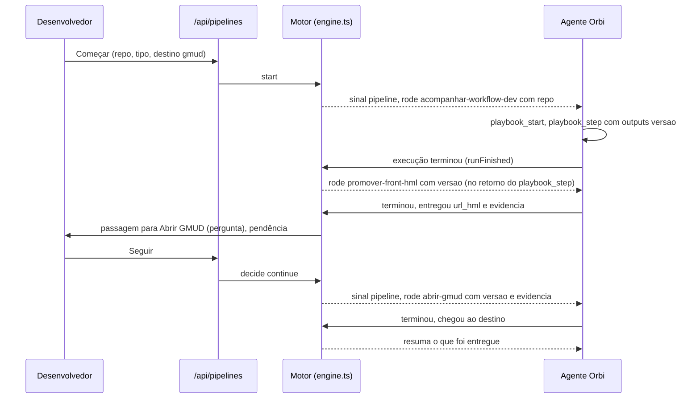

# 16. Esteiras

## Para que serve

Uma esteira encadeia procedimentos: quando um termina, o próximo começa com o
que o anterior entregou. Exemplo: acompanhar o workflow de dev (entrega a
versão) → promover para homologação (front ou backend, conforme a entrada) →
abrir a GMUD com a versão e a evidência → preencher a GMUD com o número aberto.

O desenvolvedor decide, por passagem, se o Orbi segue sozinho ou pergunta antes.
Ao começar, pode dar um destino ("vá até a abertura da GMUD"): pedir "até X" já
autoriza as passagens que perguntam até lá.

Cada entrega roda numa conversa. Quem decide o que vem depois é o runtime, não o
modelo: qual ramo, com quais dados, se precisa perguntar.

## Onde aparece

- **Tela Esteiras** (barra lateral, entre Conversa e Cérebro; o selo conta as
  entregas esperando você):
  - **Em andamento**: as entregas, em que etapa estão, o que esperam, **Abrir
    conversa**.
  - **Minhas esteiras**: a lista e o detalhe de cada uma: o que precisa para
    começar, as etapas com os ramos, o que cada procedimento **recebe** e
    **entrega**, e como é cada passagem ("segue sozinho" ou "pergunta antes de
    seguir"). Avisa os dados que nenhuma etapa entrega (o Orbi pergunta quando
    chegar lá). **Começar uma entrega** (entradas e destino), **Editar** e
    **Apagar**.
- **Conversa**: uma faixa no topo com as etapas e o estado, os **dados** já
  entregues e, quando espera você, o cartão da decisão: **Seguir para…** /
  **Encerrar aqui** numa passagem; **Tentar de novo** / **Pular** / **Encerrar**
  numa falha; os campos que faltam quando um dado não veio. A decisão também
  aparece em **Pendências** (tipo "Esteira").
- **Criar pela conversa**: "quando o workflow de dev terminar, já promove para
  homologação e depois abre a GMUD" vira um cartão de aprendizado com a prévia da
  esteira (`brain_learn` com tipo `pipeline`), aprovado como qualquer aprendizado.
- **Problemas de configuração** no detalhe da esteira ("Os dados não passam direito
  entre as etapas"), com **Pedir correção ao Orbi**: abre uma conversa em que ele
  propõe as correções num cartão de aprendizado.
- **Revisão da execução** na conversa, ao fim de cada turno em que etapas terminaram
  (documento 5), com os problemas de configuração da esteira.
- **Valor padrão** nas entradas (editor da esteira, coluna "padrão"): com ele, o
  Orbi começa sem perguntar e mostra o valor usado; **Começar uma entrega** já vem
  preenchido. Se você responder a mesma coisa duas vezes, o Orbi propõe guardar como padrão.
- **Cérebro → Procedimentos**: cada procedimento mostra **Recebe** (parâmetros) e
  **Entrega** (o que registra ao terminar), editáveis.
- **Agentes de código**: listam, leem e rodam esteiras pelo MCP (documento 15).

## Como funciona

- **Entrega de um procedimento**: o procedimento declara `outputs` (nome em
  `snake_case` e descrição). No último `playbook_step`, o Orbi registra os valores
  com `outputs`; nomes não declarados são recusados, e valores do cofre são
  limpos. Ficam na execução (`playbook_runs.outputs`).
- **Dados de uma etapa**: cada parâmetro vem, nesta ordem, do mapa da opção
  (`entrada.repo`, `gmud.numero_gmud` ou `perguntar`) ou, sem mapa, de uma entrada
  ou de uma entrega anterior com o mesmo nome. O que não vem de lugar nenhum faz a
  esteira esperar o desenvolvedor informar.
- **Ramos**: uma etapa pode ter várias opções, cada uma com uma condição
  `campo = valor` sobre uma entrada ou uma entrega anterior. Nenhuma condição bate:
  a esteira para e explica.
- **Conferência da configuração** (`pipelineConfigProblems` em `brain/domain/review.ts`):
  - o mapa de uma etapa aponta para um parâmetro que o procedimento não tem
    (`{{nome}}` nos passos): o dado não chega;
  - etapa depois da primeira cujo procedimento não recebe nada: os dados só
    passariam pela memória do modelo;
  - passo que pergunta ao desenvolvedor (`ask_developer`, "não assumir") o que a
    esteira já dá. Pergunta condicional ("se o lock aparecer, parar e perguntar",
    "caso peça MFA") é o que fazer quando algo dá errado, não conta (`asksAlways`);
  - na revisão, com os dados da entrega: passo que escreve fixo um valor que uma
    etapa anterior entrega (um caminho), em vez de `{{nome}}`.
  São avisos, não impedem salvar. `GET /api/pipelines` traz `warnings`.
- **Etapa por etapa**: enquanto a etapa atual não termina, o Orbi não consegue
  começar o procedimento de outra etapa da mesma esteira: `playbook_start` devolve o
  que falta (os passos abertos) e que a esteira diz a próxima.
- **Encerrar** (na faixa da esteira, na conversa): termina uma entrega rodando ou
  presa (uma etapa que nunca fechou). A revisão que vem em seguida aponta o que
  ficou aberto.
- **Padrão sugerido**: na revisão do fim da entrega, uma entrada sem padrão que
  recebeu o mesmo valor nas últimas entregas vira sugestão de padrão na correção.
- **Padrão**: `withDefaults` completa as entradas que o pedido deixou de fora antes
  de validar.
- **Passagem que vira automática**: numa passagem `ask` em que você clicou
  **Seguir** três vezes seguidas, ela passa a `auto`, com um aviso em Pendências
  (**Manter perguntando** desfaz). **Encerrar aqui** zera a contagem.
- **Passagens**: `auto` segue; `ask` espera, a não ser que (a) quem começou foi o
  desenvolvedor com um destino, ou (b) quem começou foi um agente com a permissão
  **pular perguntas**. O destino de um agente sozinho não libera.
- **Falha**: a etapa falhou → a esteira espera: **Tentar de novo**, **Pular**
  (segue para a próxima) ou **Encerrar**.
- **Como o Orbi fica sabendo**: no começo e depois de uma decisão, por um sinal
  `pipeline` na conversa. Entre etapas que seguem sozinhas, no retorno do
  `playbook_step` que encerrou a execução (campo `esteira`), sem esperar outro
  turno. O prompt (`prompts/orbi/esteiras.md`, incluído quando há esteiras) diz para seguir esse texto ao pé da letra.
- **Uma por conversa**: uma conversa só tem uma esteira em andamento.
- **Apagar**: um procedimento usado numa esteira não pode ser apagado (a tela diz
  qual esteira usa).

## Peças

| Onde | O quê |
| --- | --- |
| `apps/runtime/src/brain/domain/pipelines.ts` | Regras puras: validação, ramo, origem dos dados, lacunas, passagens |
| `apps/runtime/src/brain/repo/pipelines.ts` | Definições no banco |
| `apps/runtime/src/pipelines/runs.ts` | Entregas (execuções de esteira) |
| `apps/runtime/src/pipelines/engine.ts` | O motor: começar, etapa terminou, decisão |
| `apps/runtime/src/agents/tools/pipelines.ts` | `pipeline_start` e `pipeline_provide` |
| `apps/runtime/src/agents/tools/playbooks.ts` | `outputs` no `playbook_step` e o retorno `esteira` |
| `apps/runtime/src/http/routes/pipelines.ts` | `/api/pipelines` e `/api/pipeline-runs` |
| `apps/runtime/src/mcp/pipelines.ts` | Como as esteiras aparecem para agentes de código |
| `apps/desktop/src/views/pipelines/` | Tela Esteiras: em andamento, minhas esteiras, editor |
| `apps/desktop/src/views/conversation/{PipelineBar,PipelineDecision}.tsx` | Faixa e decisão na conversa |
| `apps/desktop/src/components/PipelinePreview.tsx` | Prévia no cartão de aprendizado |

## O que fica guardado

- Migração 10: `playbooks.outputs`, `playbook_runs.params` e `playbook_runs.outputs`.
- Migração 11: `pipelines` (nome, descrição, entradas, etapas, usos) e
  `pipeline_runs` (esteira, conversa, estado, destino, entradas, etapas com
  parâmetros, origem e entregas, etapa atual, quem pediu, o que espera).
- Migração 12: permissões de esteira dos agentes e `agent_requests.pipeline`.
- Migração 13: `pipelines.passage_streaks` (quantas vezes seguidas você seguiu cada
  passagem). O padrão das entradas fica no JSON `inputs` (`default`).
- As duas tabelas geram o evento `pipelines`.

## API

| Rota | O quê |
| --- | --- |
| `GET /api/pipelines` · `GET /api/pipelines/:name` | Esteiras, com as lacunas de dados |
| `PUT /api/pipelines/:name` · `DELETE /api/pipelines/:name` | Salvar (mesma validação do aprendizado) e apagar |
| `POST /api/pipelines/:name/start` `{inputs, destination?}` | Começar uma entrega numa conversa nova |
| `GET /api/pipeline-runs?active=1` · `GET /api/pipeline-runs/conversation/:id` | Entregas |
| `POST /api/pipeline-runs/:id/decide` `{decision, values?}` | `continue`, `retry`, `skip` ou `stop` |
| `POST /api/pipelines/:name/fix` | Conversa nova em que o Orbi propõe a correção dos problemas de configuração |
| `POST /api/pipeline-runs/:id/cancel` | Encerrar uma entrega rodando ou presa |

## Limites conhecidos

- Não há etapas em paralelo nem voltar para uma etapa anterior.
- As condições de ramo são só igualdade.
- Editar uma esteira não muda as entregas em andamento quanto às etapas já
  criadas; a escolha de ramo e de dados usa a definição atual.
- Um valor entregue é texto; listas e objetos vão como texto.

## Testes

- `apps/runtime/test/pipelines.test.ts`: validação, dados por nome e por mapa,
  ramo, passagem que pergunta, destino, regras para agentes, falha (tentar, pular,
  encerrar), dados que faltam, procedimento em uso não se apaga.
- `apps/runtime/test/levels.test.ts`: padrão nas entradas e passagem que vira automática.
- `apps/runtime/test/review.test.ts`: a esteira top-repos como estava (mapa sem
  parâmetro, passo que pergunta, caminho fixo), corrigida sem avisos, e a revisão
  que pega a falha que chega depois do passo.
- `apps/runtime/test/flow-*.test.ts` ("revisão no fim"): `show_ui` falhando na
  mesma leva do `playbook_step`, pego pela revisão, pede correção e não sobe.
- `apps/runtime/test/flow-*.test.ts` ("esteira pedida por agente"): pelo MCP,
  com o modelo roteirizado: roda a etapa, para na passagem, segue com a decisão,
  passa os dados e responde ao agente.
- `apps/desktop/test/pipelines.test.ts`: estado, linha de espera, origem dos dados,
  problemas do rascunho no editor.
- `npm run demo`: a esteira `entrega-do-portal` já vem cadastrada.
