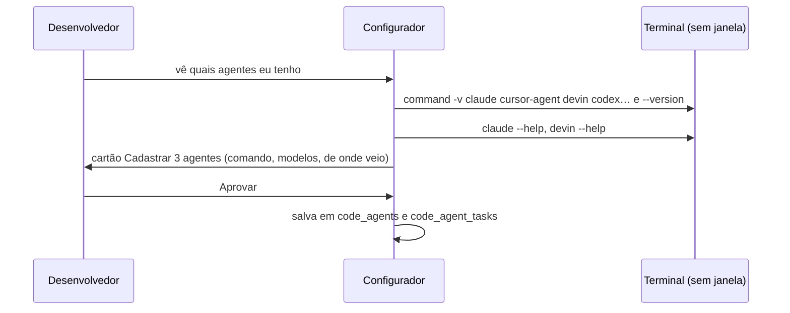

# 17. Agentes de código desta máquina

## Para que serve

Quando uma esteira ou um procedimento quebra por causa de código (um teste, a
cobertura, a compilação), o Orbi pede a um **agente de código instalado na
máquina** (Claude Code, Cursor, Devin…) para investigar ou corrigir. O agente
trabalha numa **cópia descartável** do repositório; quem aplica a correção é o
Orbi, pelas regras de autonomia.

Cada **tarefa** tem o seu agente e o seu modelo:

| Tarefa | Quando | Exemplo |
| --- | --- | --- |
| **Investigar** | Erro que o Orbi não conhece (nenhum problema conhecido serve) | Claude Code · `claude-haiku-5-5` |
| **Corrigir** | Erro conhecido: o cérebro já sabe a solução | Cursor · GPT Luna |

Não confundir com o documento 15: lá são os agentes que **pedem coisas ao Orbi**
pelo MCP. Aqui são os agentes que **o Orbi chama** para mexer em código.

## Onde aparece

- **Configurações → Agentes de código** (no submenu da tela Configurações): à esquerda,
  **Quem faz o quê** (as duas tarefas com agente e modelo) e **Nesta máquina**
  (comando, modelos, situação do último teste, Testar, Editar, Remover, e botões
  para começar por um agente conhecido); à direita, numa coluna da altura da
  tela, o chat **Configurar com o Orbi**: peça para procurar os agentes, explicar
  um deles ou mudar quem faz cada tarefa.
- **Configurações → Capacidades**: a linha "Agente de código" resume quem faz cada
  tarefa (`GET /api/health` → `codeAgent`).

## Como funciona

### Cadastro

Um agente é um **comando de uso único** que roda no terminal do desenvolvedor
(Git Bash no Windows), sem janela, dentro da cópia:

```
claude -p --model {modelo} -- {prompt}
```

- `{prompt}` é onde entra o pedido; sem ele, o pedido vai no fim.
- `{modelo}` é onde entra o modelo da tarefa. Sem modelo escolhido, a opção que
  o carrega (`--model {modelo}`) sai da linha e o agente usa o padrão dele.
- O comando roda **um programa só**: `;`, `&&`, `|` e `$(…)` fora de aspas são
  recusados ao salvar (`code-agents/command.ts`).

O **catálogo** (`code-agents/catalog.ts`) traz os agentes que o Orbi já sabe
chamar (Claude Code, Cursor, Devin). É dado, não código: aparece como sugestão
("Adicionar Devin") e só vale depois de cadastrado.

**Testar** manda um pedido curto ("responda só ok") numa pasta vazia e guarda o
resultado: confirma instalação, login e que o agente não fica esperando uma
tecla. Gasta um pedido da conta do agente, por isso só roda quando você clica.

### O chat de configuração

É o mesmo chat das conversas (`components/chat/ChatPanel`), mas falando com
**outro agente** do runtime, o configurador (`agents/configurador.ts`), na
conversa fixa `config:agentes-de-codigo`. Ele não tem as ferramentas do Orbi das
conversas (procedimentos, esteiras, navegador): só as de
`agents/tools/code-agent-setup.ts`.



| Ferramenta | O que faz | Portão |
| --- | --- | --- |
| `code_agents_state` | O que está cadastrado e o catálogo | leitura |
| `find_code_agents` | `command -v` dos agentes conhecidos (e de outros nomes) e `--version` | leitura |
| `read_agent_help` | `--help` de um agente ou de um subcomando (`codex exec --help`) | leitura |
| `code_agents_register` | Cadastra agentes e, se dito, as tarefas | `aprender`: sempre pede |
| `code_agent_test` | Pedido curto ao agente (gasta da conta dele) | pede |

As leituras só aceitam nomes de programa e um subcomando, e rodam sempre com
`--version` ou `--help`. O comando cadastrado passa pela mesma validação da tela
(um programa só). O chat nunca faz login: diz o comando que você roda.

As pendências desta conversa aparecem em Pendências como as outras; **Ir até**
abre a tela Configurações.

### Onde o agente roda: em segundo plano (padrão) ou numa janela do terminal

Por padrão o agente roda **em segundo plano**, sem janela. Em cada agente dá para
escolher **numa janela do terminal** (editor do agente, Onde roda): o Orbi abre
uma janela de verdade (Terminal no macOS, a do Git Bash no Windows, o terminal da
área de trabalho no Linux), que mostra o que o Orbi pediu e o que o agente
responde, e fica aberta para você ler. A janela roda um script pequeno
(`code-agents/terminal-window.ts`) que guarda a saída e o código de saída; o Orbi
espera o fim. A descoberta (`--version`, `--help`) roda sempre em segundo plano.

Se o agente falha também na janela do terminal, o problema é do próprio agente
(o login dele), não do Orbi: confira rodando o mesmo comando de uso único no seu
terminal (ex.: `claude -p "responda ok"`).

### Com qual ambiente o agente roda (em segundo plano)

O agente é uma ferramenta do desenvolvedor: roda com a **sessão dele** (o login do
agente, proxy, certificados, variáveis do perfil do shell), como no terminal, e
nunca com o que é do Orbi: as variáveis `ORBI_*`, a chave do modelo do Orbi
(`ANTHROPIC_API_KEY`), as da ponte do Chrome e tudo que o `.env` do Orbi trouxe
(`terminal/orbi-env.ts`, `inherit: 'developer'` em `terminal/exec.ts`). Se o
agente funciona no terminal e não pelo Orbi, a diferença está aí.

Se o próprio Orbi foi iniciado de dentro de uma sessão do Claude Code (ele rodou
o `npm start`), o ambiente traz a identidade daquela sessão (`CLAUDECODE`,
`CLAUDE_CODE_SESSION_ID`, um proxy em `ANTHROPIC_BASE_URL`…); nenhuma variável
`CLAUDE*`/`ANTHROPIC*` passa adiante nesse caso, senão o `claude` do Orbi tenta
usar a sessão do outro e falha ("OAuth session expired").

Quando o teste falha por login, o resultado traz o que o Orbi vê (só nomes, nunca
valores): qual programa respondeu e a versão, quais variáveis de login existem,
shell, usuário e pasta, se há arquivo de login e se o Keychain do macOS está
acessível.

O teste roda com o modelo que você escolher; sem escolha, com o padrão do agente.

### `ORBI_CODE_AGENT` (o jeito antigo)

Continua valendo enquanto nenhuma tarefa tiver agente cadastrado: aparece na
lista como "(do .env)" e faz as duas tarefas.

### O executor

`code-agents/fixer.ts` cria uma git worktree descartável da branch, roda o
agente da tarefa com o pedido de **investigar** ou de **corrigir** e devolve os
arquivos alterados, o diff e o resumo do agente, com quem fez e com qual
modelo. O agente não faz commit nem push; não vê credenciais; não grava no
cérebro. Subir é outro passo, pelo portão (`code_agent_push_fix`), e descartar
remove a cópia.

### No fluxo: investigar e corrigir

Com um agente cadastrado, o Orbi ganha as ferramentas de correção e a parte
"Correção de código" do prompt (só quando há procedimento rodando ou uma
ferramenta falhou). As regras por nível estão no documento 10:

| Situação | N1 | N2 | N3 |
| --- | --- | --- | --- |
| Investigar um erro sem conhecimento | pede | pede | pede |
| Aplicar a correção que a investigação achou | pede | pede | pede |
| Corrigir um problema conhecido (preparar e aplicar na branch da entrega) | pede | segue e avisa | segue e avisa |

A regra global "Agente de código: corrigir código de produção" continua sendo o
teto: com ela em Perguntar (o padrão), aplicar em código de produção pede em
qualquer nível.

Correção que seguiu sozinha aparece no cartão **Houve correção de código** e em
Pendências (**Para você saber**, item `code-change`) até você marcar Visto.

Quando uma correção de investigação passou, a revisão do fim da execução pede o
**problema conhecido** com `quem_corrige: agente de código` e `conferir`; aprovado,
na próxima vez é o caminho do problema conhecido.

## Peças

| Peça | Arquivo |
| --- | --- |
| Tipos, catálogo, linha de comando | `apps/runtime/src/code-agents/{types,catalog,command}.ts` |
| Cadastro e tarefas | `apps/runtime/src/code-agents/registry.ts` (`CodeAgents`) |
| Teste do agente | `apps/runtime/src/code-agents/tester.ts` |
| Janela do terminal, e onde roda | `apps/runtime/src/code-agents/terminal-window.ts`, `run.ts`; `terminalWindow` em `src/platform/` |
| Executor na cópia | `apps/runtime/src/code-agents/fixer.ts` |
| Ferramentas do Orbi | `apps/runtime/src/agents/tools/code.ts` (investigar, corrigir conhecido, aplicar, descartar) |
| Parte do prompt | `apps/runtime/src/prompts/orbi/agentes-de-codigo.md` |
| Aviso em Pendências | `apps/runtime/src/inbox/code-change.ts`; cartão `apps/desktop/src/components/ui/CodeChange.tsx` |
| Agente do chat de configuração | `apps/runtime/src/agents/configurador.ts`, `configurador-capabilities.ts`, `prompts/configurador/agentes-de-codigo.md` |
| Ferramentas do chat | `apps/runtime/src/agents/tools/code-agent-setup.ts`, `code-agents/discovery.ts` |
| Qual agente responde a conversa | `apps/runtime/src/agents/directory.ts` |
| API | `apps/runtime/src/http/routes/code-agents.ts` |
| Tela | `apps/desktop/src/views/autonomy/codeAgents/` (`CodeAgentsPage`: lista e tarefas à esquerda, `ConfigChat` à direita) |
| Submenu da Autonomia | `apps/desktop/src/views/autonomy/AutonomyView.tsx` (Regras, Agentes de código, Cofre, Uso, Voz, Capacidades) |
| Chat comum | `apps/desktop/src/components/chat/ChatPanel.tsx` |
| Tabelas | `code_agents`, `code_agent_tasks` (migração 16, `docs/banco.md`) |

## API

| Rota | O que faz |
| --- | --- |
| `GET /api/code-agents` | Agentes, tarefas e catálogo |
| `PUT /api/code-agents/:id` | Cadastra ou muda um agente (`SaveCodeAgent`) |
| `DELETE /api/code-agents/:id` | Remove (e tira das tarefas) |
| `PUT /api/code-agents/tasks/:task` | Agente e modelo da tarefa (`agent: null` limpa) |
| `POST /api/code-agents/:id/test` | Pedido curto ao agente; guarda o resultado |

Mudanças viram o evento `code-agents`. O chat fala com `/agents/configurador/config:agentes-de-codigo`.

## Limites

- O agente precisa ter um modo de uso único (responde e sai). Um agente que só
  funciona interativo fica esperando até o limite de tempo.
- Nem todo agente deixa escolher o modelo pela linha de comando; nesse caso a
  lista de modelos fica vazia e vale o padrão dele.

## Testes

- `apps/runtime/test/code-agents.test.ts`: linha de comando com pedido e modelo,
  validação do comando, catálogo, cadastro e tarefas, o `.env` como reserva, a
  API e um agente de verdade (um script) corrigindo numa cópia.
- `apps/runtime/test/flow-config-agents.test.ts`: o chat é outro agente (prompt
  e ferramentas próprios), o cadastro só vale depois do cartão, a aprovação volta
  para ele, e um comando com dois programas volta como problema.
- `apps/runtime/test/flow-code-fix.test.ts`: erro novo pede para investigar e
  para aplicar, mesmo com tudo em automático; problema conhecido segue sozinho,
  faz o push na branch da entrega e avisa em Pendências.
- `apps/desktop/test/codeAgents.test.ts`: situação, tarefas, catálogo e modelos.
