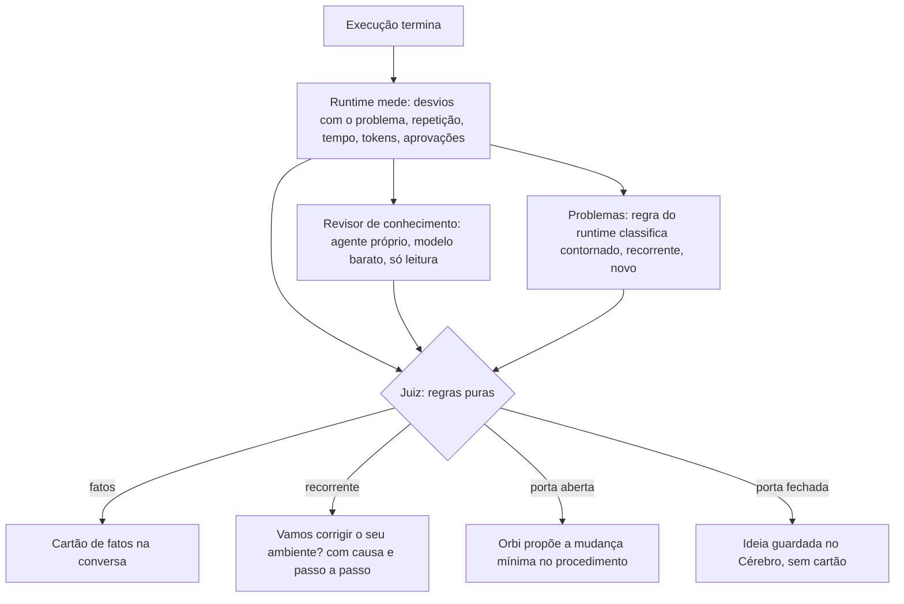

# 19. Revisão no fim da execução: autonomia antes de perfeição (refinamento técnico)

> Situação: **refinamento, nada implementado**. Este documento diz o que muda no código e
> em que ordem. O quadro visual está no Whiteboard "Orbi · Revisão no fim da execução".

## O problema, nas palavras do uso real

Um procedimento "validar ambiente da app X" (tasks do ECS e banco da aplicação), rodado umas
10 vezes, nunca saiu de N1:

1. **Conhecimento perdido.** Ao rodar, o Orbi descobriu o banco da aplicação lendo a task
   definition, mas isso nunca virou fato no cérebro.
2. **Problema recorrente sem correção na raiz.** Um erro de certificado aparece toda vez. O
   Orbi guardou a solução de contorno e a aplica a cada execução, mas nunca propôs corrigir o
   ambiente nem explicou como.
3. **Melhoria demais.** Toda revisão propõe mudar o procedimento ("um script aqui", "reorganizar
   ali"). O procedimento não amadurece e continua pedindo aprovação comando a comando.

O objetivo é **cumprir o que o procedimento promete e ganhar autonomia**. Conhecimento pode
crescer a cada execução; os passos mudam pouco.

## Decisões (padrões adotados até o desenvolvedor dizer outra coisa)

| Decisão | Padrão | Onde fica |
| --- | --- | --- |
| Quando mudar os passos | só se a execução não chegou ao fim, se você corrigiu o Orbi nela, ou se o ganho medido é alto | `brain/domain/judge.ts` |
| Ganho alto | 30% a menos de tempo, de tokens ou de aprovações, medido nas últimas execuções | constante `HIGH_GAIN` |
| Repetições até propor "corrigir o ambiente" | 2 execuções seguidas com o mesmo problema conhecido | constante `RECURRING_AFTER` |
| Quando revisar com modelo | conhecimento: sempre que a execução leu algo novo, no modelo **barato** (documento 12); procedimento: só quando o juiz abre a porta | `review/review.ts` |
| Fatos sensíveis | endereço do banco sim; usuário, senha, token e chave nunca (o cartão recusa) | `brain/domain/learning.ts` |

## Diagnóstico no código atual

### 1. Ninguém lê o que os comandos devolveram

- A revisão (`review/review.ts`) roda os analisadores de `review/analyzers/`: `aberto`,
  `passo-feito-com-falha`, `desvios`, `python-na-hora`, `tabela-copiada` e
  `problema-conhecido`. **Nenhum olha a saída dos comandos ou das páginas.**
- `terminal/runner.ts` (`afterCommand`) guarda no rastro da execução só o comando, o código de
  saída e o fim do erro (`noteCommand`). A saída de sucesso (onde estava o banco) não fica em
  lugar nenhum depois do turno.
- O passo 0 (`playbook_resolve`, documento 18) só aprende fatos sobre as **entradas** do pedido.

### 2. Problema conhecido continua sendo desvio, e repetição não é contada

- Nível: `settleRun` (`brain/services/autonomy.ts`) só conta a execução se ela for **limpa**
  (`run.status === 'done'` e `runDeviations(run)` vazio, `brain/domain/levels.ts`).
- Uma falha de ferramenta (`kind: 'falha'`) só é perdoada se **a mesma ferramenta, no mesmo
  passo** funcionar logo depois (`recoverRunDeviation`). Se o contorno usa outra ferramenta
  (outro comando via `run_script`, Python, o navegador), a falha fica e a execução nunca é
  limpa. Ter o problema conhecido no cérebro não muda isso.
- Falha de comando (`kind: 'comando'`) não conta para o nível, e `afterCommand` marca `known`
  quando o erro bate com um problema conhecido. Mas o desvio não guarda **qual** problema foi, e
  não existe contagem de quantas execuções seguidas tiveram o mesmo problema. Sem isso, o
  runtime não tem como dizer "é recorrente".
- O problema conhecido (`brain/domain/knowledge.ts`) tem `sintoma`, `causa`, `solucao`,
  `quem_corrige` e `conferir`, mas não distingue **contorno** (o que o Orbi faz a cada vez) de
  **correção na raiz** (o que alguém faz uma vez no ambiente).

### 3. Toda revisão manda reescrever o procedimento

- `reviewInstruction` (`review/review.ts`) diz ao modelo, para qualquer achado, até uma
  `melhoria`: "Proponha as correções com UM brain_learn: para cada procedimento com problema,
  o mesmo nome com os passos corrigidos". O modelo obedece, e todo cartão vira reescrita.
- O cartão de aprendizado aceita qualquer reescrita do procedimento: nada pede que a mudança
  seja pequena, nem a compara com o que a revisão encontrou.
- Passos reescritos mudam os comandos. As ações conhecidas são por impressão digital
  (`fingerprintWith`), então comandos novos voltam a pedir aprovação mesmo em N2 (`decideAction`
  só deixa ir sozinho o que é conhecido).
- O juiz não tem números para decidir: tempo existe (`startedAt`/`finishedAt`), mas tokens são
  guardados por conversa e dia (`usage`), não por execução, e aprovações pedidas não são contadas
  no rastro.

### Para confirmar no seu computador

A versão do computador pessoal é anterior. Esta consulta no `orbi.db` da pasta de dados mostra
o que impediu cada execução de contar para o nível:

```sql
SELECT started_at, status, deviations, steps FROM playbook_runs
WHERE playbook = '<nome do procedimento>' ORDER BY started_at DESC LIMIT 10;
```

## Arquitetura proposta



A sua ideia de três subagentes fica mais simples no código: **só um agente novo**.

- **Conhecimento** precisa de um modelo, porque é leitura e interpretação. É um agente próprio,
  `Revisor` (`'use agent'`, prefixo `revisao:<runId>`), que o runtime chama sozinho no fim da
  execução. Ele só lê e propõe; não conversa com você.
- **Problemas** é quase todo regra: o runtime já sabe qual problema conhecido bateu (passando a
  guardar o id) e conta as repetições. O modelo entra só para **explicar** a correção na raiz,
  e quem explica é o próprio Orbi na conversa, a partir do problema guardado.
- **Procedimento** continua sendo o Orbi na revisão de hoje, mas só é chamado quando o juiz abre
  a porta, e com a ordem de mudar o mínimo.
- **Juiz** é código puro (`brain/domain/judge.ts`), com teste. Um modelo julgando outro modelo
  tende a achar toda melhoria boa, e é isso que queremos evitar.

## Mudanças por camada

### Banco (migração 22, só acréscimo)

- `playbook_runs`: `tokens_in`, `tokens_out`, `cost_usd`, `model_ms` (somados enquanto a
  execução está aberta) e `asked` (aprovações pedidas).
- `run_observations` (nova): `run_id`, `step_id`, `tool`, `source` (comando ou página),
  `excerpt` (até 4 KB, **já limpo pelo `redact` do cofre**), `at`. Apagada depois da revisão de
  conhecimento, ou em 7 dias. Em `db/changes.ts` não entra: a tela não a mostra.
- `playbook_ideas` (nova): `id`, `playbook`, `text`, `gain` (o que mediria), `run_id`,
  `status` (`kept` | `applied` | `dismissed`), `created_at`. Entra em `db/changes.ts` (tópico
  `brain`), porque o Cérebro mostra.

### Domínio (regras puras, `brain/domain/`)

- `levels.ts`
  - `Deviation` ganha `problem?: string` (id do problema conhecido) e `workedAround?: boolean`.
  - `activeDeviations` deixa de fora o que foi **contornado com a solução conhecida**: falha
    com `problem` e passo que terminou `done`. Assim o certificado deixa de prender em N1.
  - O que não é contornado continua contando como hoje: falha sem problema conhecido, passo
    falho ou pulado, ação negada.
- `knowledge.ts`
  - `recurrence(runs, problemId)`: quantas execuções seguidas do procedimento tiveram o
    problema.
  - O problema conhecido ganha `raiz` (a correção de vez, e quem faz) além de `solucao` (o
    contorno). `asKnownProblem` lê os dois.
- `judge.ts` (novo): `judge(input) → Verdict[]`.
  - A entrada tem os achados por tipo, as métricas desta execução, a média das últimas 5 e a
    recorrência por problema.
  - Cada `Verdict` é `facts` | `fixEnvironment` | `changeProcedure` | `keepIdea`, com o motivo
    em uma linha.
  - Só gera `changeProcedure` quando: a execução não terminou (`failed`, ou passo `failed`/
    `skipped`), o desenvolvedor corrigiu o Orbi no meio (uma resposta dele mudou um passo), ou o
    ganho estimado passa de `HIGH_GAIN`. O resto vira `keepIdea`.
- `learning.ts`
  - `proposalProblems` recusa fato com propriedade que pareça credencial (nome como senha,
    password, token, secret, chave, key; ou valor com cara de segredo). O cartão nunca chega a
    você com isso.
  - Para uma mudança de procedimento vinda da revisão, `minimalChange(antes, depois, passos
    permitidos)` recusa a reescrita que mexe em passos fora dos que o juiz apontou.

### Runtime

- `terminal/runner.ts` (`afterCommand`) e `browser_read`: com uma execução aberta, guardam o
  trecho da saída em `run_observations` (limpo pelo `redact`). `noteCommand` passa o id do
  problema conhecido que bateu.
- `observability/telemetry.ts`: cada turno do modelo soma os tokens também na execução aberta
  da conversa.
- `agents/gate.ts`: quando pede aprovação dentro de uma execução, soma em `asked`.
- `review/review.ts` vira um orquestrador em três tempos:
  1. as regras de hoje (analisadores) e o `settleRun`, já com o contornado fora;
  2. o **revisor de conhecimento**, quando há observações novas: o runtime manda as
     observações da execução e o que o cérebro já sabe dos conceitos envolvidos para o agente
     `Revisor`, que devolve fatos candidatos por uma ferramenta (`propose_facts`, só dados);
  3. o **juiz**, e então um único sinal para a conversa, com as decisões:
     - fatos viram cartão de aprendizado (categoria `aprender`, aprovação como sempre, sem mexer
       nos passos);
     - um problema recorrente vira o cartão "Vamos corrigir o seu ambiente?";
     - a porta aberta vira a instrução de mudança mínima;
     - a porta fechada grava a ideia em `playbook_ideas`, sem cartão.
- `reviewInstruction` deixa de mandar reescrever por padrão. O texto passa a sair do veredito:
  "proponha a mudança só nos passos X, Y; o resto fica igual", ou nenhum pedido de mudança.
- `agents/revisor.ts` (novo, `'use agent'`): ferramentas só de leitura (`brain_query`) e
  `propose_facts`; prompt em `prompts/revisor.md`; modelo: o primeiro `cheap` de
  `modelChoices` (documento 12), senão o padrão. Rota e prefixo em `app.ts`
  (`routeConversations`), como o Configurador.

### Prompts

- `prompts/orbi/base.md` (revisão): "Autonomia antes de perfeição. Não proponha melhorias por
  conta própria: o runtime diz quando mudar o procedimento e quais passos."
- `prompts/orbi/falhas.md`: diante de um problema conhecido recorrente, "explique a causa, a
  correção de vez e quem faz; pergunte se o desenvolvedor quer corrigir agora".
- `prompts/revisor.md` (novo): o que é fato (conceito que o cérebro já tem, valor lido numa
  saída), o que não é (credenciais, valores de uma execução só, como a versão daquele pedido) e
  "na dúvida, não proponha".

### Contrato e app

- `ExecutionReview` ganha `verdicts`. O cartão de revisão (`ReviewCard`) mostra:
  - "Aprendi" com os fatos (o cartão de aprendizado segue aparte);
  - o cartão "Vamos corrigir o seu ambiente?" (`fix_environment`, no catálogo `ui`): causa,
    o que fazer, quem faz e os botões "Corrigir agora" (o Orbi conduz) e "Agora não";
  - uma linha "1 ideia guardada no Cérebro", sem pedir nada.
- Cérebro → procedimento: seção "Ideias guardadas", com a ideia, o ganho medido e os botões
  Aplicar (a conversa propõe a mudança) e Descartar.
- O painel "O que aprendi" (documento 1) passa a mostrar por que a última execução não contou,
  ou "contornou um problema conhecido".

## Fases (cada uma entra sozinha e já ajuda)

| Fase | O que entra | Resolve | Testes |
| --- | --- | --- | --- |
| 1 · Nível justo | `Deviation.problem`/`workedAround`, contornado fora de `activeDeviations`, recorrência, cartão "corrigir o ambiente", `raiz` no problema | o certificado deixa de prender em N1; você entende a correção | `levels`, `knowledge` (unidade); fluxo: 3 execuções com o mesmo erro conhecido → N2 e cartão de ambiente |
| 2 · Juiz e menos reescrita | `judge.ts`, métricas por execução, `reviewInstruction` pelo veredito, `minimalChange`, `playbook_ideas` e a seção no Cérebro | revisões param de reescrever; ideias ficam guardadas | `judge` (tabela de casos); fluxo: execução limpa com "melhoria" → nenhuma reescrita, ideia guardada; eval de comportamento com o cenário "validar ambiente" |
| 3 · Conhecimento | `run_observations` com `redact`, agente `Revisor` no modelo barato, `propose_facts`, recusa de credenciais | o banco da task definition vira fato | fluxo com o modelo roteirizado; teste de segurança: saída com senha não chega ao cartão nem ao banco |
| 4 · Ajuste fino | números do juiz pela sua experiência; painel e eval | — | eval:behavior com 10 execuções seguidas do mesmo procedimento |

## Riscos e cuidados

- **Credenciais nas saídas**: as observações passam pelo `redact` do cofre antes de gravar, e o
  cartão recusa propriedades com cara de credencial. As observações nunca vão para os logs.
- **Contornado escondendo problema de verdade**: só conta como contornado o que bateu com um
  problema **conhecido** e cujo passo terminou bem. Erro novo continua sendo desvio e "nunca vi".
- **Custo**: o revisor de conhecimento roda no modelo barato e só quando há observações novas;
  os outros não chamam modelo a mais.
- **Fatos de uma execução só** (a versão daquele pedido) não são conhecimento. O prompt do
  revisor e o `leakedSpecifics` do documento 18 cuidam disso.

## Fora do escopo

- Corrigir o ambiente sozinho: o Orbi explica e conduz, com aprovação, como qualquer ação.
- Mudar a regra de subida N2 → N3 (`RUNS_FOR_N3`).
