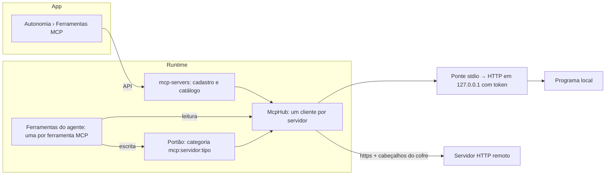

# 20. Ferramentas MCP e a nova Autonomia (refinamento técnico)

Estado: **fases 1 a 4 feitas** (telas no lugar, Chrome configurável, servidores por endereço e por comando); a 5 é proposta. Telas no canvas "Orbi · Autonomia:
ferramentas MCP e agentes" (boards A a F).

## O que muda para o desenvolvedor

1. **A tela Agentes sai da barra lateral.** A barra fica com Conversas, Esteiras, Cérebro e
   Autonomia. Os pedidos dos agentes viram **Autonomia › Agentes que pedem** (pedidos e
   conexões, como hoje).
2. **As sugestões dos agentes vão para o Cérebro**, numa aba **Sugestões para aprender**,
   revisadas ao lado do que o Orbi já sabe (Aceitar, Aceitar como variação de…, Rejeitar). O
   selo de sugestões passa para o ícone do Cérebro.
3. **Autonomia ganha grupos**: Permissões (Regras, Cofre), Conexões (Ferramentas MCP, Agentes
   que pedem, Agentes de código), Modelo (Modelo, Voz) e Acompanhar (Uso, Capacidades).
4. **Autonomia › Ferramentas (MCP)**: os servidores MCP que o Orbi usa. O Chrome DevTools é o
   primeiro, com a sua página de configuração. O desenvolvedor adiciona outros (Jira,
   ServiceNow, Sonar…) por endereço ou por comando local.
5. **Toda ferramenta é de leitura ou de escrita**, e cada servidor ganha duas linhas nas
   Regras. A escrita pede aprovação, como qualquer ação do Orbi.

## Decisões (do desenvolvedor, em 11/11)

| Assunto | Decisão |
| --- | --- |
| Servidor por comando local | Aceito. O Orbi pergunta antes de iniciá-lo pela primeira vez e sempre que o comando muda |
| Servidor remoto | Aceito, fora da máquina, só por `https`. `http` só em `127.0.0.1` |
| Ferramenta nova num servidor já cadastrado | Fica disponível na hora e conta como **escrita** até ser marcada: o Orbi pede aprovação antes de usar |
| Leitura ou escrita | Vem do que o servidor informa (`readOnlyHint`, `destructiveHint`). Sem informação, escrita. A que apaga começa desligada |
| "Sempre sozinho para esta ferramenta" no cartão | Sim, por ferramenta. Aparece na página do servidor como "sozinho (você escolheu)" e dá para voltar. Nunca é oferecido para ferramenta que apaga |
| Sugestões dos agentes | Vão para o Cérebro |
| Credenciais | Só referência do cofre (`{{segredo:nome}}`) em cabeçalhos e variáveis de ambiente. O valor é resolvido na hora de conectar, nunca vai ao modelo, à conversa nem aos logs |

## Arquitetura proposta

### Cadastro e catálogo (`apps/runtime/src/mcp-client/`)

O nome `mcp/` já é o Orbi como servidor (documento 15). O lado cliente ganha a pasta
`mcp-client/`; o Chrome DevTools (`browser/mcp/`) passa a ser um servidor desse cadastro,
marcado como embutido.

- **Migração 23**:
  - `mcp_servers`: `id`, `name`, `transport` (`http` | `command`), `url`, `command` (JSON:
    programa e argumentos), `headers` e `env` (JSON, valores só com referências do cofre),
    `enabled`, `approved_command` (hash do comando aprovado), `builtin`, datas.
  - `mcp_tools`: `server_id`, `name`, `description`, `input_schema` (JSON), `hint` (o que o
    servidor diz: `leitura` | `escrita` | `apaga` | nulo), `kind` (o que você marcou, ou nulo),
    `enabled`, `alone` ("sempre sozinho"), `first_seen`, `last_seen`.
  - As duas tabelas entram em `db/changes.ts`; `docs/banco.md` atualizado.
- **Tipo efetivo** (regra pura, `mcp-client/domain.ts`, com teste): `kind` se você marcou; senão
  `hint`; senão `escrita`. `apaga` é escrita com efeito de apagar.
- **Catálogo**: conectar lista as ferramentas (`tools/list`) e grava em `mcp_tools`. Ferramenta
  que não estava antes entra com `kind` nulo, ligada, e o servidor mostra "revisar
  ferramentas". O catálogo só muda ao conectar, não a cada turno (o agente é refeito a cada
  turno e a lista de ferramentas precisa ficar estável).

### Conexão (`McpHub`)

- Um `Client` do SDK de MCP por servidor, criado em `createOrbi` e iniciado em
  `startBackground` (só servidores ligados e, por comando, com o comando aprovado).
- **HTTP**: `StreamableHTTPClientTransport`. Endereço fora de `127.0.0.1` exige `https`
  (`validate` no cadastro). Os cabeçalhos são resolvidos por `vault.resolve` na hora de conectar.
- **Comando**: reaproveita a ponte do Chrome (`browser/mcp/bridge.ts`), que vira genérica: o
  programa roda como filho, falando stdio, exposto em `127.0.0.1` com token próprio. Ambiente
  montado explicitamente (só `PATH` e as variáveis declaradas, com valores do cofre), pasta de
  trabalho `dados/mcp/<id>`. O runtime recusa iniciar um comando cujo hash não está em
  `approved_command`. Aprovar é o botão Testar ou Salvar na tela, com a confirmação "Este
  comando vai rodar nesta máquina com o seu usuário".
- Toda saída passa por `redact` com os valores do cofre usados na conexão.

### Ferramentas do agente

Hoje o Chrome monta as leituras pelo MCP nativo do Flue (`mcp__chrome__*`), fora do portão, e a
escrita por `browser_act`. Para os novos servidores, a proposta é **uma ferramenta do agente
por ferramenta MCP**, com o esquema dela, registrada por uma capacidade `mcp-tools`:

- nome `<servidor>__<ferramenta>`, descrição e esquema do catálogo;
- **leitura**: ferramenta comum, a não ser que a regra do servidor para leitura não seja
  "sozinho". Nesse caso também passa pelo portão;
- **escrita**: `ctx.gated`, categoria `mcp:<servidor>:escrita`, efeito `apaga` quando o tipo é
  apagar; o cartão é "Executar ferramenta · <servidor>", com os argumentos e as referências do
  cofre como estão;
- `alone` (sempre sozinho) faz o portão tratar a categoria como "sozinho" só para aquela
  ferramenta, nunca para quem apaga, e respeita "observar".

A ponto de conferir na fase 3: o Flue aceitar o esquema JSON da ferramenta MCP direto em
`defineTool` (senão, `v.record` validando e o esquema na descrição). O Chrome continua como
está até a fase 5, para não mexer no navegador e no gravador junto.

### Autonomia: categorias que crescem

- `Category` (`autonomy/policy.ts`) passa a aceitar `` `mcp:${string}:leitura` `` e
  `` `mcp:${string}:escrita` ``, além das fixas. `parsePolicy` mantém as do cadastro e
  descarta as de servidores removidos. Padrão: leitura sozinho, escrita perguntar.
- `effectOfCategory` e os níveis N1 a N3 valem igual dentro de procedimento. Apagar nunca roda
  sozinho, a não ser no N3 com a ação conhecida, como hoje.
- A tela Regras lista as categorias fixas e, depois, as dos servidores (board D).

### Chrome DevTools: configurações na tela

As opções que hoje só estão no `.env` (`CHROME_BROWSER_URL`, `CHROME_HEADLESS`,
`CHROME_MCP_AUTOSTART`, `CHROME_PROFILE_DIR`, `CHROME_PATH`, portas) passam a ter tela (board B).
Mesmo caminho do modelo (`llm/setup.ts`): a tela grava no `.env` da pasta de dados, o runtime
recarrega a configuração e reinicia a ponte, sem reiniciar o Orbi. `loadConfig` continua sendo
o único lugar que lê.

### API

| Rota | Para quê |
| --- | --- |
| `GET` · `POST /api/mcp/servers` | Listar e adicionar servidores |
| `PUT` · `DELETE /api/mcp/servers/:id` | Mudar (comando novo volta a pedir aprovação) e remover |
| `POST /api/mcp/servers/:id/test` | Conectar, listar ferramentas com o tipo sugerido e o motivo |
| `PUT /api/mcp/servers/:id/tools/:tool` | `kind`, `enabled`, `alone` |
| `GET` · `PUT /api/browser/settings` | As configurações do Chrome DevTools |

Contratos em `packages/contracts` (`McpServer`, `McpTool`, pedidos valibot). A sugestão aceita
continua em `/api/agents/suggestions/:id/accept`; só a tela muda de lugar.

### App

- `App.tsx`: sai o botão Agentes da barra; o selo de sugestões vai para o Cérebro. "Abrir
  conversa" de um pedido continua levando à conversa.
- `AutonomyView`: grupos no menu; seções novas `ferramentas` e `pedem`. `views/agents/` vira
  `views/autonomy/agents/` sem a aba Sugestões.
- `BrainView`: aba nova `sugestoes` com o `Suggestions` de hoje.
- `views/autonomy/mcp/`: `ServerList`, `ServerPage` (configurações e ferramentas), `AddServer`
  (endereço ou comando, credenciais do cofre com "Guardar nova no cofre", Testar),
  `ChromeSettings`; regras sem React em `mcp.ts`, com Vitest.

## Fases (cada uma entra sozinha)

| Fase | O que entra | Teste |
| --- | --- | --- |
| 1 · Telas no lugar | Agentes em Autonomia, sugestões no Cérebro, grupos no menu, página Ferramentas só com o Chrome | Vitest de navegação e e2e da tela Conversas sem regressão |
| 2 · Chrome configurável | `/api/browser/settings`, `.env` e ponte reiniciada | unitário da gravação e e2e com o Chrome real |
| 3 · Servidores por endereço | cadastro, catálogo, `McpHub` HTTP, ferramentas do agente, categorias e cartão | fluxo com um servidor MCP falso local (leitura, escrita, apagar, sem dica): a leitura roda sozinha, a escrita vira cartão, apagar desligado, o token do cabeçalho não aparece na conversa, no log nem no catálogo |
| 4 · Servidores por comando | ponte genérica, aprovação por hash, ambiente explícito | fluxo com um programa MCP escrito no próprio teste: comando não aprovado não inicia, comando mudado volta a perguntar |
| 5 · Ferramentas novas e sempre sozinho | "revisar ferramentas", `alone` no cartão e na página; Chrome passa para o cadastro | unitário do tipo efetivo e fluxo de "sempre sozinho" |

## Riscos e cuidados

- **Programa local é código de terceiro rodando com o usuário.** Por isso a aprovação por hash,
  o ambiente explícito e a pasta própria. O Orbi não instala nem baixa nada sozinho.
- **Muitas ferramentas no agente** pesam no prompt. Só as ligadas entram; se passar de um
  limite (ex.: 40), o agente recebe as leituras e uma `mcp_act` genérica para as escritas.
- **Servidor que mente na dica**: a dica só sugere. O desenvolvedor pode marcar como escrita, e
  o padrão sem dica já é escrita.
- **Credencial em resposta de servidor**: `redact` com os valores usados; o revisor de
  conhecimento (documento 19) já recebe a saída limpa.

## Como ficou (fase 1)

- Barra lateral sem Agentes; o selo de sugestões está no Cérebro (`App.tsx`).
- `views/autonomy/AutonomyView.tsx`: menu em grupos (`GROUPS`), seções `ferramentas` e `pedem`.
- `views/autonomy/agents/`: a antiga tela, com Pedidos e Conexões; `views/brain/Suggestions.tsx`
  na aba Sugestões do Cérebro.
- `views/autonomy/mcp/McpToolsPage.tsx`: só o Chrome DevTools e o estado dele, por enquanto.
- O e2e da tela (`scripts/e2e-teaching-screen.ts`) confere a barra, os grupos, as duas páginas
  novas e a aba Sugestões.

## Como ficou (fase 2)

- `browser/settings.ts`: `chromeSettings` (o que vale agora e o Chrome achado), `applyChromeSettings`
  (grava no `.env`, põe no ambiente e na configuração viva), `browserUrlProblem` (só o seu Chrome
  nesta máquina). Valor vazio no `.env` vale o padrão (`config.ts`).
- `restartChrome` em `compose.ts`: espera uma partida em andamento, fecha a ponte e o Chrome do
  Orbi e sobe de novo se ligado. `SharedChrome.stop` esquece o endereço em uso.
- "Iniciar junto com o Orbi" virou **Navegador ligado**: sem ponte não há navegador nenhum, então
  o nome antigo prometia algo que não acontece.
- App: `views/autonomy/mcp/ChromeSettingsCard.tsx` e `chromeForm.ts`.

## Como ficou (fase 3)

- `mcp-client/domain.ts` (regras puras): `hintOf` (anotações MCP), `effectiveKind` (sua marca, senão
  a dica, senão escrita; marcar "escrita" não tira o "apaga"), `categoryOf`, `effectOf` (escrita é
  `publica`: é outro sistema), `serverIdFor` (`chrome` reservado), `agentToolName`
  (`<servidor>__<ferramenta>`), `urlProblem`, `headerProblems` (cabeçalho de credencial só com
  referência do cofre, e a referência precisa existir).
- `mcp-client/schema.ts`: o JSON Schema da ferramenta vira valibot (objeto, texto, lista fechada,
  número, inteiro, lógico, lista, objeto dentro, nulo); o resto passa e o servidor confere. Isso
  resolveu o ponto aberto: o Flue só aceita valibot.
- `mcp-client/store.ts` (`McpServers`, migração 23) e `mcp-client/hub.ts` (`McpHub`): um cliente
  por servidor, cabeçalhos resolvidos do cofre só ao conectar, saída e erros sem os valores
  (`redact`), 30 000 caracteres no máximo. `startBackground` conecta os ligados e atualiza a lista.
- `agents/tools/mcp-tools.ts`: cada ferramenta ligada vira ferramenta do agente pelo portão
  (`ctx.gated`), leitura também (respeita "observar" e entra no histórico do procedimento). Até 60.
- Autonomia: `Category` aceita `mcp:<id>:leitura|escrita`; `levelOf` dá o padrão (leitura
  sozinho, escrita perguntar); `GET /api/autonomy` mostra as duas de cada servidor; remover o
  servidor tira as regras (`forgetMcp`).
- App: `views/autonomy/mcp/` (`ServerList`, `AddServer`, `HeaderRows`, `ToolMarks`, `ServerPage`,
  `mcpForm.ts`); o Chrome abre pelo nome na lista. Regras ganha "<servidor>: ler" e "alterar".
  O cartão diz "Executar ferramenta".
- Testes: `mcp-client.test.ts` (regras, esquema, ferramenta nova, hub contra um servidor falso),
  `flow-mcp-tools.test.ts` (leitura sozinha, escrita vira cartão e roda aprovada, apagar desligada,
  o token fora do modelo, da conversa, da lista e do log), `mcpForm.test.ts`, e o e2e da tela
  adiciona um servidor pela interface (`test/support/fake-mcp.ts`).

## Como ficou (fase 4)

- **Sem a ponte HTTP**: a proposta era reaproveitar a ponte do Chrome, mas ela só existe porque o
  Flue monta MCP por endereço. As ferramentas dos servidores cadastrados passam pelo `McpHub`, que
  é um cliente MCP próprio: ele fala stdio direto com o programa (`StdioClientTransport` do SDK).
  Menos uma porta aberta e menos um processo.
- O SDK inicia o programa sem shell (`cross-spawn`, que também resolve `.cmd` no Windows), herda só
  `PATH`, `HOME` e poucas outras do runtime, e recebe as variáveis declaradas, resolvidas do cofre.
  Pasta de trabalho `dados/mcp/<id>`. A saída de erro do programa entra (curta e limpa) na
  mensagem de erro, nunca inteira no log.
- **Aprovação**: `commandApproval` (`mcp-client/domain.ts`) é o hash de programa, argumentos e
  ambiente (nomes e referências, nunca valores). `mcp_servers.approved_command` guarda o aprovado;
  `needsApproval` compara. Testar e adicionar por comando exigem `approve` (a tela pergunta antes,
  em `ConfirmCommand`); comando ou ambiente mudado deixa o servidor em `aprovar`: o hub não inicia,
  as ferramentas saem do agente e a página mostra **Aprovar e iniciar** (`POST /:id/approve`).
- Os programas filhos morrem com o runtime (`McpHub.killNow` no `exit`).
- `splitCommand` e `commandText` ficam em `packages/contracts/src/mcp.ts`, usados pela tela e
  pelo runtime.
- Testes: `mcp-client.test.ts` (sem aprovação não roda; aprovado conecta; o programa recebe a
  credencial e ela não volta; variável do runtime não declarada não chega; roda na pasta dele;
  comando mudado pede de novo), `test/support/fake-mcp-stdio.mjs`, `mcpForm.test.ts` e o e2e da
  tela (adiciona por comando, confirma, muda o comando e aprova de novo).

## Fora do escopo

- Servidores MCP compartilhados entre máquinas ou por equipe.
- OAuth interativo de servidores remotos (fica para depois; hoje, token no cofre).
- Expor ferramentas de outros servidores aos agentes que pedem (documento 15).
