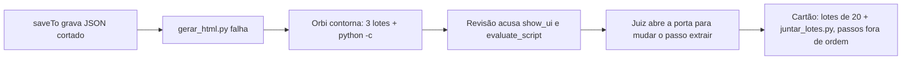

# 23. Execução que não ensina errado

Proposta de 13/11, a partir da execução "Consultar promoções de livros infantis clássicos"
(conversa `chat:01m795g3q4q7kgwm08t128h95x`). **Ainda não implementado.** Cada problema foi
conferido no código; a referência de arquivo e linha está em cada um.

## O que aconteceu, em uma linha

O runtime gravou um arquivo quebrado, a revisão culpou o passo, e o modelo propôs um remendo no
procedimento. Se o cartão fosse aprovado, todo procedimento futuro carregaria o contorno de um
bug que não é dele.



## Do Orbi ou do playbook?

A regra: se nenhum playbook, por melhor que fosse, evitaria o problema, ele é do Orbi.

| # | Problema | De quem |
|---|---|---|
| 1 | O `saveTo` do navegador grava a resposta cortada | Orbi |
| 2 | A trava do cartão não confere a ordem dos passos | Orbi |
| 3 | A revisão culpa erros de chamada, não a falha real | Orbi |
| 4 | Variação nasce sem scripts; correção apaga as entregas | Orbi |
| 5 | Comandos de leitura pedem aprovação; comando fora da lista pede aprovação para depois ser recusado | Orbi |
| 6 | O passo do cartão de aprovação é adivinhado | Orbi e modelo |
| 7 | Uma variação por categoria | Playbook, com empurrão do Orbi |
| 8 | Leitura da página inteira vai para o modelo | Orbi e modelo |
| 9 | Contagem e selo errados na extração | Playbook |

---

## 1. O `saveTo` do navegador grava a resposta cortada

**Na execução.** O passo extrair rodou `evaluate_script` com `saveTo promo_pagina_1.json`. O
arquivo saiu com o cabeçalho do Chrome, metade do JSON e a marca de corte:

```
Script ran on page and returned:
```json
[{"titulo":"O Pequeno Príncipe",...},
 ... {"titulo":"Alice no País das Mara
…[truncado]
```

**No código.**
- `browser/mcp/chrome-devtools.ts:51`: `call()` corta toda resposta em 30 mil caracteres,
  pensando no modelo.
- `agents/tools/browser.ts:53-58`: o `browser_act` chama `call()` e **só depois** grava o
  arquivo. Recebe o texto já cortado.
- `agents/tools/browser.ts:68` (`payloadOf`): procura um bloco ```` ```json … ``` ````. O texto cortado
  perdeu o ```` ``` ```` do fim, a expressão não casa, e a função devolve o texto inteiro, com o
  cabeçalho.
- O comando no terminal não tem o problema: `terminal/runner.ts:26` sobe o limite para 50 MB
  quando há `saveTo`. O navegador ficou de fora.

**Proposta.**
- `call(tool, args, signal, { full: true })`: sem corte. O `browser_act` com `saveTo` usa `full`;
  o corte continua para o que volta ao modelo.
- Se o arquivo termina em `.json`, o conteúdo precisa ser JSON válido. Se não for, não grava e
  devolve: "o retorno não é JSON (começa com 'Script ran on page…'): nada foi gravado".

**Depois.** Uma extração, 60 itens, o HTML na primeira vez. Somem os três lotes, o `python3 -c`
de juntar e quatro aprovações.

**Teste.** Página falsa local que devolve 80 mil caracteres num `evaluate_script`: o arquivo
gravado é o JSON inteiro e válido; uma resposta que não é JSON não grava nada.

---

## 2. A trava do cartão não confere a ordem dos passos

**Na execução.** O cartão de revisão pendente propõe:

```
1. extrair        ← lotes de 20 + juntar_lotes.py
2. abrir-site
3. ir-categoria
4. filtrar-promocao
5. gerar-html
```

Na próxima execução, o Orbi tentaria extrair antes de abrir a Amazon.

**No código.** `brain/domain/judge.ts:124` (`outOfScope`) compara, para cada passo fora do
escopo, o `label` e o `how`, e acusa passo novo ou removido. **Não olha a posição.** A
versão acima passa: `extrair` está no escopo, e os outros quatro estão iguais.

**Proposta.** `outOfScope` compara também a ordem dos passos fora do escopo. Mensagem:
"esta versão muda a ordem dos passos (extrair veio antes de abrir-site): mantenha a ordem de
antes".

**Teste.** Unidade em `judge`: mesma lista com um passo do escopo movido para o início é
recusada; a mesma lista na ordem certa passa.

---

## 3. A revisão culpa erros de chamada, não a falha real

**Na execução.** A revisão disse: "passo extrair foi dado como feito, mas show_ui e
mcp__chrome__evaluate_script falhou".

| Erro | O que foi | Importa para o procedimento? |
|---|---|---|
| `show_ui {}` | O modelo chamou sem argumentos | Não |
| `mcp__chrome__evaluate_script` não existe | Nome errado: esse comando só existe pelo `browser_act`; a chamada seguinte, pelo `browser_act`, deu certo | Não |
| `gerar_html.py` com JSONDecodeError | A falha real, vinda do arquivo do item 1 | Sim, mas a causa é do Orbi |

**No código.**
- `compose.ts:138`: uma falha só é dada como recuperada quando **a mesma ferramenta** dá certo
  depois, no mesmo passo. `mcp__chrome__evaluate_script` nunca dá certo (não existe), e o acerto
  foi do `browser_act`: outro nome. `show_ui` não foi chamado de novo.
- `brain/domain/review.ts:13` (`stepClaimProblems`): qualquer falha não recuperada no passo vira
  "passo dado como feito, mas … falhou".
- `review/review.ts:97-117`: o juiz transforma esse achado em "mudar o procedimento" e abre o
  escopo do passo extrair. É isso que permitiu o cartão do item 2.
- A falha do `gerar_html.py` entrou como `kind: 'comando'` e foi recuperada quando a mesma linha
  deu certo (`brain/services/execution.ts:56-68`). Ela some da revisão, que é o certo para o nível,
  mas a causa (o arquivo cortado) nunca aparece.

**Proposta.**
- **Erro de chamada não é falha do passo.** Argumento inválido (erro de validação) e ferramenta
  que não existe são registrados como `kind: 'chamada'`. Não acusam o passo e não seguram o nível.
- **Limitação do Orbi não vira mudança de procedimento.** Quando o runtime sabe que a culpa é
  dele (no item 1, o arquivo que ele recusou gravar ou um corte), o desvio leva
  `causa: 'orbi'`. O juiz não abre a porta por ele, e a revisão diz: "o problema foi do Orbi
  (resposta grande do navegador), não do procedimento: nada para mudar".

**Teste.** Fluxo com o modelo roteirizado: `show_ui {}` + nome de ferramenta inexistente +
`browser_act` certo. A revisão não acusa o passo e não abre escopo.

---

## 4. Variação nasce sem scripts; correção apaga as entregas

**Na execução.**
1. "Criar versão a partir deste" → `brain_learn` recusado: "gerar_html.py não está no
   procedimento".
2. O Orbi não tinha como ler o script da base. A busca de semelhantes não traz scripts, e
   `brain_query` com o nome do procedimento respondeu `notFound`. Pediu aprovação para um `find`
   no disco e não achou nada.
3. Você disse "gere um novo", e ele escreveu outro script, que grava `promocoes-infantis.html`
   em vez do nome da base.
4. No fim, registrar `html_path` e `total_promocoes` foi recusado: "não declara o que entrega".

**No código.**
- `brain/domain/scripts.ts:36-39`: o passo que cita `run_script X.py` exige `X.py` nos scripts
  **do próprio** procedimento. `variationOf` não entra na conta.
- `brain/services/procedures.ts:16-21` (`savePlaybook`): scripts, intenção e entradas que
  faltam vêm da versão anterior **de mesmo nome**. Uma variação tem nome novo, então não herda
  nada da base.
- `agents/tools/similar.ts:24-37`: os candidatos trazem passos e instruções, mas não scripts,
  entradas nem entregas.
- `agents/tools/brain.ts:24-26`: `brain_query` com `id` só procura entidades. Procedimento não é
  entidade, e dá `notFound`.
- **Achado novo, pior:** `brain/domain/learning.ts:130`. Quando o `brain_learn` não manda
  `outputs`, o procedimento fica com `outputs: []`. Scripts, intenção e entradas são preservados
  quando faltam (linhas 118 e 134), mas as entregas não, e `savePlaybook` também não as
  preserva. **Toda correção feita pela revisão, que manda só os passos, apaga as entregas
  declaradas do procedimento.** Conferido rodando `changeFromProposal` sem `outputs`: o
  resultado é `outputs: []`, sem `scripts` nem `inputs`. Isso explica a variação sem entregas e
  pode já ter apagado as entregas da base de informática na revisão anterior.

**Proposta.**
- `outputs` ausente no `brain_learn` = mantém o que havia, como scripts e entradas.
- Com `variationOf`, o que a variação não traz vem da base: scripts, entradas, entregas e
  intenção. Um script só é repetido na variação se for mudado. O cartão mostra
  "gerar_html.py · herdado de consultar-promocoes-informatica".
- `playbook_similar` passa a trazer o nome e a descrição dos scripts, as entradas e as entregas
  de cada candidato. O código não vem; com a herança, não precisa.
- `brain_query` com o nome de um procedimento devolve o procedimento, inclusive o código dos
  scripts.

**Depois.** "Criar versão a partir deste" vira um cartão só, sem perguntas, e o HTML sai igual
ao de informática.

**Testes.** Corrigir só os passos mantém as entregas; variação sem scripts que cita o
`gerar_html.py` da base é aceita e roda o script da base; `brain_query` pelo nome acha o
procedimento.

---

## 5. Aprovações que não precisavam existir

**Na execução.** 12 pedidos de aprovação no N1:

| Pedido | Hoje | Depois |
|---|---|---|
| `find` procurando o script (`run_shell`) | aprovação | some (item 4) |
| `mkdir` da pasta | aprovação | continua |
| `evaluate_script` com `saveTo` | aprovação | continua |
| `head -c 300` no JSON | aprovação | roda sozinho, se `head` for permitido |
| `head` + `tail` (`run_shell`) para investigar | aprovação | some (item 1) |
| 3 extrações em lote | aprovação | somem (item 1) |
| `python3 -c` juntando lotes | aprovação | some (item 1) |
| `gerar_html.py` (2 vezes) | aprovação | 1 vez |
| `cp` do nome final | aprovação | continua |

**No código.**
- `commands/files.ts`: só `cat` é "só lê". `head`, `tail`, `wc`, `ls`, `find` e `grep` caem em
  `comandos-escrita` (`autonomy/policy.ts:108`) e sempre pedem aprovação.
- `config.ts:10`: a lista padrão de comandos permitidos não tem `head`. O `run_command` não
  confere a lista antes de pedir aprovação (`agents/tools/terminal.ts`, sem `precheck`). A
  recusa vem só ao rodar (`terminal/exec.ts:99`). **Se `head` não está na sua lista, você
  aprovou um comando que foi recusado em seguida.** O `brain_learn` já confere a lista
  (`agents/tools/brain.ts:238`); o `run_command` não.
- `run_shell` é sempre `comandos-escrita` (`agents/tools/terminal.ts:169`): é uma linha de
  shell, não dá para saber o que faz. Isso fica como está.

**Proposta.**
- Perfil "só lê" para `head`, `tail`, `wc`, `ls` e `grep`, e para `find` sem `-delete`,
  `-exec`, `-ok` ou `-fprint`.
- `run_command` com um comando fora da lista é recusado **antes** do cartão: "head não está
  entre os comandos permitidos (…): use cat, ou peça para liberar".

**Depois.** Com os itens 1 e 4, sobram 4 aprovações (`mkdir`, `evaluate_script`,
`gerar_html.py`, `cp`), as normais do N1. Repetidas sem desvio, viram ações conhecidas.

---

## 6. O passo do cartão de aprovação é adivinhado

**Na execução.**
- `mkdir` (do passo extrair) apareceu como "passo 3 de 5 · Filtrar".
- `gerar_html.py` e `cp` (do gerar-html) apareceram como "passo 4 de 5 · Extrair".
- `gerar-html` foi dado como feito antes de `extrair`.

**No código.**
- `compose.ts:136` e `brain/services/execution.ts:58`: o passo de uma ação é "o primeiro
  `running` ou `waiting`; se não houver, o primeiro `pending`". O Orbi pediu o `mkdir` com
  `filtrar-promocao` ainda `pending` (ele só o fechou depois): o primeiro pendente era o 3.
- `agents/tools/playbooks.ts:161-205` (`playbook_step`): aceita fechar qualquer passo em qualquer
  ordem, e não abre o próximo sozinho. `gerar-html` nunca foi aberto, então tudo dele contou
  para `extrair`.

O passo errado não é só aparência. É ele que decide onde entram o desvio, a ação conhecida e a
observação. Uma ação contada no passo errado vira ação conhecida do passo errado.

**Proposta.**
- Fechar um passo (`done` ou `skipped`) abre o próximo pendente.
- Fechar um passo com um anterior ainda aberto (`pending` ou `running`) é recusado: "feche
  extrair antes de gerar-html". Pular é explícito, com `skipped`.

**Teste.** Unidade em `advanceRun`: fechar o 2 abre o 3; fechar o 5 com o 4 aberto é recusado.

---

## 7. Uma variação por categoria

Já são três procedimentos quase iguais (informática, informática em várias páginas e livros
infantis), e este fixou "livros infantis clássicos" no texto do passo. Pedindo brinquedos, vem
o quarto.

Isso é de playbook: a base fixou "informática" em vez de ter uma entrada. Mas o Orbi empurra
para a variação: o cartão de semelhante oferece "Criar versão" como sugestão, e
`prompts/orbi/base.md:54` só ensina a montar variação.

**Proposta (decisão sua).** Quando a diferença entre o pedido e o procedimento é só um valor
(uma categoria, um termo de busca), a sugestão é "transformar em entrada": a base ganha
`{{busca}}`, e o pedido roda com `busca = "livros infantis clássicos"`. Variação fica para
quando **o jeito de fazer** muda (percorrer várias páginas).

---

## 8. A página inteira vai para o modelo

**Na execução.** Dois `take_snapshot`, com a lista de departamentos e o menu inteiros. Pelos
trechos que a cópia cortou, cerca de 45 mil e 141 mil caracteres, só para achar a categoria.

**No código.** As leituras do navegador chegam ao modelo pelo mount nativo
(`mcp__chrome__*`, `browser/mcp/chrome-devtools.ts:8-14`), que **não passa** pelo corte de 30
mil do `call()`. O corte existe só no caminho que não precisava dele (o `saveTo`, item 1).

**Proposta.**
- Uma linha nas regras de execução: para achar algo na página, um `evaluate_script` pequeno
  (ou `take_snapshot` de uma parte), não a página inteira.
- Medir antes de cortar: o mount nativo é do Flue. Se ele aceitar um limite, aplicar; se não,
  deixar só a regra.

---

## 9. Contagem e selo (do playbook)

- A página mostrava "1-48 de mais de 500.000", e o arquivo teve 60 itens. Provavelmente o
  seletor `[data-component-type=s-search-result]` pega patrocinados e carrosséis. Falta remover
  repetidos pelo `asin` e ignorar patrocinados. Isso não foi conferido na página.
- O "selo" usa `.a-color-price`, que pega preço.

Isso é conteúdo do procedimento, para evoluir pela revisão. Depois dos itens 1 a 3, a revisão
vai conseguir apontar isso direito.

---

## Ordem

| Fase | Itens | Tamanho |
|---|---|---|
| 1 | 1 (saveTo inteiro e JSON válido), 2 (ordem dos passos), 4a (correção não apaga entregas) | pequeno |
| 2 | 3 (erro de chamada e causa do Orbi) | médio |
| 3 | 4b (herança da variação, `brain_query` de procedimento, semelhantes com scripts) | médio |
| 4 | 5 (perfis de leitura, lista antes do cartão), 6 (passo que anda sozinho) | médio |
| 5 | 7 e 8 (regra e sugestão) | pequeno, depois da sua decisão no 7 |

## Enquanto isso

Negue o cartão de revisão pendente (lotes de 20 com `juntar_lotes.py`). Confira também, na
tela do Cérebro, se `consultar-promocoes-informatica` ainda declara as entregas `html_path` e
`total_promocoes`. Pelo item 4, a revisão anterior pode tê-las apagado.
