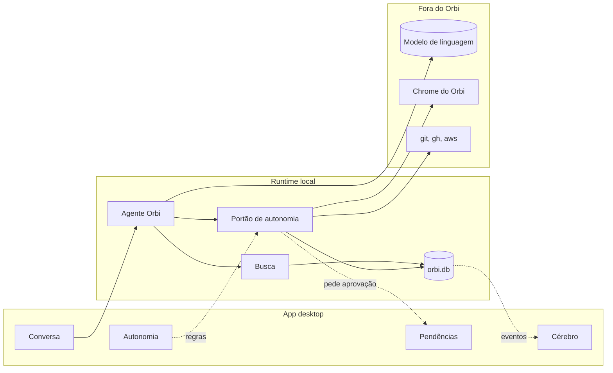

# Funcionalidades do Orbi

Um documento por funcionalidade. Cada um responde, na mesma ordem: para que
serve, onde aparece na tela, como funciona por dentro (com diagrama), quais
peças do código participam, que tecnologias usa, o que fica guardado, como se
configura, os limites conhecidos e os testes que a cobrem.

A visão geral do sistema (camadas, composição, contrato entre app e runtime)
está em [../arquitetura.md](../arquitetura.md). Os guias práticos estão em
[desenvolvimento](../desenvolvimento.md), [empacotamento](../empacotamento.md)
e [plugins](../plugins.md).

| # | Funcionalidade | Onde aparece |
| --- | --- | --- |
| 1 | [Conversa](01-conversa.md) | Tela **Conversa**: você pede, o Orbi responde com texto e cartões |
| 2 | [Pendências e aprovações](02-pendencias-e-aprovacoes.md) | Painel **Pendências** e cartões **Aprovar / Negar** e perguntas na conversa |
| 3 | [Autonomia](03-autonomia.md) | Tela **Autonomia**, níveis por tipo de ação; e por procedimento no Cérebro |
| 4 | [Cérebro](04-cerebro.md) | Tela **Cérebro**: conhecimento, procedimentos, execuções, ontologia |
| 5 | [Procedimentos (playbooks)](05-procedimentos.md) | Checklist ao vivo na conversa; aba **Playbooks** do Cérebro |
| 6 | [Ensinar pelo navegador](06-ensinar-pelo-navegador.md) | Botão **Ensinar pelo navegador** na conversa |
| 7 | [Navegador do Orbi](07-navegador-do-orbi.md) | Quando o Orbi opera um portal num passo de procedimento |
| 8 | [Busca e "Já sei algo parecido"](08-busca-e-parecidos.md) | Antes de agir num pedido e antes de guardar um procedimento |
| 9 | [Cofre de credenciais](09-cofre.md) | Senhas em demonstrações; cartão de credencial na conversa; **Configurações → Cofre** |
| 10 | [Terminal, investigação e correção de código](10-terminal-e-codigo.md) | Comandos `git`/`gh`/`aws`, scripts Python e correções com Claude Code |
| 11 | [Retornos agendados](11-retornos-agendados.md) | "Volto em 10 minutos para conferir o CI" |
| 12 | [Modelo de linguagem e plugins](12-modelo-e-plugins.md) | O modelo por trás de tudo; a tela da primeira abertura; **Configurações → Modelo** |
| 13 | [Uso e logs](13-uso-e-logs.md) | **Configurações → Uso do modelo** e o arquivo `runtime.log` |
| 14 | [App desktop e empacotamento](14-app-desktop.md) | A janela do Orbi, o runtime embutido e o instalador |
| 15 | [Agentes de código (MCP)](15-agentes-mcp.md) | Configurações › **Servidor MCP** (pedidos e conexões do Claude Code e do Cursor) e Cérebro › **Sugestões** |
| 16 | [Esteiras](16-esteiras.md) | Tela **Esteiras**: procedimentos em sequência, com ramos, passagens e destino |
| 17 | [Agentes de código desta máquina](17-agentes-de-codigo.md) | **Configurações → Agentes de código**: quem investiga e quem corrige, com qual modelo; o chat que descobre os agentes |
| 18 | [Conceitos, fatos e procedimentos](18-conceitos-e-procedimentos.md) *(proposta)* | Ensinar ensaiando, procedimentos sobre conceitos, aprender fatos ao executar e a fronteira "sei / não sei" |
| 19 | [Revisão no fim da execução](19-revisao-da-execucao.md) | Autonomia antes de perfeição: fatos aprendidos ao rodar, problema recorrente corrigido na raiz, juiz que só muda o procedimento quando vale |
| 20 | [Ferramentas MCP e a nova Autonomia](20-ferramentas-mcp.md) | Servidores MCP cadastrados pelo desenvolvedor (por endereço ou comando), leitura ou escrita por ferramenta, credenciais do cofre, sempre sozinho, Configurações |
| 21 | [Conversa dentro do cartão](21-conversa-no-cartao.md) | O porquê dentro do cartão, perguntar sobre o cartão nele mesmo, ajuste que muda o próprio cartão (versões) |
| 22 | [Fatos sem repetição](22-fatos-sem-repeticao.md) | A revisão não repete o que o cérebro já sabe, aprender soma em vez de trocar, e o passo que achou o fato passa a consultar o Cérebro, no mesmo cartão |
| 23 | [Execução que não ensina errado](23-execucao-que-nao-ensina-errado.md) | O saveTo do navegador inteiro, a ordem dos passos travada, chamada errada do modelo que não culpa o passo, variação que herda da base, menos aprovações |
| 24 | [Registro e diagnóstico](24-registro-e-diagnostico.md) | Cada chamada da execução guardada, tela de detalhes com "Copiar execução completa" e marca de leitura cara; proposta: detectores, diagnóstico dos defeitos do Orbi e issue |
| 25 | [Procedimento provado](25-procedimento-provado.md) | Mudança a pedido (feito); proposta: prova na criação, retrospectiva por passo, aprendizados do procedimento |

## Como as funcionalidades se ligam

Toda ação que muda algo (comando, clique, aprendizado) passa pelo portão de
autonomia. As leituras (consultar o cérebro, ler uma página, `git status`) vão
direto. O gravador de demonstrações e o cofre estão no documento 6.

## Convenções destes documentos

- Caminhos de arquivo são relativos à raiz do repositório.
- "Runtime" é o processo Node em `apps/runtime`; "app" é a janela em `apps/desktop`.
- Diagramas em [Mermaid](https://mermaid.js.org): o GitHub e a maioria dos editores
  mostram como imagem.
- Variáveis de configuração ficam no `.env` do runtime (`apps/runtime/.env` no
  desenvolvimento; na pasta de dados do app instalado, veja o documento 14).
